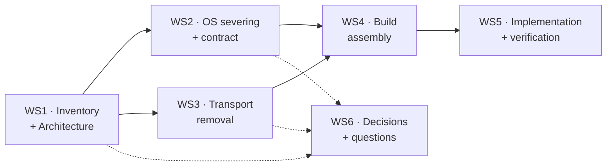

# WMB — Project Introduction

## 1. Background

This repository assembles four upstream trees into what will become **WMB — the Window Manager Binary**: a single, self‑contained, OS‑agnostic X11
windowing system that links an X server, a window manager, an Xlib implementation, and one or more applications into **one image**, with **no socket
transport** between them and **no operating system underneath** beyond a small hardware abstraction layer.

The four inputs, as they sit in the tree today:

| Tree | What it is | Size | Local state |
|---|---|---|---|
| `tinyx/` | TinyX — the KDrive‑based framebuffer X server (X11R6.9‑era `xserver` reduced to `dix` + `os` + `mi` + `fb` + `kdrive` + a handful of extensions) | 193 `.c`, ~117.6 kLOC | Upstream‑ish; one additive local module (`kdrive/tima/`) |
| `libX11/` | The reference Xlib implementation | 262 `.c`, ~37.3 kLOC | Unmodified |
| `jwm/` | Joe's Window Manager — a compact, dependency‑light reparenting WM | 50 `.c`, ~26.3 kLOC (+4.5 kLOC headers) | Unmodified |
| `X11/` | The X11 header/protocol root (`X.h`, `Xlib.h`, `Xproto.h`, `Xutil.h`) plus the Xt/Xaw/Xmu/`xtrans` trees | headers‑dominant | Unmodified; used as the include root |
| `framework/` | Our own code: the hosted SDL backend, a bare‑metal fiber runtime, heap/buffer helpers, and the first transport‑shim sketch | ~4.2 kLOC | **This is the only tree we own outright** |

Two supporting trees exist and are currently dormant: `fonts/freetype/` (a full FreeType checkout, not yet wired into anything) and `X11/fonts/` (the
classic `libXfont` sources).

### 1.1 What the tree does today

Almost nothing. That statement is deliberate and it is the honest starting point:

- `framework/CMakeLists.txt` defines a **single executable target**, `wmb_tima_build`, which compiles the SDL backend (`sdl_library/`, `sdl_drivers/`), two
  heap helpers, the five files of the Tima KDrive DDX (`tinyx/kdrive/tima/`), and a six‑line stub `main()` in `framework/wmb_x11/wmb_main.c`.
- It does **not** compile or link any part of `tinyx/dix`, `tinyx/os`, `tinyx/mi`, `tinyx/fb`, `tinyx/kdrive/src`, `libX11/`, or `jwm/`. There is no built
  binary anywhere in `build/` or `build_local/`.
- `framework/fiber/` contains a complete, portable cooperative fiber core (`fiber.c`, `fiber_sync.c`, `hal_task.c` and its headers) **and a working hosted
  port** in `linux_hosted/fiber_linux/`. Both are exercised by the smoke programs under `linux_hosted/`, one of which — `sdl_fiber_example_v2/` — is a
  running proof of concept of the in‑process transport's client–server handshake ([`21-`](21-inprocess-transport.md) §11). The preemption tick is
  deliberately disarmed ([`90-`](90-decisions.md) D‑47).
- `framework/wmb_x11/wmb_io.c` contains a first sketch of the in‑process transport (`wmb_sync_handler`, `_XGetRequest`, `_XReply`) — 277 lines that have
  never been compiled.
- `tinyx/kdrive/tima/tima_kdrive_system.c` wires `KdOsFuncs`, `InitCard`, `InitOutput`, `InitInput`, `OsVendorInit` and the `ddx*` stubs. The cooperative
  wait hook the whole design depends on — `tima_WaitForEvents()` — does not exist.

So: the **components are present**, a **design has been argued at length** (see `docs_old/`, ~33.6 kLOC of prior planning across four generations of
documents), and **nothing has been assembled**. This project starts by fixing that.

### 1.2 Why this is not a normal X11 port

A stock X11 stack is a *distributed system that happens to run on one machine*. Its defining property is a **wire protocol over a socket**:

```
  application ──► libX11 ──► XCB ──► AF_UNIX socket ──► TinyX os/io.c ──► dix/dispatch.c ──► ProcVector[opcode]
                                        (serialise)                          (deserialise)
```

Every request is encoded into bytes, pushed into a kernel socket buffer, copied back out, and decoded — to reach a function that lives, in our case, a few
kilobytes away in the same address space. That round trip drags in POSIX sockets, `select()`, non‑blocking I/O, `SIGPIPE` handling, credential passing,
host access control and XDMCP, none of which exist on a bare‑metal target.

WMB removes the wire. `XCreateWindow(dpy, …)` will reach `ProcCreateWindow(client)` through a **direct function call**, in the same thread, with the
request still sitting in `dpy->buffer` where Xlib built it. That single decision is what makes the rest of the project tractable — and it is what makes
this an architectural project rather than a build‑system project.

### 1.3 The three questions this project answers

1. **What does WMB actually consist of?** Nobody has written down the complete component list — which TinyX modules, which extensions, which libX11 files,
   which JWM subsystems, which framework pieces, and what each one costs. [`01-component-inventory.md`](01-component-inventory.md) is that list.

2. **What in it is Linux?** The tree is full of upstream code written against POSIX. Before anything can be made portable, every `#include <sys/...>`,
   every `select()`, every `getenv()` and every `fopen()` must be found, attributed to a component, and given a disposition.
   [`10-os-dependency-census.md`](10-os-dependency-census.md) is that census — and its headline finding is that the damage is **far more concentrated than
   expected**.

3. **What replaces the socket?** [`20-transport-inventory.md`](20-transport-inventory.md) enumerates every byte of the transport;
   [`21-inprocess-transport.md`](21-inprocess-transport.md) designs what goes in its place.

### 1.4 Ownership and licensing

`framework/` is ours. `tinyx/`, `libX11/`, `jwm/` and `X11/` are upstream X.Org / JWM sources under MIT‑style and GPL‑2 licences respectively. This has one
practical consequence that shapes the entire plan:

> **Upstream code is modified under a hard patch budget.** Every edit to `tinyx/`, `libX11/` or `jwm/` must be exportable as an ordered `.patch` file,
> guarded behind a feature macro, and replayable against a fresh upstream checkout. Adapters are preferred to patches; patches are preferred to forks;
> forks are not permitted.

The budgets are stated per‑component in [`11-portability-plan.md`](11-portability-plan.md) §9 and enforced as exit gates.

## 2. Project Goal

> **Assemble TinyX, libX11 and JWM into a single OS‑agnostic binary in which the X11 client/server socket transport has been replaced by direct in‑process
> function calls, every Linux/POSIX dependency has been severed behind an explicit portable contract, and the whole thing is buildable from one CMake
> invocation — first as a hosted SDL executable for development, then as a freestanding image for an embedded target.**

Concretely, five deliverables:

1. **A component inventory.** Every source file that ends up in WMB, classified by disposition (CARRY / GUARD / STUB / EXCLUDE / NEW), with LOC and
   rationale. No file is compiled into WMB without an entry.

2. **A portable platform contract.** A small set of headers — `hal_display.h`, `hal_input.h`, `hal_task.h`, `hal_time.h`, `wmb_os.h` — that constitute *the
   entire surface* between WMB and whatever is underneath it. Two implementations exist: hosted (Linux + SDL + libucontext) and target (freestanding). WMB
   code above the contract is byte‑identical between them.

3. **A socketless client/server path.** libX11's five transport hooks replaced; TinyX's internal‑client registration made additive; request, reply, event
   and error paths all in‑process. Plus the external‑application story: a fixed‑address vtable and a thin redistributable wrapper library.

4. **A hosted SDL build that runs.** One `cmake --build` producing `wmb_host`, opening an SDL window, running TinyX on a fiber, running JWM as an internal
   client, with decorated windows that move and resize. **This is the primary near‑term goal** — the embedded target is not attempted until the hosted
   build is green.

5. **A freestanding target build.** The same sources, a different profile: no sockets, no `select()`, no `fork`, no signals, no `getenv`, four mandatory
   syscalls, a target HAL, and a linker script that places the entry vtable at a fixed address.

## 3. Guiding Principles

These are not aspirations. Each one is enforced by a named gate somewhere in [`41-verification-plan.md`](41-verification-plan.md).

1. **Portable‑first, SDL‑second.** Every component targets a platform‑abstract interface. SDL is the *first* backend, never the *only* one. A KDrive DDX
   file that includes `SDL.h` is a defect, not a shortcut. *Gate: `grep -r "SDL" tinyx/ libX11/ jwm/` returns zero.*

2. **Adapter first, patch last, fork never.** Prefer adding a file over editing one; prefer editing one behind a macro over editing it unguarded. Every
   upstream edit is a line item in the patch manifest. *Gate: patch budget in [`11-`](11-portability-plan.md) §9.*

3. **One profile switch, not many.** Build profiles are composed from a small orthogonal set of macros (`WMB_HOSTED`, `WMB_FREESTANDING`,
   `WMB_HAS_OS_TRANSPORT`) whose meanings are fixed in [`12-platform-contract.md`](12-platform-contract.md) §3. No component
   invents its own.

4. **The target path is the tested path.** A test that only exercises the hosted socket bridge proves nothing about the target. Every capability is
   validated through the **in‑process** path first; socket bridges exist for interoperability testing with stock X11 apps, and are compiled out on target.

5. **Cooperative, single‑threaded, never blocking.** There is one thread of execution. Waiting is always `hal_yield_timeout(ms)`, never `select()`, never
   `sleep()`, never a condition variable owned by the OS. *Gate: no `pthread_*` symbol outside the hosted timer shim.*

6. **Sever, don't rewrite.** Linux dependencies are *removed or redirected*, not replaced with hand‑written equivalents of upstream logic. If a TinyX file
   does something we don't need, we exclude the file — we do not rewrite it into a "portable" variant that then diverges forever.

7. **No phase starts until the previous one has a green gate.** Every phase in [`40-implementation-plan.md`](40-implementation-plan.md) has a concrete,
   runnable Definition of Done. "It compiles" is never a DoD on its own.

8. **Documents are the source of truth; fix them in place.** This document set supersedes everything in `docs_old/`. When something here is wrong, correct
   *this* set — do not add a catch‑up document. The prior generations of `docs_old/active/`, `docs_old/library/`, `docs_old/archive_docs/` and
   `docs_old/archive_docs2/` exist only as historical reference and are not authoritative.

## 4. Scope

### 4.1 In scope

| # | Area | What the project does |
|---|---|---|
| 1 | **Component inventory** — all four trees | Every file classified; module groups defined; build assembly specified. [`01-`](01-component-inventory.md) |
| 2 | **OS dependency severing** — `tinyx/os/`, `tinyx/kdrive/`, `libX11/src/`, `jwm/src/` | Full census, per‑file disposition, guard macros, replacement stubs. [`10-`](10-os-dependency-census.md), [`11-`](11-portability-plan.md) |
| 3 | **Platform contract** — display, input, tasks, time, libc floor | Header set + two implementations (hosted, freestanding). [`12-`](12-platform-contract.md) |
| 4 | **Cooperative runtime** — `framework/fiber/` | Hosted port shipped (glibc `<ucontext.h>`; libucontext is D‑11's target and not yet vendored), target port contract, `hal_task_*` mapping. [`12-`](12-platform-contract.md) §6, [`30-`](30-host-build.md) §5 |
| 5 | **Transport removal** — libX11 ⇄ TinyX | Five transport hooks replaced; internal client registration; reply/event/error paths. [`20-`](20-transport-inventory.md), [`21-`](21-inprocess-transport.md) |
| 6 | **External application ABI** — fixed‑address vtable | `wmb_api_t` layout, versioning, thin wrapper library, linker placement. [`22-`](22-entry-point-abi.md) |
| 7 | **Hosted SDL build** | CMake assembly of all module groups, generated config headers, profiles, bring‑up order. [`30-`](30-host-build.md) |
| 8 | **Target build** | Freestanding compile, syscall floor, target HAL skeleton, link map. [`31-`](31-target-build.md) |
| 9 | **JWM integration** | Dependency stripping, symbol namespacing, cooperative event loop, in‑process launch table. [`01-`](01-component-inventory.md) §6, [`40-`](40-implementation-plan.md) P7 |
| 10 | **Verification** | Test pyramid, per‑phase DoD, symbol gates, leak and stability runs. [`41-`](41-verification-plan.md) |

### 4.2 Out of scope

| Area | Reason |
|---|---|
| Hardware acceleration of any kind | Framebuffer‑only by requirement. `mi`/`fb` software rendering is the only path. |
| Multi‑head, Xinerama, RandR mode setting | Fixed width/height/bpp by requirement. RandR is compiled in only because KDrive references it. |
| Network transparency, XDMCP, remote clients | The whole point of the project is their removal. |
| X11 authentication (MIT‑MAGIC‑COOKIE, XDM‑AUTHORIZATION) | No transport ⇒ no untrusted peer. All in‑process clients are trusted by construction. |
| TrueType / FreeType text rendering | `fonts/freetype/` stays dormant. Built‑in bitmap fonts only for now; the font path is a registry so that adding a scalable backend later is an addition, not a rewrite — see [`90-decisions.md`](90-decisions.md) D‑38. |
| Internationalisation, input methods (XIM), locale handling | Cut from both libX11 and JWM. English, 8‑bit, no `setlocale`. |
| Multi‑core / SMP scheduling | Single cooperative thread by requirement. A dedicated GUI core is a deployment option, not a design input. |
| Choosing the actual embedded target hardware | The target profile is specified against a *contract*, not a chip. Naming the chip is a separate project. |
| Preserving the ability to run WMB as a normal X server on Linux | The hosted build is a **development harness**, not a product. |

### 4.3 The embedded target

The target platform is referred to throughout as **"the target"** and is characterised only by its contract, not its identity:

- Single core, no MMU assumed. WMB itself uses one thread of execution; it does not require to be the only component in the image
  ([`90-decisions.md`](90-decisions.md) D‑42).
- A linear framebuffer at fixed resolution and bit depth (the hosted default is 800×480, 16 bpp — `PIXEL_TYPE_T=uint16_t`).
- Byte‑stream keyboard and mouse input following the existing HAL command protocol (`CMD_KEY_DOWN`, `CMD_MOUSE_X`, … — see
  [`12-platform-contract.md`](12-platform-contract.md) §5).
- **No** task primitive: `framework/fiber/` provides WMB's own scheduling ([`90-decisions.md`](90-decisions.md) D‑31). A platform scheduler is neither
  required nor used.
- A monotonic millisecond counter.
- A heap (or a region from which one can be built).
- Console output for `ErrorF`.

Nothing else. The prior document generation named a specific OS ("Tima OS"); this set deliberately does not, because **every dependency on it that is not
in the list above is a bug**. Where the historical name survives in identifiers (`tinyx/kdrive/tima/`, `tima_kdrive_fb.c`, `config_tima.h`) it is treated
as an arbitrary label for "the target DDX", not as a commitment.

## 5. Workstreams

Six workstreams. §7 sequences them; §8 lists what each produces.

### 5.1 WS1 — Component Inventory and Architecture

Establish what WMB is made of and how the pieces fit. Produce the authoritative file‑level inventory with dispositions, the module‑group decomposition that
the build will mirror, and both the as‑is and to‑be architecture descriptions. Nothing else can be planned until this exists, because every subsequent
workstream is scoped by "the set of files that are actually in WMB".

Deliverables: [`01-component-inventory.md`](01-component-inventory.md), [`02-baseline-architecture.md`](02-baseline-architecture.md),
[`03-target-architecture.md`](03-target-architecture.md).

### 5.2 WS2 — OS Dependency Severing

Find every Linux/POSIX dependency in the in‑scope file set, classify it, and specify its removal. Then define the portable contract that replaces it. This
is the workstream that makes "raw compilation with no OS dependency" real rather than aspirational.

The census is deliberately front‑loaded as a **catalogue exercise**, not a compile‑error hunt. Chasing undefined symbols late in integration is the
standard way these projects fail; enumerating every `#include <sys/*>` on day one is cheap and makes the surprises visible immediately. The good news,
already established: in `tinyx/`, POSIX headers appear in exactly **eleven** files, six of which are in `tinyx/os/` and five of which are in directories we
exclude wholesale.

Deliverables: [`10-os-dependency-census.md`](10-os-dependency-census.md), [`11-portability-plan.md`](11-portability-plan.md),
[`12-platform-contract.md`](12-platform-contract.md).

### 5.3 WS3 — Transport Removal

Enumerate the client/server transport as it exists — libX11's five hooks, XCB's connection machinery, TinyX's `os/connection.c` / `os/io.c` /
`os/WaitFor.c` triangle, and the `xtrans` layer beneath them. Then design and specify the in‑process replacement: how a request crosses from `dpy->buffer`
into `ProcVector[opcode]`, how a reply comes back, how an event is delivered, how an error is synthesised, and how an *external* application (a separate
binary) reaches into WMB through a fixed‑address vtable.

Deliverables: [`20-transport-inventory.md`](20-transport-inventory.md), [`21-inprocess-transport.md`](21-inprocess-transport.md),
[`22-entry-point-abi.md`](22-entry-point-abi.md).

### 5.4 WS4 — Build Assembly

Turn the module decomposition from WS1 and the profile macros from WS2 into two working builds. The hosted build comes first and carries all development
weight: SDL display, SDL input, libucontext fibers, optional X11 socket listener for interoperability testing with stock clients. The target build follows
and proves that the same sources compile freestanding.

Deliverables: [`30-host-build.md`](30-host-build.md), [`31-target-build.md`](31-target-build.md).

### 5.5 WS5 — Implementation and Verification

The phased execution plan with exit gates, and the verification strategy that defines what "green" means at each gate. The plan is published twice: once
by phase, which is how it is gated, and once by module, which is how it is staffed.

Deliverables: [`40-implementation-plan.md`](40-implementation-plan.md), [`41-verification-plan.md`](41-verification-plan.md),
[`42-tinyx-module-plan.md`](42-tinyx-module-plan.md), [`43-kdrive-module-plan.md`](43-kdrive-module-plan.md),
[`44-framework-module-plan.md`](44-framework-module-plan.md), [`45-jwm-module-plan.md`](45-jwm-module-plan.md).

### 5.6 WS6 — Decision and Question Registers

Two living documents: settled decisions (with the alternatives that lost and why), and open questions (with owners and the phase by which each must close).
These absorb the accumulated argument in `docs_old/` so that nothing has to be re‑litigated.

Deliverables: [`90-decisions.md`](90-decisions.md), [`91-open-questions.md`](91-open-questions.md).

## 6. Reading Order

For someone joining the project:

1. **This document** — what WMB is and why. *(you are here)*
2. [`01-component-inventory.md`](01-component-inventory.md) — what it is made of.
3. [`02-baseline-architecture.md`](02-baseline-architecture.md) — how the pieces work today.
4. [`03-target-architecture.md`](03-target-architecture.md) — how they will work.
5. [`40-implementation-plan.md`](40-implementation-plan.md) — the order of work.

Then **the module plan for the tree you are working in** — it is the same plan as [`40-`](40-implementation-plan.md), sliced by ownership:

| Working in | Read |
|---|---|
| `tinyx/dix`, `tinyx/mi`, `tinyx/fb`, `tinyx/os` | [`42-tinyx-module-plan.md`](42-tinyx-module-plan.md) |
| `tinyx/kdrive/`, `linux_hosted/`, `<target>_native/` | [`43-kdrive-module-plan.md`](43-kdrive-module-plan.md) |
| `framework/`, `libX11/`, `wrapper/`, `apps/` | [`44-framework-module-plan.md`](44-framework-module-plan.md) |
| `jwm/` | [`45-jwm-module-plan.md`](45-jwm-module-plan.md) |

Then, by need:

- Doing portability work → [`10-`](10-os-dependency-census.md), [`11-`](11-portability-plan.md), [`12-`](12-platform-contract.md).
- Doing transport work → [`20-`](20-transport-inventory.md), [`21-`](21-inprocess-transport.md), [`22-`](22-entry-point-abi.md).
- Doing build work → [`30-`](30-host-build.md), [`31-`](31-target-build.md).
- Wondering *why* something was decided → [`90-decisions.md`](90-decisions.md).
- Blocked on something undecided → [`91-open-questions.md`](91-open-questions.md).

## 7. Method and Sequencing

The workstreams are not fully parallel. WS1 gates everything. WS2 and WS3 are largely independent of one another but both consume WS1. WS4 consumes WS2's
profile macros and WS1's module groups. WS5 sequences the actual code.



The **implementation** sequence inside WS5 is different from the *document* sequence, and is driven by one rule: **build from the bottom of the stack
upward, and prove each layer runs before adding the next.**

| # | Layer brought up | Proven by |
|---|---|---|
| P1 | Platform contract + SDL backend | Test pattern visible in an SDL window through `hal_display_*` only |
| P2 | Fiber runtime, hosted port | Two fibers ping‑pong; a busy fiber is preempted |
| P3 | `hal_task_*` cooperative layer | Producer/consumer with `hal_yield_timeout` |
| P4 | TinyX whole‑stack link | The server initialises, reaches `Dispatch()` and paints a root window |
| P5 | In‑process client path | An internal test client draws a window with zero sockets open |
| P6 | Linux dependency severing | Symbol gate: no `socket`/`select`/`fork`/`getenv` in the link |
| P7 | JWM as internal client | Decorated windows, move/resize, root menu |
| P8 | External ABI | A separately‑linked app runs against the vtable |
| P9 | Freestanding target build | Cross‑compiled image, four syscalls, boots on target HAL |

P4 is deliberately placed **before** P5: bringing the whole TinyX stack up with *no client at all* isolates "did we assemble TinyX correctly?" from "did we
replace the transport correctly?". An earlier plan used stock X clients over a socket as an independent oracle here; that profile was retired as out of
scope ([`90-`](90-decisions.md) D‑49), so the isolation is now provided by staging rather than by a second transport. Conflating the two is still the single
most likely way to lose a month.

## 8. Deliverables Index

| Document | Workstream | Answers |
|---|---|---|
| [`00-introduction.md`](00-introduction.md) | — | What is WMB, what is the goal, what are the rules |
| [`01-component-inventory.md`](01-component-inventory.md) | WS1 | Which files are in WMB and why |
| [`02-baseline-architecture.md`](02-baseline-architecture.md) | WS1 | How the stack works today |
| [`03-target-architecture.md`](03-target-architecture.md) | WS1 | How the stack will work |
| [`10-os-dependency-census.md`](10-os-dependency-census.md) | WS2 | Every Linux/POSIX dependency, per file |
| [`11-portability-plan.md`](11-portability-plan.md) | WS2 | How each one is severed, in what order |
| [`12-platform-contract.md`](12-platform-contract.md) | WS2 | The portable interface WMB sits on |
| [`20-transport-inventory.md`](20-transport-inventory.md) | WS3 | Everything the socket transport touches |
| [`21-inprocess-transport.md`](21-inprocess-transport.md) | WS3 | What replaces it, in detail |
| [`22-entry-point-abi.md`](22-entry-point-abi.md) | WS3 | How external applications get in |
| [`30-host-build.md`](30-host-build.md) | WS4 | The SDL development build |
| [`31-target-build.md`](31-target-build.md) | WS4 | The freestanding embedded build |
| [`40-implementation-plan.md`](40-implementation-plan.md) | WS5 | The phased plan with exit gates |
| [`41-verification-plan.md`](41-verification-plan.md) | WS5 | What "done" means at each gate |
| [`42-tinyx-module-plan.md`](42-tinyx-module-plan.md) | WS5 | The plan as the TinyX team sees it |
| [`43-kdrive-module-plan.md`](43-kdrive-module-plan.md) | WS5 | The plan as the DDX and backend team sees it |
| [`44-framework-module-plan.md`](44-framework-module-plan.md) | WS5 | The plan as the framework and transport team sees it |
| [`45-jwm-module-plan.md`](45-jwm-module-plan.md) | WS5 | The plan as the window manager team sees it |
| [`90-decisions.md`](90-decisions.md) | WS6 | Settled decisions and rejected alternatives |
| [`91-open-questions.md`](91-open-questions.md) | WS6 | What is still undecided, and by when |

## 9. Success Criteria

The project is complete when all nine hold:

1. **Single binary.** One CMake invocation produces one image containing TinyX, libX11, JWM and at least one application. No shared objects, no `dlopen`.
2. **Zero transport.** `nm --undefined-only` on the target image shows no `socket`, `bind`, `listen`, `accept`, `connect`, `select`, `poll`, `readv`,
   `writev`, `fcntl`, `sigaction`.
3. **Zero OS coupling above the contract.** No file in `tinyx/`, `libX11/` or `jwm/` compiled into the target profile includes `<sys/*>`, `<netinet/*>`,
   `<linux/*>`, `<pthread.h>` or `<dlfcn.h>`.
4. **Zero backend leakage.** No file outside `linux_hosted/` references SDL. No file outside `<target>_native/` references target hardware.
5. **The hosted build runs.** SDL window, JWM‑decorated client windows, working keyboard and mouse, move/resize, root menu.
6. **The target path is what was tested.** The in‑process client path — not a socket bridge — is what JWM and the test applications use in the hosted
   build.
7. **Patch budget respected.** The upstream edit manifest is within the caps in [`11-`](11-portability-plan.md) §9, every edit is macro‑guarded, and the
   `.patch` series replays cleanly onto a fresh checkout of each upstream tree.
8. **Freestanding compile is green.** The target profile compiles and links with no host libc beyond the documented floor, and no unresolved symbol outside
   the documented syscall set.
9. **Stability.** A one‑hour hosted run with continuous input shows a flat heap high‑water mark and no fiber stack canary trip.

## 10. Glossary

| Term | Meaning |
|---|---|
| **WMB** | Window Manager Binary — the single linked image produced by this project |
| **TinyX** | The KDrive‑based X server in `tinyx/` |
| **DIX** | Device‑Independent X — the protocol‑handling core of an X server (`tinyx/dix/`) |
| **DDX** | Device‑Dependent X — the hardware‑facing half of an X server; for us, `tinyx/kdrive/tima/` |
| **KDrive** | The X.Org "kdrive" miniature server framework: `KdCardFuncs` / `KdKeyboardFuncs` / `KdMouseFuncs` / `KdOsFuncs` |
| **`mi`** | Machine‑Independent rendering fallbacks (`tinyx/mi/`) |
| **`fb`** | The framebuffer rendering engine (`tinyx/fb/`) |
| **shadow** | `tinyx/miext/shadow/` — renders into a shadow buffer and blits damaged regions to the real framebuffer |
| **HAL** | Hardware Abstraction Layer — our display/input/task/time contract, [`12-`](12-platform-contract.md) |
| **Fiber** | A cooperatively‑scheduled execution context with its own stack; `framework/fiber/` |
| **Internal client** | An X client living inside WMB, reaching the server by function call rather than socket |
| **`SyncHandle()`** | The Xlib macro invoked at the end of every request‑building function; our interception point |
| **`ProcVector`** | TinyX's 256‑entry table of request handlers, `tinyx/dix/tables.c` |
| **Hosted profile** | The Linux + SDL + libucontext development build (`WMB_HOSTED`) |
| **Target profile** | The freestanding embedded build (`WMB_FREESTANDING`) |
| **Patch budget** | The hard cap on the number of modified upstream files, per tree |
