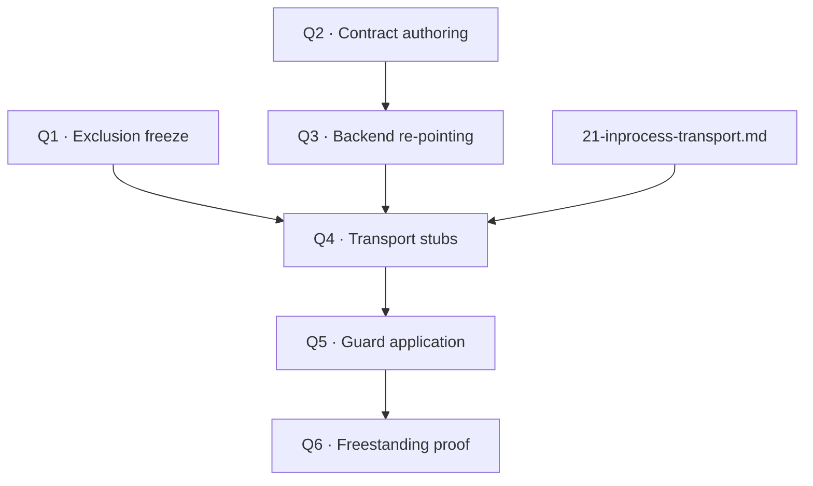

# 11 — Portability Plan

## 1. Purpose

This document is the **mechanical plan for severing every dependency catalogued in [`10-os-dependency-census.md`](10-os-dependency-census.md)**. It is the
second deliverable of workstream 2 ([`00-introduction.md`](00-introduction.md) §5.2) and it specifies, per file and per dependency, *what edit is made,
behind what guard, in what order, with what exit gate*.

It is the document that makes "raw compilation with no OS dependency" an executable instruction rather than an aspiration.

### 1.1 What this document is not

- **Not the census.** What the dependencies are is [`10-`](10-os-dependency-census.md).
- **Not the replacement API.** What the code calls instead is [`12-platform-contract.md`](12-platform-contract.md).
- **Not the transport design.** The three STUB files in `tinyx/os/` are specified in [`21-inprocess-transport.md`](21-inprocess-transport.md); this
  document only states *that* they are stubbed and what the gate is.
- **Not the build.** [`30-`](30-host-build.md) / [`31-`](31-target-build.md).

## 2. Strategy

Four mechanisms, in strict order of preference. **Always use the earliest one that works.**

| # | Mechanism | Cost | When |
|---|---|---|---|
| M1 | **Do not compile the file.** | Zero. No patch, no guard, no maintenance. | The file's entire purpose is OS‑coupled |
| M2 | **Compile a replacement file with the same external symbols.** | One new file we own. No upstream diff. | The file has a small, well‑defined external surface that we can reimplement |
| M3 | **Guard a region of an upstream file with `#ifdef`.** | One line item in the patch manifest. Must be replayable. | The file is mostly needed but has an OS‑coupled region |
| M4 | **Rewrite upstream logic.** | Forbidden. | — |

M1 handles ~15,000 LOC. M2 handles the transport. M3 handles 13 files. M4 never happens.

### 2.1 Naming conventions

| Kind | Convention | Example |
|---|---|---|
| Replacement file (M2) | `<original>_wmb.c`, beside the original | `tinyx/os/io_wmb.c` |
| Guard macro for OS transport | `WMB_HAS_OS_TRANSPORT` | `#ifdef WMB_HAS_OS_TRANSPORT` |
| Guard macro for profile | `WMB_HOSTED` / `WMB_FREESTANDING` | — |
| Guard macro for in‑process client path | `WMB_INPROC` | — |
| New framework file | `framework/<area>/<name>.c` | `framework/library/heap.c` |
| New port file | `<port>/<module>/<name>.c` | `linux_hosted/system_linux/hal_time_hosted.c` |

**Guard style is fixed**: file‑level or block‑level `#ifdef` only, no `#if defined(A) && !defined(B) || …` compound conditions in upstream files. A
reviewer replaying the patch series onto a new upstream release must be able to see, in one line, what the guard is for.

## 3. Phase Structure

Six phases with hard exit gates. Phases are sequential; each consumes the previous phase's artefact.

| Phase | Name | Exit gate |
|---:|---|---|
| **Q1** | Exclusion freeze | The CMake source lists contain no EXCLUDE file, and every symbol referenced from an excluded file is accounted for (satisfied, stubbed, or guarded) |
| **Q2** | Contract authoring | `hal_display.h`, `hal_input.h`, `hal_task.h`, `hal_time.h`, `wmb_os.h` exist and compile standalone against a freestanding C compiler with no includes beyond `<stdint.h>` / `<stddef.h>` / `<stdbool.h>` |
| **Q3** | Backend re‑pointing | `tinyx/kdrive/tima/*.c` includes only `hal_*.h`; a mock backend links the DDX with no SDL present |
| **Q4** | Transport stubs | `waitfor_wmb.c`, `connection_wmb.c`, `io_wmb.c` compile and the whole‑stack build links in the `host-pure` profile |
| **Q5** | Guard application | The 13 guarded upstream files carry their guards; the patch manifest is complete; the series replays on fresh checkouts |
| **Q6** | Freestanding proof | The `target` profile compiles every translation unit with `-ffreestanding -nostdinc` plus only the documented floor |

Q1 and Q2 can run in parallel. Q3 depends on Q2. Q4 depends on Q1 and on [`21-`](21-inprocess-transport.md). Q5 depends on Q4. Q6 depends on everything.

## 4. Phase Q1 — Exclusion Freeze

Delete nothing; simply never list the file. The work is in **proving** that each exclusion is safe.

### 4.1 The exclusion list

| Excluded | LOC | Mechanism | Symbols that must be satisfied elsewhere |
|---|---:|---|---|
| `tinyx/kdrive/linux/` | 1,760 | M1 | None — the DDX replaces it |
| `tinyx/kdrive/fbdev/` | 884 | M1 | None |
| `tinyx/kdrive/vesa/` | 3,472 | M1 | None |
| `tinyx/kdrive/src/kmap.c` | 151 | M1 | `KdMapDevice`, `KdUnmapDevice`, `KdMapRegisters` — **verify no caller** (census C2) |
| `tinyx/os/access.c` | 1,952 | M1 | `AccessUsingXdmcp`, `AddLocalHosts`, `ChangeAccessControl`, `GetAccessControl`, `ResetHosts`, `AddHost`, `RemoveHost`, `GetHosts`, `InvalidHost`, `LocalClient`, `ForEachHostInFamily`, `AuthorizedClient`, `DefineSelf`, `AugmentSelf` → stubs in `connection_wmb.c` |
| `tinyx/os/{auth,mitauth,xdmauth,xauembed}.c` | 1,019 | M1 | `CheckAuthorization`, `AuthorizationFromID`, `GenerateAuthorization`, `RemoveAuthorization`, `ResetAuthorization`, `InitAuthorization` → stubs |
| `tinyx/os/xdmcp.c` | 1,618 | M1 | `XdmcpUseMsg`, `XdmcpOptions`, `XdmcpRegisterConnection`, `XdmcpInit`, `XdmcpOpenDisplay`, `XdmcpCloseDisplay`, `XdmcpReset`, `isItTimeToYield` → stubs |
| `tinyx/os/xstrans.c` | 30 | M1 | All `_XSERVTrans*` → none needed once `connection_wmb.c` / `io_wmb.c` land |
| `tinyx/dbe/` | 2,620 | M1 | `DbeExtensionInit` → guarded out of `mi/miinitext.c` |
| `tinyx/Xext/shm.c` | ~1,000 | M1 | `ShmExtensionInit`, `ShmRegisterFuncs` → guarded out of `miinitext.c` |
| `tinyx/Xext/xf86bigfont.c` | ~700 | M1 | `XFree86BigfontExtensionInit` → guarded out |
| `libX11/src/xcb_io.c` | ~800 | M1 | 13 symbols → **all** reimplemented in `wmb_transport.c` (see [`20-`](20-transport-inventory.md) §3) |
| `libX11/src/{x11_xcb,locking,CrGlCur,os2Stubs}.c` | — | M1 | `XInitThreads`, `_XCreateMutex_fn` etc. → no‑op stubs in `wmb_open.c` |
| `libX11/src/xlibi18n/`, `SetLocale.c`, `Xrm.c`, `lc*` | ~8,000 | M1 | `_XlcCurrentLC`, `XSetLocaleModifiers`, `XSupportsLocale`, `XrmInitialize`… → minimal stubs |
| `X11/xtrans/` | header lib | M1 | — |

### 4.2 The stub‑symbol file

All the "→ stubs" entries above collect into **one new file**, `tinyx/os/excluded_stubs_wmb.c` (~180 LOC), rather than being scattered. Rationale: when a
future phase wants to re‑enable, say, XDMCP, exactly one file has to be revisited.

Every stub is one of three shapes and nothing else:

```c
/* shape 1: permissive — the operation is meaningless without a peer */
Bool CheckAuthorization(unsigned nl, char *nd, unsigned dl, char *dt,
                        ClientPtr cl, char **reason) { *reason = NULL; return TRUE; }

/* shape 2: inert — the operation is a no-op */
void ResetHosts(char *display) { (void)display; }

/* shape 3: refusing — the operation cannot be supported and callers must cope */
int ChangeAccessControl(ClientPtr client, int fEnabled) { (void)client; (void)fEnabled; return BadAccess; }
```

A stub that lies (returns success for something that did not happen) is only acceptable when the operation is genuinely meaningless in a single address
space. Each stub carries a one‑line comment stating which shape it is and why.

### 4.3 Q1 exit gate

```bash
# no excluded file appears in any source list
grep -rE 'kdrive/(linux|fbdev|vesa)|os/(access|auth|mitauth|xdmauth|xauembed|xdmcp|xstrans)\.c|dbe/|Xext/(shm|xf86bigfont)\.c|xcb_io\.c' \
     framework/CMakeLists.txt jwm/CMakeLists.txt        # → empty

# the link produces no unresolved symbol from the exclusion ledger
cmake --build build --target wmb_host 2>&1 | grep 'undefined reference'   # → empty
```

## 5. Phase Q2 — Contract Authoring

Write the five headers of [`12-platform-contract.md`](12-platform-contract.md). Nothing else in this phase.

### 5.1 Exit gate

Each header must compile as the sole content of a translation unit under:

```bash
cc -std=c11 -ffreestanding -nostdinc -I framework/library -c -x c - <<< '#include "hal_display.h"'
```

with only `<stdint.h>`, `<stddef.h>`, `<stdbool.h>` available (the three freestanding headers C11 guarantees). A contract header that needs `<sys/types.h>`
is not a contract.

## 6. Phase Q3 — Backend Re‑Pointing

Break the DDX's coupling to a backend‑named directory and to the ad‑hoc `hal_drivers.h` surface.

### 6.1 Edits

| File | Edit | Mechanism |
|---|---|---|
| `hal/hal_display.h` | New; the framebuffer contract | New |
| `hal/hal_input.h` | New; the input contract, **carrying the existing `CMD_*` / `KEY_DATA_*` / `MOUSE_BUTTON_*` constants verbatim** | New |
| `linux_hosted/sdl_drivers/hal_display_sdl.c` | New; adapts `lcd_driver_*` → `hal_display_*` | New |
| `linux_hosted/sdl_drivers/hal_input_sdl.c` | New; adapts `keypad_driver_*` + `mouse_driver_*` → `hal_input_*` | New |
| `linux_hosted/sdl_drivers/hal_mock.c` | New; a null backend for link‑isolation testing | New |
| `tinyx/kdrive/tima/tima_kdrive_fb.c` | `#include "hal_drivers.h"` → `#include "hal_display.h"`; `lcd_driver_get_framebuffer()` → `hal_display_get_fb()->pixels`; shadow update → `hal_display_flush()` | M3 |
| `tinyx/kdrive/tima/tima_kdrive_kbd.c` | → `hal_input.h`; `keypad_driver_*` → `hal_input_poll_key()` | M3 |
| `tinyx/kdrive/tima/tima_kdrive_mouse.c` | → `hal_input.h`; **plus defects D1–D4** from [`01-`](01-component-inventory.md) §6.3 | M3 |
| `tinyx/kdrive/tima/tima_kdrive_system.c` | → `hal_task.h`; **implement `tima_WaitForEvents()`** (defect D5); fix `ddxProcessArgument` (D6) | M3 |
| `linux_hosted/sdl_drivers/hal_drivers.h` | Retained as the *backend‑internal* header. The `CMD_*` constants move to `hal_input.h`; this file `#include`s them back so the SDL sources are unchanged | M3 |

These four DDX files are ours (untracked additive module), so they do not consume upstream patch budget.

### 6.2 Exit gate

```bash
# no DDX file references a backend
grep -rl 'SDL\|sdl_\|hal_drivers\.h' tinyx/                              # → empty

# the DDX links against the mock backend with no SDL on the link line
cmake --build build-mock --target wmb_ddx_linktest                       # → success
```

Plus a runnable check: with the SDL backend, a test pattern written through `hal_display_get_fb()` and pushed with `hal_display_flush()` appears in the
window.

## 7. Phase Q4 — Transport Stubs

Compile the three replacement files. Their *design* is [`21-inprocess-transport.md`](21-inprocess-transport.md); their *portability role* is stated here.

| Replacement | Replaces | Removes |
|---|---|---|
| `tinyx/os/waitfor_wmb.c` | `WaitFor.c` (670 LOC) | `select()`, `fd_set`, `XFD_*`, `errno`, `<X11/Xpoll.h>` |
| `tinyx/os/connection_wmb.c` | `connection.c` (1,027 LOC) | `<sys/socket.h>`, `<sys/uio.h>`, `<signal.h>`, `_XSERVTrans*`, `getpeername`, `accept` |
| `tinyx/os/io_wmb.c` | `io.c` (1,026 LOC) | `<sys/uio.h>`, `struct iovec`, `_XSERVTransRead/Writev` |

The `_wmb.c` files are the **only** transport compiled, in every profile that runs an X server. `WaitFor.c`, `connection.c`, `io.c` and `xstrans.c` remain
in the tree as reference material but never appear in a source list ([`90-`](90-decisions.md) D‑49). Because the replacements keep the upstream symbol
names, substitution is a source‑list change and `dix/` stays untouched.

**What this costs.** D‑15 originally kept a socket profile so that "did we assemble TinyX correctly?" and "did we replace the transport correctly?" could be
answered separately. With that profile retired, a first‑light failure has two candidate causes, and the separation is provided by *staging* instead: Q4/P4
bring up the server with no client at all, and only P5 introduces one.

### 7.1 Preserving `BlockHandler` / `WakeupHandler` — the critical detail

Census item SD3. `WaitFor.c:206` calls `BlockHandler(&wt, &LastSelectMask)` immediately before `select()` and `WakeupHandler(i, &LastSelectMask)`
immediately after. KDrive registers `KdBlockHandler` / `KdWakeupHandler` there, and `KdBlockHandler` is what calls `KdOsFuncs.pollEvents`. `mieq` drains in
`WakeupHandler`.

`waitfor_wmb.c` **must** preserve both calls, in the same order, with the same arguments minus the fd mask:

```c
int WaitForSomething(int *pClientsReady)
{
    unsigned long timeout_ms = 0;

    BlockHandler(&timeout_ms, NULL);          /* → KdBlockHandler → pollEvents */

    if (!wmb_client_queue_pending())
        hal_yield_timeout((uint32_t)timeout_ms);

    WakeupHandler(0, NULL);                   /* → mieqProcessInputEvents      */

    return wmb_collect_ready_clients(pClientsReady);
}
```

A stub that skips these two calls compiles, links, runs, draws — and has no keyboard or mouse. Verification gate V‑Q4‑3 in [`41-`](41-verification-plan.md)
exists specifically to catch this.

### 7.2 Q4 exit gate

- `host-pure` profile links with zero unresolved symbols.
- `lsof -p $(pidof wmb_host)` shows no socket.
- `strace -f -e trace=network,select,poll ./wmb_host` produces no output.
- The server dispatch loop is reached and idles at a bounded CPU cost (it must not spin at 100 %).

## 8. Phase Q5 — Guard Application

The 13 upstream files that carry edits.

### 8.1 `tinyx/` — 8 guarded files

| # | File | Guard | Edit |
|--:|---|---|---|
| 1 | `dix/main.c` | `WMB_INPROC` | `main()` → `TinyX_ServerFiber(void *)`; remove the `envp` parameter; guard the `getenv("XAUTHORITY")` block at L250; guard the XDMCP argument handling |
| 2 | `mi/miinitext.c` | `WMB_EXT_MINIMAL` | Three lines: don't register `dbe`, `shm`, `xf86bigfont` |
| 3 | `os/utils.c` | `WMB_HAS_OS_TRANSPORT` | Guard the `<signal.h>` block, `sigaction` installs, `<sys/wait.h>` child reaping, `setrlimit`, `Fopen()`, `<netdb.h>` hostname resolution |
| 4 | `os/osinit.c` | `WMB_HAS_OS_TRANSPORT` | Guard `setrlimit(RLIMIT_NOFILE)` and the `fopen` stderr redirect |
| 5 | `os/log.c` | `WMB_FREESTANDING` | Guard `<sys/stat.h>` and the log rotation path; keep `ErrorF`/`LogVWrite` |
| 6 | `os/osdep.h` | `WMB_INPROC` | Guard `<X11/Xpoll.h>` and the fd‑bitset typedefs; add the internal‑client fields. Always taken, since `WMB_INPROC` is always defined ([`12-`](12-platform-contract.md) §3) |
| 7 | `os/strlcpy.c` | — | `<sys/types.h>` → `<stddef.h>` (one line) |
| 8 | `kdrive/src/kinput.c` | `WMB_HAS_OS_TRANSPORT` | Guard the `<signal.h>` / SIGIO async‑input path; the polled path is unchanged |

`os/strlcat.c` also includes `<sys/types.h>` but the file is 56 lines and trivially replaceable by M2 if the one‑line edit is not wanted; it is listed here
as guard #8b and does not count separately.

### 8.2 `libX11/` — 2 guarded files

| # | File | Guard | Edit |
|--:|---|---|---|
| 9 | `X11/Xlibint.h` | `WMB_INPROC` | The `Data()` macro: on overflow call `_XBufferOverflow(dpy, n)` to grow `dpy->buffer`, instead of `_XSend(dpy, data, len)`. **The highest‑leverage single edit in the project** — it is what lets 245 API files work unchanged |
| 10 | `libX11/src/XlibInt.c` | `WMB_INPROC` | Guard the `<sys/socket.h>` / `<sys/ioctl.h>` / `<sys/utsname.h>` block and the fd‑based `_XWaitForReadable` / `_XWaitForWritable` helpers; keep error handling and `_XEatData` |

### 8.3 `jwm/` — 3 guarded files (+3 mechanical)

| # | File | Guard | Edit |
|--:|---|---|---|
| 11 | `jwm/src/jwm.h` | `WMB_INPROC` | Gate the `<sys/select.h>` / `<unistd.h>` / `<signal.h>` / `<sys/wait.h>` include block |
| 12 | `jwm/src/event.c` | `WMB_INPROC` | `select()` on `ConnectionNumber` → `hal_yield_timeout()` loop, preserving `Signal()` callback cadence |
| 13 | `jwm/src/command.c` | `WMB_INPROC` | `fork`/`execl`/`waitpid` → `wmb_app_table` lookup + `hal_task_create()` |

Three further JWM files (`main.c`, `misc.c`, `timing.c`) are handled by **M2 via `-include jwm_namespace.h`** rather than by editing: the namespace header
`#define`s `main` → `Jwm_Main`, `getenv` → `Jwm_GetEnvStub`, and neutralises the `TZ` helpers. This keeps the JWM diff to three files.

### 8.4 Patch budget — hard caps

| Tree | Cap | Planned | Slack |
|---|---:|---:|---:|
| `tinyx/` | 8 | 8 | 0 |
| `libX11/` (incl. `X11/Xlibint.h`) | 3 | 2 | 1 |
| `jwm/` | 4 | 3 | 1 |
| **Total** | **15** | **13** | **2** |

Exceeding a cap requires an entry in [`90-decisions.md`](90-decisions.md) with the alternative that was rejected and why. The caps exist because every
guarded file is a merge conflict every time upstream moves.

### 8.5 Patch manifest

Q5 produces `patches/` at the repository root:

```
patches/
├── MANIFEST.md              # ordered list, one row per patch: file, guard, rationale, LOC delta
├── tinyx/
│   ├── 0001-main-server-fiber-entry.patch
│   ├── 0002-miinitext-minimal-extensions.patch
│   ├── 0003-utils-guard-process-deps.patch
│   ├── 0004-osinit-guard-rlimit-and-log-redirect.patch
│   ├── 0005-log-guard-file-rotation.patch
│   ├── 0006-osdep-guard-fdset.patch
│   ├── 0007-strlcpy-stddef.patch
│   └── 0008-kinput-guard-sigio.patch
├── libX11/
│   ├── 0001-Xlibint-data-macro-buffer-growth.patch
│   └── 0002-XlibInt-guard-socket-helpers.patch
└── jwm/
    ├── 0001-jwm-h-guard-posix-includes.patch
    ├── 0002-event-cooperative-loop.patch
    └── 0003-command-inproc-app-table.patch
```

### 8.6 Q5 exit gate

```bash
# every patch applies to a pristine upstream checkout
for tree in tinyx libX11 jwm; do
    git -C /tmp/pristine/$tree apply --check patches/$tree/*.patch || exit 1
done

# every guard macro used in an upstream file is one of the sanctioned four
grep -rhoE '#if(n?def)? +WMB_[A-Z_]+' tinyx libX11 jwm X11/Xlibint.h | sort -u
# → WMB_INPROC, WMB_HOSTED, WMB_FREESTANDING, WMB_HAS_OS_TRANSPORT, WMB_EXT_MINIMAL  (and nothing else)
```

## 9. Phase Q6 — Freestanding Proof

The gate that makes the "no OS dependency" claim true rather than plausible.

### 9.1 The libc floor

The target build is allowed to use exactly these, and they must be satisfiable by a minimal libc (newlib‑nano, picolibc, or a hand‑written set):

| Group | Functions |
|---|---|
| `<string.h>` | `memcpy` `memmove` `memset` `memcmp` `strlen` `strcpy` `strncpy` `strcmp` `strncmp` `strcat` `strncat` `strchr` `strrchr` `strstr` `strdup` |
| `<stdlib.h>` | `malloc` `calloc` `realloc` `free` `abort` `atoi` `strtol` `strtoul` `qsort` `bsearch` `abs` |
| `<stdio.h>` | `snprintf` `vsnprintf` `sprintf` `vfprintf`†  |
| `<ctype.h>` | `isalpha` `isdigit` `isspace` `isprint` `isxdigit` `toupper` `tolower` |
| `<setjmp.h>` | `setjmp` `longjmp` — mandatory ([`90-`](90-decisions.md) D‑32) |
| `<math.h>` | `sin` `cos` `sqrt` `floor` `ceil` (RENDER only) |

† `vfprintf` is only reachable through `ErrorF`; the target build redirects it to `wmb_os_console_write()` and does not need real stdio.

**Explicitly not in the floor:** `fopen`, `fread`, `fwrite`, `fseek`, `getenv`, `exit`, `time`, `localtime`, `gettimeofday`, `signal`, `raise`, `system`.

### 9.2 The syscall floor

Four, via `wmb_os.h`:

| Contract function | Purpose | Backed by |
|---|---|---|
| `wmb_os_sbrk(intptr_t)` | Heap growth | Region allocator or platform allocator |
| `wmb_os_console_write(const char *, int)` | `ErrorF` output | UART / semihosting / SDL stdout |
| `wmb_os_tick_ms(void)` | Monotonic milliseconds | Hardware timer |
| `wmb_os_abort(void)` | `FatalError` termination | Reset / halt |

### 9.3 Q6 exit gate

```bash
# every TU compiles freestanding
cmake -B build-target -DWMB_PROFILE=target -DCMAKE_C_FLAGS="-ffreestanding" && cmake --build build-target

# the link references nothing outside the floor
nm --undefined-only build-target/wmb.elf | c++filt | sort -u > /tmp/undef.txt
comm -23 /tmp/undef.txt docs/floor-symbols.txt          # → empty

# and nothing from the forbidden set
grep -E '\b(socket|bind|listen|accept|connect|select|poll|readv|writev|fcntl|sigaction|fork|execve|waitpid|getenv|fopen|dlopen|pthread_)' /tmp/undef.txt
# → empty
```

`docs/floor-symbols.txt` is a Q6 deliverable, generated from §9.1 + §9.2 and checked in.

## 10. Per‑Dependency Disposition Matrix

The complete mapping from [`10-`](10-os-dependency-census.md) to a mechanism. Every census row appears here exactly once.

| Dependency | Where | Class | Mechanism | Phase |
|---|---|---|---|---|
| `select()` scheduler loop | `os/WaitFor.c:215,219` | BLOCKING | M2 → `waitfor_wmb.c` + `hal_yield_timeout` | Q4 |
| `select()` connection poll | `os/connection.c:679` | BLOCKING | M2 → `connection_wmb.c` (removed) | Q4 |
| `fd_set` / `XFD_*` / `<X11/Xpoll.h>` | `WaitFor.c`, `connection.c`, `io.c`, `osdep.h`, `xdmcp.c` | TRANSPORT | M2 + M3 (`osdep.h` guard) | Q4, Q5 |
| `_XSERVTrans*` (xtrans) | `connection.c`, `io.c`, `xstrans.c` | TRANSPORT | M1 + M2 | Q1, Q4 |
| `<sys/uio.h>` / `writev` | `connection.c`, `io.c` | TRANSPORT | M2 | Q4 |
| `getpeername` | `connection.c` | TRANSPORT | M2 (always authorized) | Q4 |
| Socket listener, `accept` | `connection.c` | TRANSPORT | M2 | Q4 |
| `<signal.h>` server lifecycle | `os/utils.c`, `os/connection.c` | PROCESS | M3 guard | Q5 |
| `<signal.h>` SIGIO input | `kdrive/src/kinput.c` | PROCESS | M3 guard | Q5 |
| `<sys/wait.h>` | `os/utils.c` | PROCESS | M3 guard | Q5 |
| `setrlimit` | `os/osinit.c`, `os/utils.c` | PROCESS | M3 guard | Q5 |
| `fopen` log redirect | `os/osinit.c:117` | FILESYSTEM | M3 guard | Q5 |
| `<sys/stat.h>` log rotation | `os/log.c` | FILESYSTEM | M3 guard | Q5 |
| `Fopen()` privilege‑dropping | `os/utils.c:1267` | FILESYSTEM/PROCESS | M3 guard (only `auth.c` called it) | Q5 |
| `fopen` hosts file | `os/access.c:867` | FILESYSTEM | M1 | Q1 |
| `<netdb.h>` hostname | `os/utils.c`, `os/access.c`, `os/xdmcp.c` | ENVIRONMENT | M1 + M3 guard | Q1, Q5 |
| `getenv("XAUTHORITY")` | `dix/main.c:250` | ENVIRONMENT | M3 guard | Q5 |
| `main()` | `dix/main.c:227` | PROCESS | M3 guard → fiber entry | Q5 |
| `<sys/types.h>` for `size_t` | `os/strlcpy.c`, `os/strlcat.c` | TYPEDEF‑ONLY | M3 (one line) | Q5 |
| `<sys/param.h>` | `os/osdep.h`, `os/utils.c`, `os/access.c`, `os/xdmcp.c` | TYPEDEF‑ONLY | M3 guard | Q5 |
| `mmap`/`ioctl` device mapping | `kdrive/src/kmap.c` | HARDWARE | M1 | Q1 |
| Linux console/evdev/VT | `kdrive/linux/` | HARDWARE | M1 | Q1 |
| `/dev/fb0` | `kdrive/fbdev/` | HARDWARE | M1 | Q1 |
| x86 VESA / VM86 | `kdrive/vesa/` | HARDWARE | M1 | Q1 |
| SysV shared memory | `Xext/shm.c`, `Xext/xf86bigfont.c` | MEMORY | M1 | Q1 |
| `<sys/select.h>` client | `libX11/src/xcb_io.c` | BLOCKING | M1 → `wmb_transport.c` | Q1, Q4 |
| `<sys/socket.h>` etc. | `libX11/src/XlibInt.c` | TRANSPORT | M3 guard | Q5 |
| `<dlfcn.h>` | `libX11/src/{locking,CrGlCur}.c`, `xlibi18n/` | PROCESS | M1 | Q1 |
| Locale / XIM / Xrm | `libX11/src/xlibi18n/`, `SetLocale.c`, `Xrm.c` | FILESYSTEM/ENV | M1 + stubs | Q1 |
| `Data()` macro flush | `X11/Xlibint.h` | TRANSPORT | M3 guard | Q5 |
| `select()` on `ConnectionNumber` | `jwm/src/event.c` | BLOCKING | M3 guard | Q5 |
| `fork`/`execl`/`waitpid` | `jwm/src/command.c` | PROCESS | M3 guard | Q5 |
| `sigaction` | `jwm/src/main.c` | PROCESS | M2 via namespace header | Q5 |
| `getenv` | `jwm/src/misc.c` | ENVIRONMENT | M2 via namespace header | Q5 |
| `TZ` push/pop | `jwm/src/timing.c` | ENVIRONMENT | M2 via namespace header | Q5 |
| Xft / fontconfig | `jwm/src/font.c` | FILESYSTEM | M1 (build option off) | Q1 |
| JWM optional libs ×10 | `jwm/configure.ac` | — | M1 (build options off) | Q1 |
| `-D_USE_LINUX` | `framework/CMakeLists.txt:30` | — | Delete | Q2 |

## 11. Risks

| # | Risk | Likelihood | Impact | Mitigation |
|---|---|---|---|---|
| R1 | `waitfor_wmb.c` omits `BlockHandler`/`WakeupHandler` → no input, hard to diagnose | **High** | **High** | §7.1 is explicit; gate V‑Q4‑3 injects a synthetic key event and asserts it reaches a client |
| R2 | `osdep.h` fd bitsets leak into `dixstruct.h` / `dix/` and cannot be guarded cleanly | Medium | High | Census C1. Resolve during Q4 before writing the stubs; fall back to keeping a dummy `fd` field |
| R3 | An EXCLUDE file turns out to be referenced late (link time in Q4) | Medium | Medium | §4.1 pre‑enumerates the symbol obligations; `excluded_stubs_wmb.c` absorbs surprises |
| R4 | Patch budget breached because a guard turns out to need three more files | Medium | Low | Two files of slack; escalation path via [`90-`](90-decisions.md) |
| R5 | `Data()` macro edit does not reach all callers (it is a header macro; some `.c` may include a stale copy) | Low | High | Gate: `grep -rl 'Data(' libX11/src` and verify each TU sees the modified header via a compile‑time `#error` canary |
| R6 | Freestanding compile surfaces a libc dependency nobody censused (e.g. `qsort` in `dix/resource.c`) | **High** | Low | Expected. §9.1 floor is a starting hypothesis; Q6 refines it. This is why Q6 is its own phase |
| R7 | JWM's `-include jwm_namespace.h` rename collides with a legitimate symbol | Low | Medium | Prefix all renames `Jwm_`; verify with `nm` for duplicate `T` symbols |
| R8 | No independent oracle: a first‑light failure could be assembly *or* transport | Medium | Medium | Staging, not profiles — P4 gates the server with no client, P5 adds one; P4's root‑window gate is the bisection step ([`40-`](40-implementation-plan.md) §5.3) |

## 12. Sequencing Summary



Mapped onto the implementation phases in [`40-implementation-plan.md`](40-implementation-plan.md): Q2+Q3 are P1, Q1 is P4, Q4 is P5, Q5 is P6, Q6 is P9.
