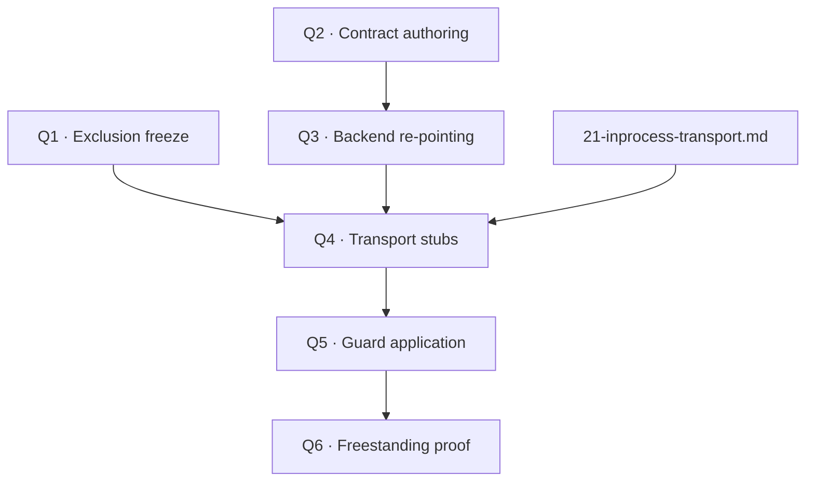

# 11 — Portability Plan

## 1. Purpose

This document is the **mechanical plan for severing every dependency catalogued in [`10-os-dependency-census.md`](10-os-dependency-census.md)**. It is the
second deliverable of workstream 2 ([`00-introduction.md`](00-introduction.md) §5.2) and it specifies, per file and per dependency, *what edit is made,
behind what guard, in what order, with what exit gate*.

It is the document that makes "raw compilation with no OS dependency" an executable instruction rather than an aspiration.

### 1.1 What this document is not

- **Not the census.** What the dependencies are is [`10-`](10-os-dependency-census.md).
- **Not the replacement API.** What the code calls instead is [`12-platform-contract.md`](12-platform-contract.md).
- **Not the transport design.** The three STUB files in `tinyx/os/` are specified in [`21-inprocess-transport.md`](21-inprocess-transport.md); this
  document only states *that* they are stubbed and what the gate is.
- **Not the build.** [`30-`](30-host-build.md) / [`31-`](31-target-build.md).

## 2. Strategy

Four mechanisms, in strict order of preference. **Always use the earliest one that works.**

| # | Mechanism | Cost | When |
|---|---|---|---|
| M1 | **Do not compile the file.** | Zero. No patch, no guard, no maintenance. | The file's entire purpose is OS‑coupled |
| M2 | **Compile a replacement file with the same external symbols.** | One new file we own. No upstream diff. | The file has a small, well‑defined external surface that we can reimplement |
| M3 | **Guard a necessary region of an upstream file.** | One line item in the patch manifest. Must be replayable; preserve the reference alternative. | The file is mostly needed but has a project-specific dependency or engine limitation |
| M4 | **Rewrite upstream logic unconditionally.** | Forbidden. | — |

M1 excludes unsupported backends; M2 handles owned adapters. M3 now implements
27 guarded files, with three future JWM sites planned at P7. M4 never happens. Device policy uses existing
DDX/HAL seams before M3; see [the TinyX methodology](47-tinyx-project-methodology.md).

### 2.1 Naming conventions

| Kind | Convention | Example |
|---|---|---|
| Replacement file (M2) | `<original>_wmb.c`, beside the original | `tinyx/os/io_wmb.c` |
| Project change in existing TinyX code | `WMB_DEVEL` | `#if defined(WMB_DEVEL)` |
| Capability/profile refinement | `WMB_HAS_OS_TRANSPORT`, `WMB_HOSTED` / `WMB_FREESTANDING` | Within the TinyX project branch, not a replacement for its selector |
| Guard macro for in‑process client path | `WMB_INPROC` | — |
| New framework file | `framework/<area>/<name>.c` | `framework/library/heap.c` |
| New port file | `<port>/<module>/<name>.c` | `linux_hosted/system_linux/hal_time_hosted.c` |

**TinyX guard style is fixed**: use the simple presence-based project expression
above, with unchanged reference code in `#else`; only an undefined macro disables
the project branch. Any definition, including zero or an empty value, selects WMB.
Guard includes/declarations/layout too. New project-owned
files are selected by the project build. Existing non-TinyX profile/client
selectors remain separate. A reviewer must be able to identify each project's
deviation in one line; do not invent backend-specific core selectors.

## 3. Phase Structure

Six phases with hard exit gates. Phases are sequential; each consumes the previous phase's artefact.

| Phase | Name | Exit gate |
|---:|---|---|
| **Q1** | Exclusion freeze | The CMake source lists contain no EXCLUDE file, and every symbol referenced from an excluded file is accounted for (satisfied, stubbed, or guarded) |
| **Q2** | Contract authoring | `hal_display.h`, `hal_input.h`, `hal_task.h`, `hal_time.h`, `wmb_os.h` exist and compile standalone against a freestanding C compiler with no includes beyond `<stdint.h>` / `<stddef.h>` / `<stdbool.h>` |
| **Q3** | Backend re‑pointing | `tinyx/kdrive/hal/*.c` includes only `hal_*.h`; a mock backend links the DDX with no SDL present |
| **Q4** | Transport stubs | `waitfor_wmb.c`, `connection_wmb.c`, `io_wmb.c` compile and the whole‑stack build links in the `host-pure` profile |
| **Q5** | Guard application | P6: 27 implemented sites replay on the pristine imported baseline; active headers/symbols and reference variants pass. JWM sites remain P7 |
| **Q6** | Freestanding proof | The `target` profile compiles every translation unit with `-ffreestanding -nostdinc` plus only the documented floor |

Q1 and Q2 can run in parallel. Q3 depends on Q2. Q4 depends on Q1 and on [`21-`](21-inprocess-transport.md). Q5 depends on Q4. Q6 depends on everything.

## 4. Phase Q1 — Exclusion Freeze

Delete nothing; simply never list the file. The work is in **proving** that each exclusion is safe.

### 4.1 The exclusion list

| Excluded | LOC | Mechanism | Symbols that must be satisfied elsewhere |
|---|---:|---|---|
| `tinyx/kdrive/linux/` | 1,760 | M1 | None — the DDX replaces it |
| `tinyx/kdrive/fbdev/` | 884 | M1 | None |
| `tinyx/kdrive/vesa/` | 3,472 | M1 | None |
| `tinyx/kdrive/src/kmap.c` | 151 | M1 | `KdMapDevice`, `KdUnmapDevice`, `KdMapRegisters` — **verify no caller** (census C2) |
| `tinyx/os/access.c` | 1,952 | M1 | `AccessUsingXdmcp`, `AddLocalHosts`, `ChangeAccessControl`, `GetAccessControl`, `ResetHosts`, `AddHost`, `RemoveHost`, `GetHosts`, `InvalidHost`, `LocalClient`, `ForEachHostInFamily`, `AuthorizedClient`, `DefineSelf`, `AugmentSelf` → stubs in `connection_wmb.c` |
| `tinyx/os/{auth,mitauth,xdmauth,xauembed}.c` | 1,019 | M1 | `CheckAuthorization`, `AuthorizationFromID`, `GenerateAuthorization`, `RemoveAuthorization`, `ResetAuthorization`, `InitAuthorization` → stubs |
| `tinyx/os/xdmcp.c` | 1,618 | M1 | `XdmcpUseMsg`, `XdmcpOptions`, `XdmcpRegisterConnection`, `XdmcpInit`, `XdmcpOpenDisplay`, `XdmcpCloseDisplay`, `XdmcpReset`, `isItTimeToYield` → stubs |
| `tinyx/os/xstrans.c` | 30 | M1 | All `_XSERVTrans*` → none needed once `connection_wmb.c` / `io_wmb.c` land |
| `tinyx/dbe/` | 2,620 | M1 | `DbeExtensionInit` → guarded out of `mi/miinitext.c` |
| `tinyx/Xext/shm.c` | ~1,000 | M1 | `ShmExtensionInit`, `ShmRegisterFuncs` → guarded out of `miinitext.c` |
| `tinyx/Xext/xf86bigfont.c` | ~700 | M1 | `XFree86BigfontExtensionInit` → guarded out |
| `libX11/src/xcb_io.c` | ~800 | M1 | 13 symbols → **all** reimplemented in `wmb_transport.c` (see [`20-`](20-transport-inventory.md) §3) |
| `libX11/src/{x11_xcb,locking,os2Stubs}.c` | — | M1 | `XInitThreads` explicitly refuses native threading; glyph-cursor creation is retained with dynamic Xcursor disabled |
| `libX11/src/xlibi18n/`, `SetLocale.c`, `Xrm.c`, `lc*` | ~8,000 | M1 | `_XlcCurrentLC`, `XSetLocaleModifiers`, `XSupportsLocale`, `XrmInitialize`… → minimal stubs |
| `X11/xtrans/` | header lib | M1 | — |

### 4.2 The stub‑symbol file

All the "→ stubs" entries above collect into **one new file**, `tinyx/os/excluded_stubs_wmb.c` (~180 LOC), rather than being scattered. Rationale: when a
future phase wants to re‑enable, say, XDMCP, exactly one file has to be revisited.

Every stub is one of three shapes and nothing else:

```c
/* shape 1: permissive — the operation is meaningless without a peer */
Bool CheckAuthorization(unsigned nl, char *nd, unsigned dl, char *dt,
                        ClientPtr cl, char **reason) { *reason = NULL; return TRUE; }

/* shape 2: inert — the operation is a no-op */
void ResetHosts(char *display) { (void)display; }

/* shape 3: refusing — the operation cannot be supported and callers must cope */
int ChangeAccessControl(ClientPtr client, int fEnabled) { (void)client; (void)fEnabled; return BadAccess; }
```

A stub that lies (returns success for something that did not happen) is only acceptable when the operation is genuinely meaningless in a single address
space. Each stub carries a one‑line comment stating which shape it is and why.

### 4.3 Q1 exit gate

```bash
# no excluded file appears in any source list
grep -rE 'kdrive/(linux|fbdev|vesa)|os/(access|auth|mitauth|xdmauth|xauembed|xdmcp|xstrans)\.c|dbe/|Xext/(shm|xf86bigfont)\.c|xcb_io\.c' \
     framework/CMakeLists.txt jwm/CMakeLists.txt        # → empty

# the link produces no unresolved symbol from the exclusion ledger
cmake --build build --target wmb_host 2>&1 | grep 'undefined reference'   # → empty
```

## 5. Phase Q2 — Contract Authoring

Write the five headers of [`12-platform-contract.md`](12-platform-contract.md). Nothing else in this phase.

### 5.1 Exit gate

Each header must compile as the sole content of a translation unit under:

```bash
cc -std=c11 -ffreestanding -nostdinc -I framework/library -c -x c - <<< '#include "hal_display.h"'
```

with only `<stdint.h>`, `<stddef.h>`, `<stdbool.h>` available (the three freestanding headers C11 guarantees). A contract header that needs `<sys/types.h>`
is not a contract.

## 6. Phase Q3 — Backend Re‑Pointing

Break the DDX's coupling to a backend‑named directory and to the ad‑hoc `hal_drivers.h` surface.

### 6.1 Edits

| File | Edit | Mechanism |
|---|---|---|
| `hal/hal_display.h` | New; the framebuffer contract | New |
| `hal/hal_input.h` | New; the input contract, **carrying the existing `CMD_*` / `KEY_DATA_*` / `MOUSE_BUTTON_*` constants verbatim** | New |
| `linux_hosted/sdl_drivers/hal_display_sdl.c` | Direct private implementation of the display HAL, including status pump | Done |
| `linux_hosted/sdl_drivers/hal_input_sdl.c` | Direct private byte queues and typed portable controls | Done |
| `linux_hosted/sdl_drivers/hal_mock.c` | New; a null backend for link‑isolation testing | New |
| `tinyx/kdrive/hal/hal_display.c` | `#include "hal_drivers.h"` → `#include "hal_display.h"`; `lcd_driver_get_framebuffer()` → `hal_display_get_fb()->pixels`; shadow update → `hal_display_flush()` | M3 |
| `tinyx/kdrive/hal/hal_input.c` | Generic `hal_input_read_byte` pairs; application keymap stays private | M3 |
| `tinyx/kdrive/hal/hal_input.c` | → `hal_input.h`; **plus defects D1–D4** from [`01-`](01-component-inventory.md) §6.3 | M3 |
| `tinyx/kdrive/hal/hal_os.c` | Generic HAL polling/lifecycle; standard block-handler deadline and real argument dispatch | Done |
| Legacy display/keypad/mouse surface | Removed; software drawing stays above the HAL, and backend headers/definitions are private | Done |

These four DDX files are ours (untracked additive module), so they do not consume upstream patch budget.

### 6.2 Exit gate

```bash
# no DDX file references a backend
grep -rl 'SDL\|sdl_\|hal_drivers\.h' tinyx/                              # → empty

# the DDX links against the mock backend with no SDL on the link line
cmake --build build-mock --target wmb_ddx_linktest                       # → success
```

Plus a runnable check: with the SDL backend, a test pattern written through `hal_display_get_fb()` and pushed with `hal_display_flush()` appears in the
window.

## 7. Phase Q4 — Transport Stubs

Compile the three replacement files. Their *design* is [`21-inprocess-transport.md`](21-inprocess-transport.md); their *portability role* is stated here.

| Replacement | Replaces | Removes |
|---|---|---|
| `tinyx/os/waitfor_wmb.c` | `WaitFor.c` (670 LOC) | `select()`, `fd_set`, `XFD_*`, `errno`, `<X11/Xpoll.h>` |
| `tinyx/os/connection_wmb.c` | `connection.c` (1,027 LOC) | `<sys/socket.h>`, `<sys/uio.h>`, `<signal.h>`, `_XSERVTrans*`, `getpeername`, `accept` |
| `tinyx/os/io_wmb.c` | `io.c` (1,026 LOC) | `<sys/uio.h>`, `struct iovec`, `_XSERVTransRead/Writev` |

The `_wmb.c` files are the **only** transport compiled, in every profile that runs an X server. `WaitFor.c`, `connection.c`, `io.c` and `xstrans.c` remain
in the tree as reference material but never appear in a source list ([`90-`](90-decisions.md) D‑49). Because the replacements keep the upstream symbol
names, substitution is a source‑list change and `dix/` stays untouched.

**What this costs.** D‑15 originally kept a socket profile so that "did we assemble TinyX correctly?" and "did we replace the transport correctly?" could be
answered separately. With that profile retired, a first‑light failure has two candidate causes, and the separation is provided by *staging* instead: Q4/P4
bring up the server with no client at all, and only P5 introduces one.

### 7.1 Preserving `BlockHandler` / `WakeupHandler` — the critical detail

Census item SD3. `WaitFor.c:206` calls `BlockHandler(&wt, &LastSelectMask)` immediately before `select()` and `WakeupHandler(i, &LastSelectMask)`
immediately after. KDrive registers `KdBlockHandler` / `KdWakeupHandler` there, and `KdBlockHandler` is what calls `KdOsFuncs.pollEvents`. `mieq` drains in
`WakeupHandler`.

`waitfor_wmb.c` **must** preserve both calls, in the same order, with the same arguments minus the fd mask:

```c
int WaitForSomething(int *pClientsReady)
{
    unsigned long timeout_ms = 0;

    BlockHandler(&timeout_ms, NULL);          /* → KdBlockHandler → pollEvents */

    if (!wmb_client_queue_pending())
        hal_yield_timeout((uint32_t)timeout_ms);

    WakeupHandler(0, NULL);                   /* → mieqProcessInputEvents      */

    return wmb_collect_ready_clients(pClientsReady);
}
```

A stub that skips these two calls compiles, links, runs, draws — and has no keyboard or mouse. Verification gate V‑Q4‑3 in [`41-`](41-verification-plan.md)
exists specifically to catch this.

### 7.2 Q4 exit gate

- `host-pure` profile links with zero unresolved symbols.
- `lsof -p $(pidof wmb_host)` shows no socket.
- `strace -f -e trace=network,select,poll ./wmb_host` produces no output.
- The server dispatch loop is reached and idles at a bounded CPU cost (it must not spin at 100 %).

## 8. Phase Q5 — Guard Application

**P6 is implemented and verified for the selected hosted windowing cohorts.**
The [actual guide](48-p6-portability.md) and
[generated manifest](../patches/MANIFEST.md) supersede earlier estimated budgets.
There are 27 implemented sites and three future JWM sites, not a claim that JWM
has been built. See D-54 for the user-approved budget expansion.

### 8.1 `tinyx/` — 15 guarded files

| # | File | Guard | Edit |
|--:|---|---|---|
| 1 | `dix/main.c` | `WMB_DEVEL` | `main()` → `TinyX_ServerFiber(void *)`; remove the `envp` parameter; guard authority/environment and XDMCP argument handling |
| 2 | `mi/miinitext.c` | `WMB_DEVEL` | Select project extensions within the project branch; preserve reference registration |
| 3 | `os/utils.c` | `WMB_DEVEL` | Guard signals, child reaping, limits, file and hostname dependencies; retain reference alternatives |
| 4 | `os/osinit.c` | `WMB_DEVEL` | Project limit/log-redirection handling; refine optional capabilities within the branch |
| 5 | `os/log.c` | `WMB_DEVEL` | Project file/log-rotation handling; keep `ErrorF`/`LogVWrite` and reference behavior |
| 6 | `os/osdep.h` | `WMB_DEVEL` | Project fd-bitset/internal-client declarations; preserve reference types/layout |
| 7 | `os/strlcpy.c` | `WMB_DEVEL` | Project `<stddef.h>` include with original `<sys/types.h>` alternative |
| 8 | `kdrive/src/kinput.c` | `WMB_DEVEL` | Native FD/SIGIO exclusion and guarded bounds, lock/reset, startup, pointer/event, acceleration, and polling-deadline corrections |
| 14 | `kdrive/src/kdrive.h` | `WMB_DEVEL` | Nine-button capacity/constants and wide button state; retain reference layout |
| 15 | `kdrive/src/kdrive.c` | `WMB_DEVEL` | Project native-option/VT/shell exclusions and lifecycle/OS-initialization handling |
| 16 | `dix/extension.c` | `WMB_DEVEL` | Observe actual successful extension registration for the P4 startup gate |
| 17 | `mi/micmap.c` | `WMB_DEVEL` | Use an unsigned blue-mask shift; strict UBSan found signed overflow during real initialization |
| 18 | `fb/fbbits.h` | `WMB_DEVEL` | Multiply negative Bresenham error by two instead of signed left shift; exposed by P5 line/wire test |
| 20 | `Xext/sync.c` | `WMB_DEVEL` | Typed millisecond block-handler deadline and correct project initializer prototype |
| 21 | `os/strlcat.c` | `WMB_DEVEL` | Standard size_t header with original reference alternative |

The strlcat include is guarded rather than copying the same function into an M2
file. Deadline adaptation also updates the actual SYNC callback/shared type;
only changing the wait-loop implementation would leave an incompatible ABI.

### 8.2 `libX11/` — 10 guarded files

| # | File | Guard | Edit |
|--:|---|---|---|
| 9 | `libX11/include/X11/Xlibint.h` | `WMB_INPROC` | Matching client ABI/header, threadless profile, `Data`/`BufAlloc` complete-batch growth through `_XBufferGrow` |
| 10 | `libX11/src/XlibInt.c` | `WMB_INPROC` | Guard the `<sys/socket.h>` / `<sys/ioctl.h>` / `<sys/utsname.h>` block and the fd‑based `_XWaitForReadable` / `_XWaitForWritable` helpers; keep error handling and `_XEatData` |
| 19 | `libX11/src/OpenDis.c` | `WMB_INPROC` | Internal connection/setup sourcing, preserving native parsing and destructor |
| 22 | `libX11/include/X11/Xlib.h` | `WMB_INPROC` | Standard public types without sys/types.h |
| 23 | `libX11/src/reallocarray.c` | `WMB_INPROC` | Retained overflow-checked allocation, standard headers |
| 24 | `libX11/src/reallocarray.h` | `WMB_INPROC` | Standard size_t header |
| 25 | `libX11/src/Macros.c` | `WMB_INPROC` | Public macro functions without native XCB/locking headers |
| 26 | `libX11/src/StrKeysym.c` | `WMB_INPROC` | Built-in/Unicode names without host database lookup |
| 27 | `libX11/src/KeysymStr.c` | `WMB_INPROC` | Built-in names without resource-database enumeration |
| 28 | `libX11/src/WMProps.c` | `WMB_INPROC` | Caller hints and C locale without environment/process identity |

### 8.2.1 Shared X11 headers — 2 guarded files

| # | File | Guard | Edit |
|--:|---|---|---|
| 29 | `X11/Xos.h` | Presence of `WMB_DEVEL`, `WMB_INPROC` or private font profile | Standard-C include branch, no fake POSIX headers |
| 30 | `X11/Xdefs.h` | `WMB_DEVEL` | `OSTimePtr` is a typed 32-bit millisecond-budget pointer |

The pinned font library additionally has a two-file conditional profile patch
managed by [WmbXfont.cmake](../cmake/WmbXfont.cmake). Its two prior P4 bitmap
repairs remain separate. Disk/fontenc/catalogue backends are excluded, not
silently left in unreachable archive sections.

### 8.3 `jwm/` — 3 guarded files (+3 mechanical)

| # | File | Guard | Edit |
|--:|---|---|---|
| 11 | `jwm/src/jwm.h` | `WMB_INPROC` | Gate the `<sys/select.h>` / `<unistd.h>` / `<signal.h>` / `<sys/wait.h>` include block |
| 12 | `jwm/src/event.c` | `WMB_INPROC` | `select()` on `ConnectionNumber` → `hal_yield_timeout()` loop, preserving `Signal()` callback cadence |
| 13 | `jwm/src/command.c` | `WMB_INPROC` | `fork`/`execl`/`waitpid` → `wmb_app_table` lookup + `hal_task_create()` |

Three further JWM files (`main.c`, `misc.c`, `timing.c`) are handled by **M2 via `-include jwm_namespace.h`** rather than by editing: the namespace header
`#define`s `main` → `Jwm_Main`, `getenv` → `Jwm_GetEnvStub`, and neutralises the `TZ` helpers. This keeps the JWM diff to three files.

### 8.4 Patch budget — hard caps

| Tree | Cap | Planned | Slack |
|---|---:|---:|---:|
| `tinyx/` | 15 | 15 | 0 |
| `libX11/` | 10 | 10 | 0 |
| shared `X11/` | 2 | 2 | 0 |
| `jwm/` | 4 | 3 | 1 |
| **Total** | **31** | **30** | **1** |

Exceeding a cap requires an entry in [`90-decisions.md`](90-decisions.md) with the alternative that was rejected and why. The caps exist because every
guarded file is a merge conflict every time upstream moves. D-51 raises the
TinyX cap by two for necessary header-layout and lifecycle changes; copying
engine logic into the HAL port was rejected. D-52 adds two necessary P4 engine
sites for truthful registration observation and defined visual-mask arithmetic.
D-53 adds the necessary framebuffer arithmetic site rather than suppressing
UBSan. Reusing the real Xlib setup parser consumes the existing third client slot.
D-54 expands TinyX to 15, libX11 to 10 and explicitly budgets the two shared
headers. The audit found real transitive dependencies missed by the old
estimates. Fake POSIX headers, copied core files and linker garbage collection
as a portability proof were rejected. Of the 30 planned sites, 27 are implemented;
three JWM sites are still future P7 work.

### 8.5 Patch manifest

P6 produces [patches/](../patches/MANIFEST.md) at the repository root:

```
patches/
├── MANIFEST.md              # generated human-readable reasons and LOC deltas
├── manifest.json            # exact baseline/result hashes, selectors and caps
├── tinyx/                  # 15 replayable patches
├── libX11/                 # 10 replayable patches
└── X11/                    # 2 shared-header patches
```

### 8.6 Q5 exit gate

```bash
python3 tools/check_portability.py --build-dir build-p6
ctest --test-dir build-p6 --output-on-failure -R '^tinyx_p6_'
```

The exact baseline is the unmodified repository import, with immutable
per-file SHA-256 values, not an asserted official upstream release identity.
The gate reconstructs that baseline, checks/applies all patches, preserves notice
bytes, compiles/compares 20 reference units and checks one/zero/empty variants.
It audits all 452 active selected units and complete archives; it does not
mistake preserved reference includes or libc implementation headers for active
project OS dependencies. Target-floor/freestanding proof remains Q6/P9.

## 9. Phase Q6 — Freestanding Proof

The gate that makes the "no OS dependency" claim true rather than plausible.

### 9.1 The libc floor

The target build is allowed to use exactly these, and they must be satisfiable by a minimal libc (newlib‑nano, picolibc, or a hand‑written set):

| Group | Functions |
|---|---|
| `<string.h>` | `memcpy` `memmove` `memset` `memcmp` `strlen` `strcpy` `strncpy` `strcmp` `strncmp` `strcat` `strncat` `strchr` `strrchr` `strstr` `strdup` |
| `<stdlib.h>` | `malloc` `calloc` `realloc` `free` `abort` `atoi` `strtol` `strtoul` `qsort` `bsearch` `abs` |
| `<stdio.h>` | `snprintf` `vsnprintf` `sprintf` `vfprintf`†  |
| `<ctype.h>` | `isalpha` `isdigit` `isspace` `isprint` `isxdigit` `toupper` `tolower` |
| `<setjmp.h>` | `setjmp` `longjmp` — mandatory ([`90-`](90-decisions.md) D‑32) |
| `<math.h>` | `sin` `cos` `sqrt` `floor` `ceil` (RENDER only) |

† `vfprintf` is only reachable through `ErrorF`; the target build redirects it to `wmb_os_console_write()` and does not need real stdio.

**Explicitly not in the floor:** `fopen`, `fread`, `fwrite`, `fseek`, `getenv`, `exit`, `time`, `localtime`, `gettimeofday`, `signal`, `raise`, `system`.

### 9.2 The syscall floor

Four, via `wmb_os.h`:

| Contract function | Purpose | Backed by |
|---|---|---|
| `wmb_os_sbrk(intptr_t)` | Heap growth | Region allocator or platform allocator |
| `wmb_os_console_write(const char *, int)` | `ErrorF` output | UART / semihosting / SDL stdout |
| `wmb_os_tick_ms(void)` | Monotonic milliseconds | Hardware timer |
| `wmb_os_abort(void)` | `FatalError` termination | Reset / halt |

### 9.3 Q6 exit gate

```bash
# every TU compiles freestanding
cmake -B build-target -DWMB_PROFILE=target -DCMAKE_C_FLAGS="-ffreestanding" && cmake --build build-target

# the link references nothing outside the floor
nm --undefined-only build-target/wmb.elf | c++filt | sort -u > /tmp/undef.txt
comm -23 /tmp/undef.txt docs/floor-symbols.txt          # → empty

# and nothing from the forbidden set
grep -E '\b(socket|bind|listen|accept|connect|select|poll|readv|writev|fcntl|sigaction|fork|execve|waitpid|getenv|fopen|dlopen|pthread_)' /tmp/undef.txt
# → empty
```

`docs/floor-symbols.txt` is a Q6 deliverable, generated from §9.1 + §9.2 and checked in.

## 10. Per‑Dependency Disposition Matrix

The complete mapping from [`10-`](10-os-dependency-census.md) to a mechanism. Every census row appears here exactly once.

| Dependency | Where | Class | Mechanism | Phase |
|---|---|---|---|---|
| `select()` scheduler loop | `os/WaitFor.c:215,219` | BLOCKING | M2 → `waitfor_wmb.c` + `hal_yield_timeout` | Q4 |
| `select()` connection poll | `os/connection.c:679` | BLOCKING | M2 → `connection_wmb.c` (removed) | Q4 |
| `fd_set` / `XFD_*` / `<X11/Xpoll.h>` | `WaitFor.c`, `connection.c`, `io.c`, `osdep.h`, `xdmcp.c` | TRANSPORT | M2 + M3 (`osdep.h` guard) | Q4, Q5 |
| `_XSERVTrans*` (xtrans) | `connection.c`, `io.c`, `xstrans.c` | TRANSPORT | M1 + M2 | Q1, Q4 |
| `<sys/uio.h>` / `writev` | `connection.c`, `io.c` | TRANSPORT | M2 | Q4 |
| `getpeername` | `connection.c` | TRANSPORT | M2 (always authorized) | Q4 |
| Socket listener, `accept` | `connection.c` | TRANSPORT | M2 | Q4 |
| `<signal.h>` server lifecycle | `os/utils.c`, `os/connection.c` | PROCESS | M3 guard | Q5 |
| `<signal.h>` SIGIO input | `kdrive/src/kinput.c` | PROCESS | M3 guard | Q5 |
| `<sys/wait.h>` | `os/utils.c` | PROCESS | M3 guard | Q5 |
| `setrlimit` | `os/osinit.c`, `os/utils.c` | PROCESS | M3 guard | Q5 |
| `fopen` log redirect | `os/osinit.c:117` | FILESYSTEM | M3 guard | Q5 |
| `<sys/stat.h>` log rotation | `os/log.c` | FILESYSTEM | M3 guard | Q5 |
| `Fopen()` privilege‑dropping | `os/utils.c:1267` | FILESYSTEM/PROCESS | M3 guard (only `auth.c` called it) | Q5 |
| `fopen` hosts file | `os/access.c:867` | FILESYSTEM | M1 | Q1 |
| `<netdb.h>` hostname | `os/utils.c`, `os/access.c`, `os/xdmcp.c` | ENVIRONMENT | M1 + M3 guard | Q1, Q5 |
| `getenv("XAUTHORITY")` | `dix/main.c:250` | ENVIRONMENT | M3 guard | Q5 |
| `main()` | `dix/main.c:227` | PROCESS | M3 guard → fiber entry | Q5 |
| `<sys/types.h>` for `size_t` | `os/strlcpy.c`, `os/strlcat.c` | TYPEDEF‑ONLY | M3 (one line) | Q5 |
| `<sys/param.h>` | `os/osdep.h`, `os/utils.c`, `os/access.c`, `os/xdmcp.c` | TYPEDEF‑ONLY | M3 guard | Q5 |
| `mmap`/`ioctl` device mapping | `kdrive/src/kmap.c` | HARDWARE | M1 | Q1 |
| Linux console/evdev/VT | `kdrive/linux/` | HARDWARE | M1 | Q1 |
| `/dev/fb0` | `kdrive/fbdev/` | HARDWARE | M1 | Q1 |
| x86 VESA / VM86 | `kdrive/vesa/` | HARDWARE | M1 | Q1 |
| SysV shared memory | `Xext/shm.c`, `Xext/xf86bigfont.c` | MEMORY | M1 | Q1 |
| `<sys/select.h>` client | `libX11/src/xcb_io.c` | BLOCKING | M1 → `wmb_transport.c` | Q1, Q4 |
| `<sys/socket.h>` etc. | `libX11/src/XlibInt.c` | TRANSPORT | M3 guard | Q5 |
| `<dlfcn.h>` | `libX11/src/{locking,CrGlCur}.c`, `xlibi18n/` | PROCESS | M1 | Q1 |
| Locale / XIM / Xrm | `libX11/src/xlibi18n/`, `SetLocale.c`, `Xrm.c` | FILESYSTEM/ENV | M1 + stubs | Q1 |
| `Data()` macro flush | `libX11/include/X11/Xlibint.h` | TRANSPORT | M3 guard | Q5 |
| `select()` on `ConnectionNumber` | `jwm/src/event.c` | BLOCKING | M3 guard | Q5 |
| `fork`/`execl`/`waitpid` | `jwm/src/command.c` | PROCESS | M3 guard | Q5 |
| `sigaction` | `jwm/src/main.c` | PROCESS | M2 via namespace header | Q5 |
| `getenv` | `jwm/src/misc.c` | ENVIRONMENT | M2 via namespace header | Q5 |
| `TZ` push/pop | `jwm/src/timing.c` | ENVIRONMENT | M2 via namespace header | Q5 |
| Xft / fontconfig | `jwm/src/font.c` | FILESYSTEM | M1 (build option off) | Q1 |
| JWM optional libs ×10 | `jwm/configure.ac` | — | M1 (build options off) | Q1 |
| `-D_USE_LINUX` | `framework/CMakeLists.txt:30` | — | Delete | Q2 |

## 11. Risks

| # | Risk | Likelihood | Impact | Mitigation |
|---|---|---|---|---|
| R1 | `waitfor_wmb.c` omits `BlockHandler`/`WakeupHandler` → no input, hard to diagnose | **High** | **High** | §7.1 is explicit; gate V‑Q4‑3 injects a synthetic key event and asserts it reaches a client |
| R2 | `osdep.h` fd bitsets leak into `dixstruct.h` / `dix/` and cannot be guarded cleanly | Medium | High | Census C1. Resolve during Q4 before writing the stubs; fall back to keeping a dummy `fd` field |
| R3 | An EXCLUDE file turns out to be referenced late (link time in Q4) | Medium | Medium | §4.1 pre‑enumerates the symbol obligations; `excluded_stubs_wmb.c` absorbs surprises |
| R4 | Patch budget breached because a guard turns out to need three more files | Medium | Low | Two files of slack; escalation path via [`90-`](90-decisions.md) |
| R5 | `Data()` macro edit does not reach all callers (it is a header macro; some `.c` may include a stale copy) | Low | High | Gate: `grep -rl 'Data(' libX11/src` and verify each TU sees the modified header via a compile‑time `#error` canary |
| R6 | Freestanding compile surfaces a libc dependency nobody censused (e.g. `qsort` in `dix/resource.c`) | **High** | Low | Expected. §9.1 floor is a starting hypothesis; Q6 refines it. This is why Q6 is its own phase |
| R7 | JWM's `-include jwm_namespace.h` rename collides with a legitimate symbol | Low | Medium | Prefix all renames `Jwm_`; verify with `nm` for duplicate `T` symbols |
| R8 | No independent oracle: a first‑light failure could be assembly *or* transport | Medium | Medium | Staging, not profiles — P4 gates the server with no client, P5 adds one; P4's root‑window gate is the bisection step ([`40-`](40-implementation-plan.md) §5.3) |

## 12. Sequencing Summary



Mapped onto the implementation phases in [`40-implementation-plan.md`](40-implementation-plan.md): Q2+Q3 are P1, Q1 is P4, Q4 is P5, Q5 is P6, Q6 is P9.
