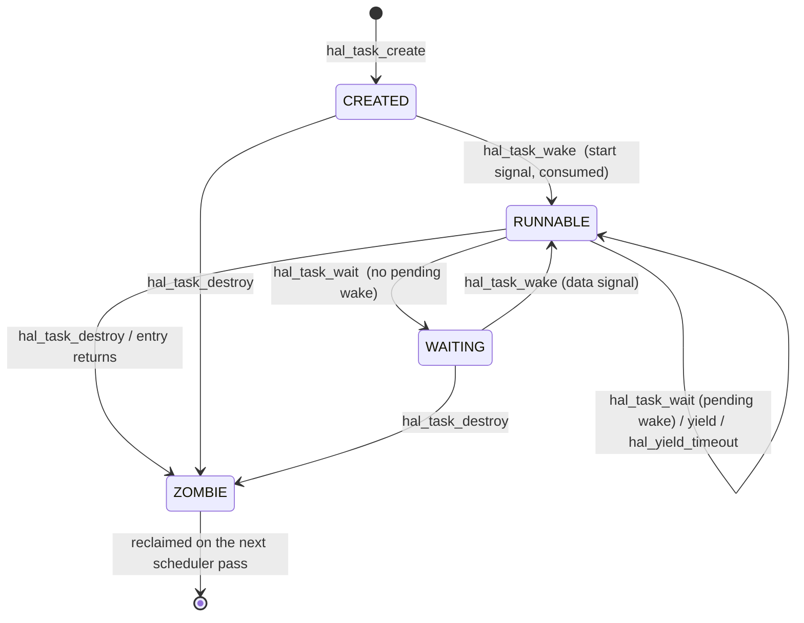

# 12 — Platform Contract

## 1. Purpose

This document defines **the entire interface between WMB and the machine it runs on**. It is the third deliverable of workstream 2
([`00-introduction.md`](00-introduction.md) §5.2).

Five headers. If a WMB source file needs something from the platform and it is not in one of these five headers, either the header is incomplete (fix it
here) or the file is doing something it should not (fix the file). There is no third option, and no escape hatch.

The contract is the mechanism by which layering rule **L1** — *nothing above the platform contract names a platform* — becomes enforceable.

### 1.1 What this document is not

- **Not the implementations.** The hosted backend is [`30-host-build.md`](30-host-build.md) §5–§6; the target backend is
  [`31-target-build.md`](31-target-build.md) §4–§6.
- **Not the transport.** The client/server bridge is [`21-inprocess-transport.md`](21-inprocess-transport.md). It sits *above* the contract and uses
  `hal_task_*`.
- **Not the removal plan.** [`11-portability-plan.md`](11-portability-plan.md).

### 1.2 The five headers

| Header | Location | Owns |
|---|---|---|
| `hal_display.h` | `framework/library/` | The framebuffer |
| `hal_input.h` | `framework/library/` | Keyboard and pointer |
| `hal_task.h` | `framework/library/` | Execution contexts and cooperative waiting |
| `hal_time.h` | `framework/library/` | Monotonic time |
| `wmb_os.h` | `framework/library/` | Console, termination, allocation, optional file I/O |

**Constraint on all five**: each must compile standalone under `-ffreestanding -nostdinc` with only `<stdint.h>`, `<stddef.h>` and `<stdbool.h>` available.
This is gate Q2 in [`11-`](11-portability-plan.md) §5.1.

## 2. Design Rules

| # | Rule | Rationale |
|---|---|---|
| PC1 | **No opaque OS types cross the contract.** No `int fd`, no `pid_t`, no `struct timeval`, no `void *` that is secretly a `SDL_Window*`. | An `fd` in the contract is a Linux dependency in disguise |
| PC2 | **Polling, not callbacks.** The platform never calls up into WMB; WMB asks the platform. | Callbacks imply an OS thread or an interrupt context, which imposes re‑entrancy requirements we cannot honour on a cooperative single thread |
| PC3 | **Nothing blocks except `hal_yield_timeout`.** Every other function returns promptly. | Rule L2 |
| PC4 | **Fixed geometry.** Resolution and depth are decided at init and never change. | No RandR, no hot‑plug, no reallocation storms |
| PC5 | **The target wire format wins.** Where hardware already has a shape (the `CMD_*` input byte protocol), the contract adopts it rather than inventing a nicer one that the target must then translate. | The host adapts to the target, never the reverse |
| PC6 | **Errors are return codes, never `errno`.** | `errno` is a libc concept |

## 3. Profile Macros

Exactly four macros control configuration. No component may invent a fifth without an entry in [`90-decisions.md`](90-decisions.md).

| Macro | Set when | Meaning |
|---|---|---|
| `WMB_HOSTED` | Host development build | A hosted libc, SDL, POSIX and libucontext are available. Debuggers work |
| `WMB_FREESTANDING` | Target build | Only the documented libc floor ([`11-`](11-portability-plan.md) §9.1) and the four contract syscalls exist |
| `WMB_HAS_OS_TRANSPORT` | Host, optionally | **Platform capability only**: the OS provides sockets and `select()`. Used by the P8 `wmb_api_t` bridge and nothing else. Never carries X11 protocol |
| `WMB_INPROC` | Always | The in‑process path is TinyX's **only** X11 transport ([`90-`](90-decisions.md) D‑49) |

Exactly one of `WMB_HOSTED` / `WMB_FREESTANDING` is defined. Enforced by a compile‑time check in `framework/library/wmb_profile.h`:

```c
#if defined(WMB_HOSTED) == defined(WMB_FREESTANDING)
#  error "exactly one of WMB_HOSTED / WMB_FREESTANDING must be defined"
#endif
#if defined(WMB_HAS_OS_TRANSPORT) && defined(WMB_FREESTANDING)
#  error "WMB_HAS_OS_TRANSPORT is not available in a freestanding build"
#endif
#if !defined(WMB_INPROC)
#  error "WMB_INPROC is the only X11 transport; it is always defined"
#endif
```

This is what keeps the port cheap. TinyX's socket transport — `os/{connection,io,WaitFor,xstrans}.c` — is **never compiled, in any profile**;
`waitfor_wmb.c` / `io_wmb.c` / `connection_wmb.c` define the same public symbols in its place, so `dix/`, `Dispatch()` included, needs no edit at all.

**`WMB_HAS_OS_TRANSPORT` is a host socket, never an X11 socket.** Its one use is the P8 bridge ([`22-`](22-entry-point-abi.md) §6), where a socket carries
framed `wmb_api_t` calls that terminate in `wmb_bridge.c`, which calls the vtable, which calls libX11‑wmb, which posts to the in‑process queue. A stock X
client cannot speak that framing and has nowhere to connect. Gate B9 depends on the combination: `wmb_hello` must produce a *JWM‑decorated* window, so JWM
runs as an in‑process fiber while the bridge socket is open.

The four sanctioned profiles are in [`03-target-architecture.md`](03-target-architecture.md) §5.

## 4. `hal_display.h` — Framebuffer

### 4.1 Interface

```c
#ifndef WMB_HAL_DISPLAY_H
#define WMB_HAL_DISPLAY_H

#include <stdint.h>
#include <stddef.h>

/* Pixel formats.  Only these are supported; adding one is a decision. */
typedef enum {
    HAL_PIXFMT_RGB565   = 0,   /* 16 bpp, the default target format */
    HAL_PIXFMT_XRGB8888 = 1    /* 32 bpp, convenient on the host    */
} hal_pixfmt_t;

typedef struct {
    void        *pixels;   /* base of the linear buffer WMB draws into */
    uint32_t     width;    /* pixels  */
    uint32_t     height;   /* pixels  */
    uint32_t     stride;   /* BYTES per row; may exceed width * bpp/8  */
    uint8_t      bpp;      /* bits per pixel: 16 or 32                 */
    hal_pixfmt_t format;
} hal_framebuffer_t;

/* Lifecycle.  Returns 0 on success, negative on failure. */
int  hal_display_init(uint32_t width, uint32_t height, hal_pixfmt_t format);
void hal_display_shutdown(void);

/* The buffer WMB renders into.  Valid between init and shutdown.
 * Never NULL after a successful init. */
const hal_framebuffer_t *hal_display_get_fb(void);

/* Publish a damaged rectangle to the physical display.
 * Coordinates are clipped by the implementation.  Must not block. */
void hal_display_flush(int32_t x, int32_t y, uint32_t w, uint32_t h);

/* Optional power management.  A backend that cannot do this returns -1
 * and WMB carries on. */
int  hal_display_set_power(int on);

#endif /* WMB_HAL_DISPLAY_H */
```

### 4.2 Contract notes

| Aspect | Requirement |
|---|---|
| Ownership | The **backend** owns `pixels`. WMB writes into it and calls `hal_display_flush`. WMB never frees it |
| Shadow vs direct | Whether `pixels` is the physical framebuffer or a shadow copy is the backend's business. TinyX's `miext/shadow` operates *above* this, on its own buffer, and its update callback is what calls `hal_display_flush` |
| Blocking | `hal_display_flush` **must not block**. On the host it queues an SDL texture update; the actual `SDL_RenderPresent` happens on the `hal` fiber |
| Geometry | Fixed for the lifetime of the process (PC4). A backend that cannot supply the requested geometry fails `init` rather than substituting one |
| Alignment | `pixels` is at least 4‑byte aligned; `stride` is a multiple of 4 |

### 4.3 Mapping

| Contract | Hosted (`hal_display_sdl.c`) | Target |
|---|---|---|
| `hal_display_init` | `lcd_driver_init()` + SDL window/texture creation | Program the display controller; set the framebuffer base |
| `hal_display_get_fb` | Wraps `lcd_driver_get_framebuffer()`, `lcd_driver_get_width/height/bits_per_pixel()` | Return the MMIO region descriptor |
| `hal_display_flush` | Mark the dirty rect; `sdl_window` presents on the next `hal` fiber turn | DMA blit or no‑op if the buffer is the scanout buffer |
| `hal_display_shutdown` | `lcd_driver_deinit()` + SDL teardown | Blank the panel |

The existing helpers `lcd_driver_set_pixel`, `lcd_driver_fill_colour`, `lcd_driver_show_bitmap_rgb`, `lcd_driver_do_scroll`, `lcd_driver_clear_screen` are
**deliberately not in the contract**. All drawing in WMB goes through `tinyx/fb/`; a second drawing path in the HAL would be a second rendering engine to
keep correct. They remain as backend‑internal helpers used by boot splash / diagnostics only.

## 5. `hal_input.h` — Keyboard and Pointer

### 5.1 The byte protocol is the contract

Per rule PC5, the existing command/data byte protocol from `linux_hosted/sdl_drivers/hal_drivers.h` is adopted verbatim, because it is what the target
hardware emits. The header **owns** these constants; the SDL backend includes them back.

```c
/* Command bytes */
#define HAL_CMD_MODIFIER        0x01   /* + modifier mask       */
#define HAL_CMD_KEY_DOWN        0x02   /* + key data            */
#define HAL_CMD_KEY_UP          0x03   /* + key data            */
#define HAL_CMD_MOUSE_X         0x04   /* + int8 dx             */
#define HAL_CMD_MOUSE_Y         0x05   /* + int8 dy             */
#define HAL_CMD_MOUSE_Z         0x06   /* + z / pressure        */
#define HAL_CMD_MOUSE_BUTTON    0x07   /* + held-button mask    */
#define HAL_CMD_MOUSE_WHEEL_X   0x08   /* + int8                */
#define HAL_CMD_MOUSE_WHEEL_Y   0x09   /* + int8                */

/* Key data values for non-printable keys */
#define HAL_KEY_BACKSPACE       127
#define HAL_KEY_ENTER            13
#define HAL_KEY_ESCAPE           27
#define HAL_KEY_LEFT              8
#define HAL_KEY_DOWN             10
#define HAL_KEY_UP               11
#define HAL_KEY_RIGHT            21

/* Packet value for HAL_CMD_MOUSE_BUTTON: simultaneous held buttons. */
#define HAL_MOUSE_MASK_LEFT     0x01u
#define HAL_MOUSE_MASK_MIDDLE   0x02u
#define HAL_MOUSE_MASK_RIGHT    0x04u
#define HAL_MOUSE_MASK_X1       0x08u
#define HAL_MOUSE_MASK_X2       0x10u
#define HAL_MOUSE_MASK_ALL      0x1fu

/* Physical button ids; NOT the packet value. */
#define HAL_MOUSE_BUTTON_LEFT     1
#define HAL_MOUSE_BUTTON_MIDDLE   2
#define HAL_MOUSE_BUTTON_RIGHT    3
#define HAL_MOUSE_BUTTON_X1       4
#define HAL_MOUSE_BUTTON_X2       5

/* Synthetic scancodes for modifiers.  These MUST match the SC_* values in
 * tinyx/kdrive/tima/tima_kdrive_kbd.c:58-66 - the DDX indexes kdKeymap with
 * them directly, so a mismatch silently remaps modifier keys. */
#define HAL_SC_LSHIFT   112
#define HAL_SC_RSHIFT   113
#define HAL_SC_LCTRL    114
#define HAL_SC_RCTRL    115
#define HAL_SC_LALT     116
#define HAL_SC_RALT     117
#define HAL_SC_LSUPER   118   /* SC_LGUI in the DDX */
#define HAL_SC_RSUPER   119   /* SC_RGUI in the DDX */
#define HAL_SC_CAPSLOCK 120
```

### 5.2 Interface

```c
#ifndef WMB_HAL_INPUT_H
#define WMB_HAL_INPUT_H

#include <stdint.h>
#include <stdbool.h>

typedef enum {
    HAL_INPUT_KEYBOARD = 0,
    HAL_INPUT_MOUSE    = 1,
    HAL_INPUT_DEV_MAX  = 2
} hal_input_dev_t;

int  hal_input_init(void);
void hal_input_shutdown(void);

/* Non-blocking byte-stream read.  Returns true and stores one byte if
 * the device has data; returns false otherwise.  Callers reassemble the
 * command/data pairs of §5.1. */
bool hal_input_has_data(hal_input_dev_t dev);
bool hal_input_read_byte(hal_input_dev_t dev, uint8_t *out);

/* Backend-specific configuration (cursor visibility, scaling, touch mode).
 * Ignored by backends that do not support it.  Returns 0 or negative. */
int  hal_input_control(hal_input_dev_t dev, const uint8_t *cmd, uint32_t len);

/* Advance the backend: drain hardware / windowing events into the byte
 * buffers.  Called from the `hal` fiber.  Must not block. */
void hal_input_pump(void);

#endif /* WMB_HAL_INPUT_H */
```

**Portability clarification (KDrive integration checkpoint).** SDL emits the complete
held-button mask rather than a single button identifier in a
`HAL_CMD_MOUSE_BUTTON` packet. The KDrive adapter converts the mask to
`KD_BUTTON_1..5`; a zero mask releases all buttons. This is necessary for
simultaneous button presses and unambiguous releases, and an MC68010 backend
must obey the same encoding.

### 5.3 Contract notes

| Aspect | Requirement |
|---|---|
| Buffering | The backend owns a ring buffer per device. Overflow drops the **newest complete** command/data pair when there is insufficient room (the current cooperative SDL implementation); never drop a partial pair. Atomicity under future preemption remains a D-47 gate |
| Framing | A command byte is always followed by exactly one data byte. `hal_input_read_byte` never returns a data byte without its command having been returned first |
| Who calls `hal_input_pump` | Only the `hal` fiber. Calling it from the server fiber would let input arrive mid‑request |
| Who calls `hal_input_read_byte` | Only `tima_KeyboardPoll()` / `tima_MousePoll()`, from `KdOsFuncs.pollEvents`, from `BlockHandler`, on the server fiber |
| Device count | The contract exposes **one** keyboard and **one** pointer. A backend with a wider device array must still fold everything into those two streams; writing an event into more than one device queue is a defect |

The two‑stage arrangement (backend → ring buffer → DDX poll) exists precisely so that input arrival and input consumption are decoupled across fibers. It
also matches how the target will work, where arrival is an ISR.

### 5.4 The wheel gap

`HAL_CMD_MOUSE_WHEEL_Y` now becomes button 4/5 press/release pairs in our DDX. Horizontal wheel events are still deferred: this version of upstream KDrive
processes only buttons 1–5 via `KdEnqueueMouseEvent`, so buttons 6/7 need a separate upstream-safe X event route. The conversion belongs in the DDX, not
in the SDL backend; all platform implementations continue to emit the same HAL protocol.

## 6. `hal_task.h` — Execution and Waiting

The most important header in the set. Everything about WMB's "no OS" claim rests here.

### 6.1 Interface

```c
#ifndef WMB_HAL_TASK_H
#define WMB_HAL_TASK_H

#include <stdint.h>
#include <stddef.h>
#include <stdbool.h>

typedef struct hal_task hal_task_t;
typedef void (*hal_task_entry_t)(void *arg);

/* Bring the cooperative runtime up.  Converts the caller into the
 * root task.  safety_tick_ms is a preemption backstop, not the
 * scheduling mechanism; 0 disables it. */
int  hal_task_runtime_init(uint32_t safety_tick_ms);

hal_task_t *hal_task_create(const char *name, hal_task_entry_t entry,
                            void *arg, size_t stack_bytes);   /* blocked */
void        hal_task_destroy(hal_task_t *t);
hal_task_t *hal_task_self(void);
const char *hal_task_name(const hal_task_t *t);

/* Round-robin yield.  Returns when the scheduler comes back around. */
void hal_task_yield(void);

/* Block until hal_task_wake() is called on this task. */
void hal_task_wait(void);

/* Mark t runnable.  Safe to call on an already-runnable task. */
void hal_task_wake(hal_task_t *t);

/* Cooperative wait with a deadline.
 *   returns 1  — woken explicitly by hal_task_wake()
 *   returns 0  — max_ms elapsed
 * max_ms == 0 behaves as hal_task_yield() and returns 0.
 * This is the ONLY blocking primitive in WMB. */
int hal_yield_timeout(uint32_t max_ms);

#endif /* WMB_HAL_TASK_H */
```

### 6.2 Contract notes

| Aspect | Requirement |
|---|---|
| Scheduling | Round‑robin over a ready list. No priorities. No preemption in normal operation |
| **The safety tick is currently disabled** | `hal_task_runtime_init` accepts `safety_tick_ms` and the port ignores it: scheduling is 100 % cooperative on every profile. This is [`90-`](90-decisions.md) D‑47, gated on the preconditions in D‑47.3. Write code as if the tick were armed — do not rely on a read‑modify‑write being atomic just because nothing can currently interrupt it |
| **How to be preemption‑safe** | `fiber_critical_enter()` / `fiber_critical_exit()`. One call masks interrupts *and* suppresses the tick, it nests, and it is callable from an ISR. This is what `framework/library/buffer.c` uses under `USE_FIBER`, and it is the sanctioned primitive for any structure shared between two fibers or between a fiber and an ISR |
| **Creation state** | **Blocked.** A new task runs only after `hal_task_wake()`. This lets a bring‑up sequence create everything and then release it in a controlled order ([`90-`](90-decisions.md) D‑43), and costs nothing — a created task could not run before its creator yielded anyway |
| Re‑entrancy | None required. There is one thread |
| **`hal_task_wake` never switches** | It marks the target runnable and returns to the caller. The same rule governs `fiber_notify()`, which the server fiber calls from inside its own dispatch loop ([`21-`](21-inprocess-transport.md) §5.5); a wake that transferred control immediately would suspend the server fiber mid‑request |
| Stack overflow | Detected. Hosted: guard page below each stack. Target: `FIBER_CANARY` checked on every switch |
| Task count | Bounded at compile time (`FIBER_MAX`). `hal_task_create` returns NULL on exhaustion; callers must handle it |
| Destruction | A task may destroy itself; `hal_task_destroy(hal_task_self())` never returns |
| **`name` is borrowed, not copied** | `hal_task_create` stores the pointer. The string must outlive the task; a stack buffer is a use‑after‑return that `hal_task_name()` will happily hand back |

### 6.2.1 Task states

Every task is in exactly one of four states. Two of them are "not runnable" and the difference between them is the whole of §6.2.2.



| State | Runnable? | Meaning |
|---|---|---|
| `CREATED` | no | Exists, has a stack, has never executed an instruction |
| `RUNNABLE` | yes | Ready or currently running |
| `WAITING` | no | Parked inside `hal_task_wait()` |
| `ZOMBIE` | no | Terminated; stack not yet reclaimed |

`CREATED` and `WAITING` are the same thing to the scheduler — both are skipped. They differ only in what a `hal_task_wake` *means*, which is the next section.

### 6.2.2 The wake protocol, exactly

A task carries **one bit** of wake state: `pending_wake`. Not a counter, not a queue. These seven rules define every observable behaviour; an implementation
that satisfies all seven is correct, and one that misses any of them produces a bug that only shows up under timing.

| # | Rule |
|---|---|
| **W1** | **A wake is sticky.** `hal_task_wake` on a `RUNNABLE` task is not lost: it sets `pending_wake`, and the task's *next* `hal_task_wait` or `hal_yield_timeout` consumes it and returns immediately (`1` for the latter) |
| **W2** | **Wakes coalesce.** `pending_wake` is a bit. Two wakes before one wait are indistinguishable from one; the second wait blocks. Callers needing a count must keep it themselves |
| **W3** | **One flag serves both waits.** `hal_task_wait` and `hal_yield_timeout` consume the same bit. A wake satisfies whichever the task reaches first |
| **W4** | **Consuming is atomic with the test.** Test-and-clear happens under the IRQ lock, including on the resume path out of `WAITING` — otherwise a wake arriving between resume and clear is lost once preemption exists |
| **W5** | **The release wake is not a signal.** The first `hal_task_wake` on a `CREATED` task moves it to `RUNNABLE` and is *consumed by the transition*. It must not set `pending_wake`, or the task's first wait returns immediately and its first delay is silently skipped |
| **W6** | **`hal_task_wake` never transfers control.** It marks and returns, in every state, including when the target is `CREATED` |
| **W7** | **A recycled slot starts clean.** `pending_wake` and the started bit are cleared by `hal_task_create`, so a wake aimed at a destroyed task cannot leak into its successor |

These seven describe the **observable contract** and are unchanged by how it is
built. In the current implementation the wait is `fiber_wait_for()` on a
predicate that consumes `pending_wake`, so W4 falls out of the runtime lock
rather than being hand-written — see `framework/fiber/docs/fiber-architecture.md` §10.5.

**W5 is the one that bites.** It is invisible in a test that wakes a task and immediately checks that it ran, and it is wrong in exactly the sequence
[`90-`](90-decisions.md) D‑43 prescribes: create every task blocked, then release `hal` and `xsrv`, then `jwm` and the app slots. Without W5 each of those
tasks skips its first timed wait at bring‑up.

### 6.2.3 Call behaviour by state

The table is exhaustive on purpose. "Undefined" appears nowhere: every combination has a defined answer, because the ones left undefined are the ones that
get discovered in a debugger.

| Call | Target state | Behaviour |
|---|---|---|
| `hal_task_wake` | `CREATED` | → `RUNNABLE`. Does **not** set `pending_wake` (W5). Returns to caller |
| `hal_task_wake` | `RUNNABLE` | Sets `pending_wake` (W1). No switch. No error |
| `hal_task_wake` | `WAITING` | Sets `pending_wake`, → `RUNNABLE`. No switch |
| `hal_task_wake` | `ZOMBIE` / `NULL` | No‑op. Not an error |
| `hal_task_wait` | pending wake set | Clears it and returns immediately. Never yields |
| `hal_task_wait` | no pending wake | → `WAITING`. Returns when woken, with the bit cleared |
| `hal_task_wait` | called from the root task | The root task must stay runnable, so it **polls** rather than parking: it yields until a wake arrives. Semantics are identical; only the mechanism differs |
| `hal_task_wait` | caller is not a task | No‑op return |
| `hal_yield_timeout(0)` | any | Equivalent to `hal_task_yield()`. Returns `0`. Does not inspect `pending_wake` |
| `hal_yield_timeout(n)` | wake arrives | Returns `1`, bit cleared, before the deadline |
| `hal_yield_timeout(n)` | no wake | Returns `0` after **at least** `n` ms |
| `hal_yield_timeout(n)` | caller is not a task | Times out normally and returns `0`; there is no flag to consume |
| `hal_task_self` | caller is not a task | Returns `NULL`. `hal_task_name(NULL)` returns `NULL` |
| `hal_task_destroy` | any state | → `ZOMBIE`; stack reclaimed on the next scheduler pass. Destroying self never returns |

**`hal_yield_timeout` is a floor, not a schedule.** It guarantees *at least* `max_ms`, never at most. The overshoot is one scheduling round — bounded by the
slowest cooperative task in the ring, not by the timer. Anything needing a hard period must re‑derive its deadline from `hal_tick_ms()` rather than assuming
the sum of its sleeps is elapsed time (D‑44 obligation 2).

### 6.3 Mapping

| Contract | Hosted | Target |
|---|---|---|
| `hal_task_runtime_init` | `fiber_runtime_init(safety_tick_ms)`; start the tick thread | `fiber_runtime_init()` with a hardware timer as the safety tick |
| `hal_task_create` | `fiber_create()` blocked; stack from `mmap` with a `PROT_NONE` guard page | `fiber_create_static()` blocked, from a statically reserved pool |
| `hal_task_yield` | `fiber_yield()` | `fiber_yield()` |
| `hal_task_wait` / `wake` | `fiber_wait_for()` on a per-task wake flag; `wake` sets the flag and calls `fiber_notify()` | same |
| `hal_yield_timeout` | Loop: `fiber_yield()` until `hal_tick_ms()` deadline or the wake flag is set | same, optionally with a `WFI` when the ready list is empty |

### 6.4 Required `fiber_config.h` overrides

The current defaults in `framework/fiber/fiber_config.h` are microcontroller‑sized and will not survive one call into `tinyx/fb/`.

| Tunable | Current | Hosted | Target |
|---|---:|---:|---:|
| `FIBER_MAX` | 8 | 16 | 12 |
| `FIBER_DEFAULT_STACK` | 2,048 | 65,536 | 32,768 |
| `FIBER_DEFAULT_PREEMPTION_MS` | 1 | 10 | 10 |
| `FIBER_MUTEX_MAX` | 8 | 16 | 8 |
| `FIBER_COND_MAX` | 8 | 16 | 8 |
| `FIBER_HOSTED_MMAP_STACKS` | — | 1 | — |

Per‑task stacks are set explicitly at `hal_task_create` and override the default; see [`03-target-architecture.md`](03-target-architecture.md) §4.1.

### 6.5 Why not `pthread`

| Property | Fibers | `pthread` |
|---|---|---|
| Single OS thread | ✓ matches the target | ✗ |
| Deterministic switch points | ✓ explicit yields | ✗ preemptive |
| No locking/atomics needed in WMB code | ✓ | ✗ every shared structure needs a mutex |
| Available on the target | ✓ (we ship it) | ✗ |
| X server re‑entrancy assumptions hold | ✓ | ✗ |

The last row is decisive. TinyX assumes one request is in flight at a time. Threads would require auditing 78 kLOC of upstream code for thread safety. The
hosted build uses **exactly one** `pthread` — the timer tick — and it touches only a tick counter and the deferred‑switch flag.

## 7. `hal_time.h` — Monotonic Time

```c
#ifndef WMB_HAL_TIME_H
#define WMB_HAL_TIME_H

#include <stdint.h>

/* Milliseconds since an arbitrary fixed origin.  Monotonic: never
 * decreases, never jumps. Wraps at 2^32 ms (~49.7 days) — all callers
 * must use unsigned difference arithmetic. */
uint32_t hal_tick_ms(void);

/* Microsecond resolution variant, for profiling only. */
uint64_t hal_tick_us(void);

/* Wall clock.  Optional, and off in every current profile.
 * Seconds since 1970-01-01 UTC; 0 if the platform has no RTC or it
 * has never been set.  Never used for elapsed-time arithmetic. */
#ifdef WMB_HAS_WALLCLOCK
uint32_t hal_wallclock_s(void);
#endif

#endif /* WMB_HAL_TIME_H */
```

### 7.1 Contract notes

`tinyx/os/utils.c:388` currently implements `GetTimeInMillis()` via `X_GETTIMEOFDAY` — i.e. **wall‑clock** time. In WMB it becomes `hal_tick_ms()`, i.e.
monotonic. This is a behavioural change and it is deliberate: the screen saver, XKB auto‑repeat, the smart scheduler and JWM's timing all want elapsed
time, not calendar time. Census item C4 tracks the verification that nothing wants calendar time.

### 7.2 The wall clock rule

`hal_wallclock_s()` exists because a target with an RTC will eventually want to display the date, and a function that is not specified gets invented
ad hoc ([`90-`](90-decisions.md) D‑30). It comes with one rule, and the rule is what keeps D‑12 true:

> **Nothing below the UI layer may call `hal_wallclock_s()`.**

`dix`, `mi`, `fb`, `render`, the transport, the scheduler and the screen saver use `hal_tick_ms()`. The only sanctioned consumer is a widget that displays
calendar time. `WMB_HAS_WALLCLOCK` is undefined in `host-pure`, `host-bridge` and `target`; enabling it is additive and costs one function.

## 8. `wmb_os.h` — The libc Floor

Everything that is neither display, input, task nor time.

```c
#ifndef WMB_OS_H
#define WMB_OS_H

#include <stdint.h>
#include <stddef.h>

/* ---- Console ---------------------------------------------------- */
/* Backs ErrorF / LogVWrite / FatalError.  Returns bytes written. */
int  wmb_os_console_write(const char *buf, int len);

/* ---- Termination ------------------------------------------------ */
void wmb_os_abort(void);              /* never returns */
void wmb_os_exit(int code);           /* never returns */

/* ---- Memory ----------------------------------------------------- */
/* Heap growth primitive.  Hosted: sbrk / a large mmap arena.
 * Target: a fixed region.  Returns (void*)-1 on failure. */
void *wmb_os_sbrk(intptr_t increment);

/* ---- Optional filesystem ---------------------------------------- */
/* Compiled only when WMB_HAS_FILESYSTEM is defined.  WMB must work
 * without it: colours and fonts are built in.  Nothing above the
 * contract may *require* these -- see 90-decisions.md D-34. */
#ifdef WMB_HAS_FILESYSTEM
int  wmb_os_open (const char *path, int flags);
int  wmb_os_read (int fd, void *buf, int len);
int  wmb_os_close(int fd);
long wmb_os_lseek(int fd, long offset, int whence);
long wmb_os_size (const char *path);   /* -1 if absent */
#endif

#endif /* WMB_OS_H */
```

### 8.1 Contract notes

| Aspect | Requirement |
|---|---|
| `wmb_os_console_write` | Must work before `hal_display_init`. It is the only diagnostic channel during early boot |
| `wmb_os_sbrk` | Monotonic within a run; `free` is handled by the allocator above it, not here |
| Filesystem | **Optional by design, supported when present** ([`90-`](90-decisions.md) D‑34). `WMB_HAS_FILESYSTEM` is off in every current profile, and `tinyx/os/oscolor.c`'s built‑in RGB table plus built‑in fonts are what make that possible. The gate that keeps it honest: `host-pure` passes with the macro undefined |
| `wmb_os_exit` vs `wmb_os_abort` | `exit` is orderly (flush console, blank display); `abort` is immediate. `FatalError` uses `abort` |

### 8.2 Not in the contract

Called out explicitly because each is a plausible mistake:

| Not present | Why |
|---|---|
| `wmb_os_getenv` | One call site in the whole tree (`dix/main.c:250`); replaced by a compile‑time constant |
| `wmb_os_time` / wall clock | Not in `wmb_os.h`; the optional `hal_wallclock_s()` in §7 is the only calendar‑time function, and it is off by default |
| `wmb_os_socket*` | The entire point of the project |
| `wmb_os_thread*` | `hal_task.h` covers it |
| `wmb_os_signal*` | No asynchronous notification model on target |
| `wmb_os_mmap` | `wmb_os_sbrk` is sufficient; `mmap` implies an MMU |
| `wmb_os_hostname` | ENVIRONMENT class; removed with the display‑name logic |

## 9. Contract Surface Summary

The complete set of symbols above the contract.

| Header | Functions | Types | Constants | Implemented by |
|---|---:|---:|---:|---|
| `hal_display.h` | 5 | 2 | 2 | The platform |
| `hal_input.h` | 6 | 1 | 22 | The platform |
| `hal_task.h` | 9 | 2 | 0 | **WMB** — `framework/fiber/` |
| `hal_time.h` | 2 (+1 optional) | 0 | 0 | The platform |
| `wmb_os.h` | 4 (+5 optional) | 0 | 0 | The platform |
| **Total** | **26 (+6)** | **5** | **24** | |

**Twenty‑six functions**, of which a platform supplies **seventeen**. The nine `hal_task_*` functions are WMB's own — WMB brings its own cooperative
scheduling on every profile ([`90-`](90-decisions.md) D‑31), so a port never implements a scheduler for it. What a port implements instead is
`fiber_port.h`'s five symbols ([`31-`](31-target-build.md) §5.1): a periodic timer, a pended software interrupt, an IRQ lock, a stack‑frame forge and a
context‑switch stub.

So the real porting cost is **17 contract functions plus 5 port symbols**, against the ~15,000 LOC of Linux‑coupled code being removed to get there.

## 10. Backend Implementation Matrix

| Contract symbol | `linux_hosted/` (hosted SDL port) | `<target>_native/` (target port) |
|---|---|---|
| `hal_display_init` | SDL_CreateWindow + SDL_CreateTexture + `lcd_driver_init` | Display controller programming |
| `hal_display_get_fb` | `lcd_driver_get_framebuffer` | MMIO base |
| `hal_display_flush` | mark dirty rect | DMA descriptor |
| `hal_display_shutdown` | SDL teardown | Panel blank |
| `hal_display_set_power` | no‑op, returns 0 | Backlight GPIO |
| `hal_input_init` | `keypad_driver_init` + `mouse_driver_init(0)` | Enable input IRQs |
| `hal_input_has_data` / `read_byte` | ring buffers in `sdl_input.c` / `sdl_mouse.c` | ISR‑filled ring buffers |
| `hal_input_control` | `mouse_driver_write_command` | Device register write |
| `hal_input_pump` | `sdl_event_loop()` — the `SDL_PollEvent` loop, plus `mouse_driver_process()` | no‑op (ISR‑driven) |
| `hal_task_*` | `framework/fiber/` + `linux_hosted/fiber_linux/` | `framework/fiber/` + `<target>_native/fiber_<target>/` |
| `hal_tick_ms` / `hal_tick_us` | `clock_gettime(CLOCK_MONOTONIC)` | Hardware counter |
| `hal_wallclock_s` (optional) | `time(NULL)` | RTC read |
| `wmb_os_console_write` | `fwrite(stderr)` | UART |
| `wmb_os_abort` / `exit` | `abort()` / `exit()` | Reset |
| `wmb_os_sbrk` | `sbrk` or a pre‑`mmap`ed arena | Fixed region |
| `wmb_os_*` filesystem | host `open`/`read`/`close` | Not compiled |

## 11. Verification

| # | Gate | Phase |
|---|---|---|
| PC‑V1 | Each of the five headers compiles standalone under `-ffreestanding -nostdinc` with only the three C11 freestanding headers | Q2 |
| PC‑V2 | `grep -rl 'SDL\|hal_drivers.h\|sdl_' tinyx/ libX11/ jwm/` is empty | Q3 |
| PC‑V3 | The DDX links against `hal_mock.c` with no SDL on the link line | Q3 |
| PC‑V4 | No symbol outside §9 is referenced by any file above the contract | Q6 |
| PC‑V5 | `hal_yield_timeout(50)` returns 0 after 50±5 ms; returns 1 immediately when woken | P3 |
| PC‑V6 | A wake delivered before the matching wait is not lost | P3 |
| PC‑V7 | Contract functions except `hal_yield_timeout` complete in bounded time (no blocking) — instrumented check during the one‑hour stability run | P8 |
