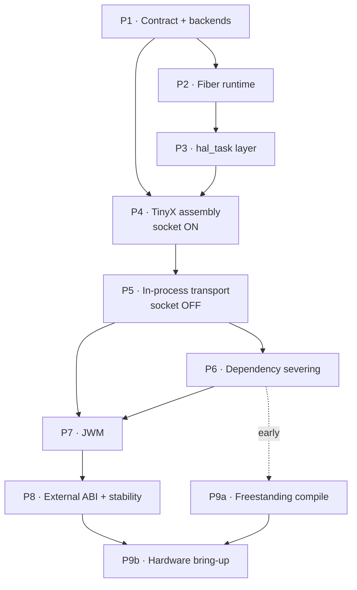

# 40 — Implementation Plan

## 1. Purpose

This document is **the order of work**: nine phases, each with a concrete scope, a deliverable list, and a Definition of Done that is *runnable*, not
merely compilable. It is the first deliverable of workstream 5 ([`00-introduction.md`](00-introduction.md) §5.5) and it is the document to read when the
question is "what do I do next?".

### 1.1 Governing rules

| # | Rule |
|---|---|
| **1** | **No phase starts until the previous phase's DoD is green.** Not "mostly working". Green |
| **2** | **Every DoD is observable.** A human can run one command and see pass or fail. "It compiles" is never sufficient on its own |
| **3** | **Build bottom‑up.** Substrate before server, server before clients, in‑process before external, host before target |
| **4** | **Prove the assembly before replacing the transport.** P4 brings the server up with no client at all; P5 introduces the first one. Conflating the two is the single most likely way to lose a month |
| **5** | **The gated profile is `host-pure`.** It is the same source configuration as `target` |

### 1.2 Phase overview

| Phase | Name | Primary risk it retires | Lead module |
|---:|---|---|---|
| P1 | Platform contract + display/input backends | "Is the HAL boundary right?" | [`43-`](43-kdrive-module-plan.md) |
| P2 | Fiber runtime, hosted port | "Does cooperative scheduling actually work?" | [`44-`](44-framework-module-plan.md) |
| P3 | `hal_task_*` layer | "Can components wait without an OS?" | [`44-`](44-framework-module-plan.md) |
| P4 | TinyX whole‑stack assembly (socket path ON) | "Can 165 kLOC of upstream code be linked and made to render?" | [`42-`](42-tinyx-module-plan.md) |
| P5 | In‑process transport (socket path OFF) | "Can the transport be replaced?" | [`42-`](42-tinyx-module-plan.md) + [`44-`](44-framework-module-plan.md) |
| P6 | Linux dependency severing | "Is the OS coupling actually gone?" | all four |
| P7 | JWM integration | "Does a real window manager work in this model?" | [`45-`](45-jwm-module-plan.md) |
| P8 | External ABI + stability | "Can a separate binary use it? Does it survive an hour?" | [`44-`](44-framework-module-plan.md) |
| P9 | Freestanding target build | "Does it compile and run with no OS?" | [`43-`](43-kdrive-module-plan.md) + [`44-`](44-framework-module-plan.md) |

Mapping to the other workstreams' phase names: [`11-portability-plan.md`](11-portability-plan.md)'s Q2+Q3 = P1, Q1 = P4, Q4 = P5, Q5 = P6, Q6 = P9.
[`30-host-build.md`](30-host-build.md)'s B1–B4 = P1–P3, B5 = P4, B6–B7 = P5, B8 = P7, B9 = P8.

### 1.3 Per‑module views

This document is organised **by phase**, because phases are how the project is gated. Teams work **by module**, so the same plan is also published as four
module documents. They contain no new decisions: each is the slice of this document that lands in one tree, plus that module's interfaces, risks and
budget.

| Module | Document | Owns | Phases it leads |
|---|---|---|---|
| TinyX | [`42-tinyx-module-plan.md`](42-tinyx-module-plan.md) | `tinyx/` above the DDX — `dix`, `mi`, `fb`, `miext`, extensions, all of `os/` | **P4, P5 (server half)**, P6 |
| KDrive + backends | [`43-kdrive-module-plan.md`](43-kdrive-module-plan.md) | The platform contract, `tinyx/kdrive/`, `linux_hosted/` and `<target>_native/` device ports | **P1, P9 (port)** |
| Framework | [`44-framework-module-plan.md`](44-framework-module-plan.md) | `framework/`, `libX11/`, the fiber ports, the external ABI, the boot host | **P2, P3, P5 (client half), P8** |
| JWM | [`45-jwm-module-plan.md`](45-jwm-module-plan.md) | `jwm/` and its glue | **P7** |

**The numbering is not a work order.** Bring‑up runs bottom‑up — [`43-`](43-kdrive-module-plan.md) and [`44-`](44-framework-module-plan.md) first
(P1–P3), then [`42-`](42-tinyx-module-plan.md) (P4–P6), then [`45-`](45-jwm-module-plan.md) (P7). §11's dependency graph is the authority.

**Where the two views disagree, this document wins.** A module document that contradicts a Definition of Done here is a defect in the module document.

## 2. Phase P1 — Platform Contract and Backends

**Goal:** Establish the boundary everything else sits on, and make the DDX platform‑agnostic.

### 2.1 Scope

| Item | Deliverable |
|---|---|
| Top‑level `CMakeLists.txt`, profiles, SDL discovery | [`30-`](30-host-build.md) §4.1–§4.2, §5 |
| The five contract headers | [`12-`](12-platform-contract.md) §4–§8 |
| SDL adapters: `hal_display_sdl.c`, `hal_input_sdl.c`, `hal_time_hosted.c` | [`12-`](12-platform-contract.md) §10 |
| `hal_mock.c` — a null backend for link isolation | New |
| Re‑point the four DDX files at `hal_*.h` | [`11-`](11-portability-plan.md) §6 |
| Close DDX defects D1–D6 | [`01-`](01-component-inventory.md) §6.3 |
| Delete `-D_USE_LINUX` | [`10-`](10-os-dependency-census.md) §8 |
| `wmb_hal_smoke` test executable | New |

### 2.2 Definition of Done

- [ ] `cmake -B build -DWMB_PROFILE=host-pure` configures on a machine with system `libsdl2-dev` and **no** `WMB_SDL_ROOT` set.
- [ ] All four profiles configure.
- [ ] Each of the five contract headers compiles standalone under `-ffreestanding -nostdinc` with only `<stdint.h>`, `<stddef.h>`, `<stdbool.h>`.
- [ ] `wmb_hal_smoke` draws a colour gradient through `hal_display_get_fb()->pixels` and `hal_display_flush()`; **it is visible in an SDL window**.
- [ ] Pressing keys and moving the mouse prints the correct `HAL_CMD_*` byte pairs.
- [ ] `grep -rl 'SDL\|sdl_\|hal_drivers\.h' tinyx/` is empty.
- [ ] The DDX object files link against `hal_mock.o` with **no SDL on the link line**.
- [ ] Mouse defects: wheel produces buttons 4/5/6/7; button release is tracked; `dx`/`dy` are initialised; `hal_input_init` is called.

### 2.3 Why first

Because every later phase depends on the boundary, and because a boundary that is wrong is cheapest to fix before 165 kLOC sits on top of it. The
mock‑backend link test is the phase's real value: it proves the DDX is genuinely decoupled rather than merely appearing to be.

## 3. Phase P2 — Fiber Runtime

**Goal:** Make `framework/fiber/` actually run.

### 3.1 Scope

| Item | Deliverable |
|---|---|
| ~~Vendor libucontext~~ | **DONE** — superseded by `linux_hosted/fiber_linux/`, which builds against a system libucontext when one is present and falls back to glibc `<ucontext.h>` when it is not. No vendored tree ([`90-`](90-decisions.md) D‑11 reopens only if the fallback bites) |
| ~~`fiber_port_hosted.c`~~ | **DONE** — `linux_hosted/fiber_linux/fiber_port.c` + `fiber_linux.cmake`, exercised by `linux_hosted/sdl_fiber_example_v2` |
| ~~`hosted_timer.c` — the one `pthread`~~ | **DEFERRED** — [`90-`](90-decisions.md) D‑47 |
| ~~`hosted_intr.c` — signal‑based deferred switch~~ | **DEFERRED** — D‑47 |
| ~~**R1** — SPSC input rings~~ | **DONE** — `buffer.c` locks wired to `fiber_critical_enter/exit` under `USE_FIBER`; gate V‑P2‑8 |
| **R2** — overflow drops a whole pair (defect D7) | D‑47 §D‑47.3; gate V‑P2‑9 |
| **R3** — damage union made atomic | D‑47 §D‑47.3 |
| `hosted_stack.c` — `mmap` + guard page | [`30-`](30-host-build.md) §6.4 |
| Hosted overrides in `fiber_config.h` | [`12-`](12-platform-contract.md) §6.4 |
| `fiber.cmake` conditional arch sources | — |
| ASan fiber annotations | [`30-`](30-host-build.md) §8 |
| `wmb_fiber_smoke` | New |

### 3.2 Definition of Done

- [ ] Two fibers ping‑pong via `fiber_yield()` 100,000 times, completing in < 100 ms, with no crash.
- [ ] ~~A fiber in a tight loop with no yield is preempted within 2× the tick period (the safety net works).~~ **Deferred** — [`90-`](90-decisions.md) D‑47.
- [ ] `fiber_mutex_t` and `fiber_cond_t` work between fibers.
- [ ] A deliberate stack overflow produces an immediate SIGSEGV on the guard page, not silent corruption.
- [ ] Valgrind clean, with the context‑switch suppression file matching whichever `ucontext` implementation the build selected.
- [ ] ASan runs without false positives on context switches.
- [ ] ~~`ps -o nlwp` shows exactly **2** threads (main + tick).~~ Shows **1** while D‑47 holds.
- [ ] **R1/R2/R3 are green** (V‑P2‑8, V‑P2‑9, review) — the preconditions that make arming the tick safe later.

### 3.3 Notes

The existing `fiber_config.h` defaults (`FIBER_MAX` 8, `FIBER_DEFAULT_STACK` 2048) are microcontroller‑sized. The hosted overrides are not optional — a 2
KB stack will not survive a single call into `tinyx/fb/`.

**Preemption is deliberately out of scope for P2** (D‑47). Doing R1–R3 here rather than at the moment the tick is armed is the whole point: they are cheap
while the data races are unreachable, and they are a debugging exercise afterwards. R2 in particular (defect D7) is a live bug today — a full input ring
desynchronises the decoder permanently, with or without a tick.

## 4. Phase P3 — `hal_task_*` Layer

**Goal:** Give the rest of WMB a way to wait that is not an OS call.

### 4.1 Scope

| Item | Deliverable |
|---|---|
| `hal_task_hosted.c` | [`12-`](12-platform-contract.md) §6.3 |
| `hal_time_hosted.c` | [`12-`](12-platform-contract.md) §7 |
| `wmb_boot.c` skeleton (host: heap, runtime, `wmb_main()`) | [`31-`](31-target-build.md) §9, [`90-`](90-decisions.md) D‑42 |
| `wmb_task_smoke` | New |

### 4.2 Definition of Done

- [ ] `hal_task_create` spawns named fibers with the requested stack size.
- [ ] `hal_yield_timeout(50)` returns **0** after 50 ± 5 ms.
- [ ] `hal_yield_timeout(200)` returns **1** immediately when another fiber calls `hal_task_wake` on it.
- [ ] A `hal_task_wake` issued **before** the matching `hal_task_wait` is not lost.
- [ ] `hal_tick_ms()` is monotonic over a 60‑second run, with no backward step.
- [ ] Producer/consumer across three fibers runs 10,000 iterations with no lost wakeups.
- [ ] No `pthread_*` symbol referenced from anything except `hosted_timer.o`.

### 4.3 Why this is a separate phase

`hal_yield_timeout` is the primitive that replaces `select()` in three different places (TinyX, JWM, and the client transport). Every one of them will be
debugged against its semantics. Getting the lost‑wakeup case wrong here produces intermittent hangs at P5, P7 and P9 that look like different bugs.

## 5. Phase P4 — TinyX Whole‑Stack Assembly

**Goal:** Link and run the whole X server, with its own socket transport intact, and prove it renders.

### 5.1 Scope

| Item | Deliverable |
|---|---|
| `cmake/WmbModules.cmake` — all module groups | [`30-`](30-host-build.md) §4.3 |
| Reference `configure` run → `docs/reference/*.reference.h` | [`90-`](90-decisions.md) D‑37 |
| `dix-config.h.in` / `kdrive-config.h.in`, curated against the reference | [`30-`](30-host-build.md) §4.6, [`91-`](91-open-questions.md) Q2 |
| **C1 audit** — do `osdep.h`'s fd bitsets leak into `dix/`? → `docs/c1-fd-bitset-audit.md` | [`91-`](91-open-questions.md) Q14 |
| Exclusion freeze (portability Q1) | [`11-`](11-portability-plan.md) §4 |
| `excluded_stubs_wmb.c` | [`11-`](11-portability-plan.md) §4.2 |
| `dix/main.c` guard → `TinyX_ServerFiber` | [`11-`](11-portability-plan.md) §8.1 |
| `miinitext.c` guard for excluded extensions (SHM, BIGFONT, DBE) | [`11-`](11-portability-plan.md) §8.1, [`90-`](90-decisions.md) D‑41 |
| `tima_WaitForEvents()` wired to `hal_yield_timeout` | DDX defect D5 |

### 5.1.1 Why the C1 audit lives here

[`91-`](91-open-questions.md) Q14 is *due* in P5, but the code it governs — `waitfor_wmb.c` and `io_wmb.c` — is *written* in P5. An audit that runs
concurrently with the code it is meant to inform is not an audit. It runs in P4, where the whole stack is compiling and every hit can be traced against a
build that works, and P5 starts with the answer in hand.

It is a day of grepping `dix/` and `tinyx/include/` for `fd_set`, `FD_SET`, `XFD_`, `ClientsWithInput`, `AllSockets` and `MaxClients`, and classifying each
hit as transport‑only (safe), typedef‑only (guardable) or a genuine `dix/` dependency. The last category is the one that matters: it would mean
`OsCommRec`'s `fd` field is not reducible to a synthetic index, and the P5 stub plan needs rethinking before, not after, it is implemented.

### 5.2 Definition of Done

Profile: **`host-pure`** — there is no socket profile ([`90-`](90-decisions.md) D‑49).

- [ ] `wmb_host` links with **zero** unresolved symbols.
- [ ] No file from the exclusion ledger appears in any CMake source list (verified by script).
- [ ] The server fiber reaches `Dispatch()` and idles at **< 5 % CPU** (not spinning).
- [ ] An SDL window opens showing the X root window.
- [ ] The server logs its screen geometry, depth, visual list and registered extension list at startup, and they match the expected values.
- [ ] That logged extension list contains no `DOUBLE-BUFFER`, `MIT-SHM`, `XFree86-Bigfont` or `XKEYBOARD` — the four that D‑25, D‑39 and D‑41 exclude.
- [ ] `docs/c1-fd-bitset-audit.md` exists, every hit is classified, and no hit is classified as a genuine `dix/` dependency — or, if one is, P5's scope is
  revised **before** P5 starts.
- [ ] The curated config templates differ from `docs/reference/*.reference.h` only in ways that have a one‑line justification.

### 5.3 Why there is no oracle, and what replaces it

This phase answers *one* question: **was the server assembled correctly?** The original plan answered it with stock X clients over a socket — an
independent oracle, written against the specification rather than against our code. D‑49 retired that profile as out of scope, so the separation now comes
from **staging** instead:

| Phase | Proves | Client involved |
|---|---|---|
| P4 | The stack links, initialises every screen and extension, reaches `Dispatch()`, and paints a root window | none |
| P5 | The transport carries a request, a reply, an event and an error | `wmb_test_client` |

The consequence to plan for: a P5 failure has two candidate causes. The debugging order is therefore fixed — **re‑run P4's root‑window gate first**. If the
root window still paints, `dix`/`mi`/`fb`/DDX are intact and the fault is in the transport.

### 5.4 Expected difficulty

This is the longest phase and the one most likely to overrun. Anticipated problems, in order of likelihood:

1. **`dix-config.h` macro set is wrong.** Missing `RENDER`, `RANDR`, `XFIXES` etc. produces "undefined reference to `PictureInit`". Curate against a
   reference `configure` run; do not guess and do not copy ([`90-`](90-decisions.md) D‑37, [`91-`](91-open-questions.md) Q2).
2. **Extension registration order.** `miinitext.c` has ordering constraints — RENDER before DAMAGE, etc.
3. **Missing stub symbols from excluded files.** Handled by `excluded_stubs_wmb.c`, but the list will grow during this phase.
4. **`main()` ownership.** `dix/main.c` and any SDL example `main` will collide. [`90-`](90-decisions.md) D‑07.
5. **`HAVE_CONFIG_H` enabling code paths that were previously dark.** The current build deliberately leaves it off.

## 6. Phase P5 — In‑Process Transport

**Goal:** Replace the socket transport and prove the target code path with zero sockets.

### 6.1 Scope

| Item | Deliverable |
|---|---|
| Dispatch protocol proof of concept | [`21-`](21-inprocess-transport.md) §11 — **DONE**, `linux_hosted/sdl_fiber_example_v2` |
| `wmb_queue.c` — slots, ready mask, client slots | [`21-`](21-inprocess-transport.md) §5.1, §5.3 |
| `connection_wmb.c` | [`21-`](21-inprocess-transport.md) §5.2, §5.7 |
| `waitfor_wmb.c` | [`21-`](21-inprocess-transport.md) §5.6 |
| `io_wmb.c` | [`21-`](21-inprocess-transport.md) §5.4, §5.5 |
| `wmb_open.c`, `wmb_close.c`, `wmb_setup.c` | [`21-`](21-inprocess-transport.md) §3.2, §3.3 |
| `wmb_transport.c` — the 13 symbols | [`21-`](21-inprocess-transport.md) §3.4 |
| `Xlibint.h` `Data()` macro edit | [`21-`](21-inprocess-transport.md) §3.5 |
| `apps/wmb_test_client/` | [`01-`](01-component-inventory.md) §11.2 |
| Debug aids: request trace, reply timeout, buffer poison | [`30-`](30-host-build.md) §8 |

### 6.2 Implementation order within P5

**Precondition:** the C1 audit (§5.1) is complete. `waitfor_wmb.c` and `io_wmb.c` must not be written against an assumption about where the fd bitsets
reach.

Follow [`21-inprocess-transport.md`](21-inprocess-transport.md) §10. The critical early milestone is **step 4**: dispatching a hand‑built `X_NoOperation`
request through `io_wmb.c` into `ProcNoOperation`. That requires no Xlib at all — a 4‑byte buffer and a `ClientRec` — and it is the cheapest possible
end‑to‑end proof that the substitution works.

The handshake those steps are built on no longer has to be discovered here: [`21-`](21-inprocess-transport.md) §11 records a running proof of concept of
§4.1's dispatch, §5.6's server loop and §2.1's queue (gate V‑P5‑0). P5 supplies the X11 half — replies, events, errors, grabs — not the protocol between the
two fibers.

### 6.3 Definition of Done

Profile: **`host-pure`** (no listener, no `WMB_HAS_OS_TRANSPORT`).

- [ ] `wmb_host` links; `strace -f -e trace=network,select,poll` produces **no output**.
- [ ] `lsof -p $(pidof wmb_host)` shows **no socket**.
- [ ] The server idles at < 5 % CPU.
- [ ] `KdOsFuncs.pollEvents` is called at **≥ 30 Hz** (instrumented counter) — this is the `BlockHandler` preservation check.
- [ ] A synthetic key event injected at the backend reaches a client's event queue.
- [ ] `wmb_test_client` prints **six PASS lines**: open display, create window, map, receive Expose, fill rectangle + draw string, close.
- [ ] The resulting window — white, with a black rectangle and the text "WMB TEST OK" — is **visible in the SDL window**.
- [ ] `XGetWindowAttributes` returns correct data (the reply path).
- [ ] A deliberate `BadWindow` reaches an installed `XSetErrorHandler`.
- [ ] **Differential test**: for ten representative API calls, the bytes in `dpy->buffer` before dispatch are byte‑identical to a checked‑in golden capture
  of the same calls made by stock Xlib.
- [ ] Valgrind clean.

### 6.4 The differential test

Gate T5 from [`20-`](20-transport-inventory.md) §8, and the highest‑value single test in the project. Method:

```
offline, once:  xtrace -d :0 -- ./ref_client          → golden byte stream, checked in
host-pure:      WMB_DEBUG_TRACE_REQUESTS=1 ./wmb_host  → dpy->buffer hexdump per request
diff against the golden file
```

The reference is captured against **any** system X server on the development machine, so it needs no WMB profile with a socket ([`90-`](90-decisions.md)
D‑49). Checking it in also makes the comparison reproducible on a machine with no X server at all.

It catches the two failure modes [`21-`](21-inprocess-transport.md) predicts (R1 multi‑part reply misclassification, R2 buffer reallocation invalidating a
live `xReq*`) at the point where they are cheap to fix.

## 7. Phase P6 — Linux Dependency Severing

**Goal:** Apply the guards, close the census, and make the portability claim verifiable.

### 7.1 Scope

Portability phase Q5. The 13 guarded files from [`11-`](11-portability-plan.md) §8, plus the patch manifest.

### 7.2 Definition of Done

- [ ] All 13 guards applied; the patch manifest is complete and matches.
- [ ] Every patch applies cleanly to a pristine upstream checkout (`git apply --check`).
- [ ] Only the five sanctioned guard macros appear in upstream files.
- [ ] Patch budget respected: `tinyx` ≤ 8, `libX11` ≤ 3, `jwm` ≤ 4.
- [ ] `host-pure` still passes every P5 gate after the guards are applied.
- [ ] `grep -rl 'include *<sys/\|include *<linux/\|include *<netinet/\|include *<pthread\.h>\|include *<dlfcn\.h>' <the compiled file set>` is empty.
- [ ] `nm --undefined-only wmb_host | grep -E 'socket|bind|listen|accept|connect|select|poll|readv|writev|fcntl|sigaction|fork|execve|waitpid'` is empty.
- [ ] `grep -rl "SDL" tinyx/ libX11/ jwm/` is empty.
- [ ] **Rule L7**: `libtinyx.a`, `libx11_wmb.a` and `libjwm.a` link against contract stubs plus the runtime substrate with **no backend and no
  `wmb_boot.o`** — the detachability check ([`90-`](90-decisions.md) D‑42). Extended to `libwmb_api.a` at P8.

### 7.3 Note

P6 is placed after P5 rather than before because a guard applied to code that has never been compiled is a guess. Once `host-pure` runs, each guard can be
applied and immediately re‑verified against a working system.

## 8. Phase P7 — JWM Integration

**Goal:** A real window manager, running as an internal client, managing real windows.

### 8.1 Scope

| Item | Deliverable |
|---|---|
| `jwm/CMakeLists.txt` with all optional libraries off | [`01-`](01-component-inventory.md) §11.1 |
| `jwm_namespace.h` (injected with `-include`) | Renames `main`→`Jwm_Main`, `getenv`, TZ helpers |
| `jwm_entry.c` — `Jwm_FiberEntry` | New |
| `jwm.h` POSIX include guard | [`11-`](11-portability-plan.md) §8.3 |
| `event.c` cooperative loop | [`11-`](11-portability-plan.md) §8.3 |
| `command.c` → `wmb_app_table` | [`11-`](11-portability-plan.md) §8.3 |
| Hard‑coded JWM configuration | New |
| Server‑readiness gate inside `wmb_main()`: all fibers created blocked, clients released on ready | [`90-`](90-decisions.md) D‑33, D‑43 |

### 8.2 Definition of Done

- [ ] `libjwm.a` links with no duplicate `T` symbols and no undefined `fork`/`execv`/`waitpid`/`sigaction`/`select`.
- [ ] JWM's root window appears within 200 ms of boot.
- [ ] `wmb_test_client`'s window appears **with JWM decorations**.
- [ ] The window can be **moved** by dragging its title bar.
- [ ] The window can be **resized** by dragging a corner.
- [ ] The root menu opens on a right‑click and its items are selectable.
- [ ] Two client windows coexist; focus follows the click; stacking order is correct.
- [ ] **`XGrabServer` works**: while JWM holds a grab, the other client is not serviced (gate T4).
- [ ] JWM's periodic callbacks (`Jwm_Signal`) fire at the expected cadence without busy‑spinning.
- [ ] No fiber starves: with three fibers running, each gets scheduled within 50 ms.

### 8.3 Note on the grab test

`XGrabServer` is easy to leave as a no‑op and hard to notice is broken — it manifests as intermittent decoration corruption. The explicit two‑client gate
exists because [`21-`](21-inprocess-transport.md) §5.7 is otherwise likely to be skipped.

## 9. Phase P8 — External ABI and Stability

**Goal:** Prove the external application story, and prove the system survives.

### 9.1 Scope

| Item | Deliverable |
|---|---|
| `framework/wmb_api/api.def` + generator | [`22-`](22-entry-point-abi.md) §5.1 |
| `wmb_api.h`, `wmb_api_table.c` | [`22-`](22-entry-point-abi.md) §3, §4.1 |
| **A5 enumeration** — generate the exhaustive list of `Display`‑dereferencing macros from `X11/Xlib.h` → `docs/xlib-display-macros.txt` | [`91-`](91-open-questions.md) Q20 |
| `wrapper/libX11-app/` + macro compat header, driven by that list | [`22-`](22-entry-point-abi.md) §5 |
| `wmb_bridge.c` (host validation scaffold) | [`22-`](22-entry-point-abi.md) §6 |
| MPSC producer side on the request queue + polled server‑wake mailbox | [`22-`](22-entry-point-abi.md) §7 E4, [`90-`](90-decisions.md) D‑44 |
| `apps/wmb_hello/` | [`01-`](01-component-inventory.md) §11.2 |
| Heap and stack instrumentation, **tagged as WMB's** rather than whole‑heap | [`40-`](40-implementation-plan.md) §13.3 step 4 |

### 9.1.1 The A5 enumeration is generated, not typed

`DefaultScreen`, `RootWindow`, `BlackPixel`, `DisplayWidth`, `ScreenCount`, `NextRequest`, `ConnectionNumber` and their `*OfScreen` variants all expand to
a dereference of a `Display` or `Screen` struct that the wrapper does not have. Missing one does not fail to compile — it segfaults at first use, in an
application we did not write.

So the list is extracted mechanically from `X11/Xlib.h` (every macro whose expansion mentions its `Display` or `Screen` parameter), checked in as
`docs/xlib-display-macros.txt`, and regenerated in CI so that an upstream header change appears as a diff rather than as a field report.

### 9.2 Definition of Done

- [ ] `wmb_api.h`, `wrappers.c` and the slot count are all generated from `api.def`; regeneration produces no diff.
- [ ] `docs/xlib-display-macros.txt` is generated, checked in, and regeneration produces no diff.
- [ ] A test translation unit that **uses every macro in that list** compiles against the wrapper's compatibility header and produces no reference to any
  `Display` or `Screen` field — in the wrapper, both types are opaque.
- [ ] `libX11-app.a` is **< 16 KB** and exports only the wrapper entry points plus `wmb_bind`.
- [ ] `wmb_hello`, a separate process linking only the wrapper, produces a **visible, JWM‑decorated window** over the bridge.
- [ ] An application built against ABI v1 runs against a v2 WMB.
- [ ] **Re‑entrancy**: two bridge clients posting from two OS threads, with the threads deliberately preempting each other, produce correct results and
  lose no requests — the E4 guard. The contention is on the queue and the wake, not on `dix`, which the server fiber still serialises. This is the only
  test in the project that deliberately uses threads, and it tests the boundary, not WMB.
- [ ] **Leak test**: 10,000 window create/destroy cycles leave the heap high‑water mark flat.
- [ ] The high‑water mark is attributed to **WMB**, not to the whole heap — so the gate survives a second tenant appearing later (§13.3 step 4).
- [ ] **Stability**: a one‑hour run with scripted continuous input shows a flat heap high‑water mark, no fiber canary trip, and no fiber starvation.
- [ ] Stack high‑water marks are measured for every fiber and recorded — these become the target's static stack sizes.

### 9.3 Why the measurements matter

[`31-target-build.md`](31-target-build.md) §5.2 and §8.1 both currently carry *estimates*. P8 replaces them with measurements. Sizing a target's static
stacks and heap from an estimate is how embedded projects run out of memory in the field.

## 10. Phase P9 — Freestanding Target Build

**Goal:** Prove the "no OS" claim.

### 10.1 Scope

| Item | Deliverable |
|---|---|
| Toolchain file | [`31-`](31-target-build.md) §6.1 |
| `<target>_native/system_<target>/` — the four primitives | [`31-`](31-target-build.md) §4.3–§4.5 |
| `<target>_native/display_<target>/` + `input_<target>/` | [`31-`](31-target-build.md) §4.1–§4.2 |
| `<target>_native/fiber_<target>/` | [`31-`](31-target-build.md) §5.1 |
| Static fiber stacks, sized from P8 measurements | [`31-`](31-target-build.md) §5.2 |
| Built‑in font | [`31-`](31-target-build.md) §7 |
| Linker script + `.wmb_api` placement | [`22-`](22-entry-point-abi.md) §4.1 |
| `docs/floor-symbols.txt` | [`11-`](11-portability-plan.md) §9.3 |

### 10.2 Definition of Done

- [ ] Every translation unit compiles with `-ffreestanding -fno-builtin -fno-pic`.
- [ ] The link references nothing outside `docs/floor-symbols.txt`.
- [ ] No forbidden symbol: `socket`, `select`, `poll`, `fork`, `exec*`, `sigaction`, `getenv`, `fopen`, `dlopen`, `pthread_*`.
- [ ] Exactly one `main`, from `wmb_boot.o`.
- [ ] `readelf -r` shows no dynamic relocations.
- [ ] `.wmb_api` is at offset 0 and `WMB_API_ADDRESS == WMB_LOAD_BASE`.
- [ ] The image fits the memory budget.
- [ ] **On hardware**: boot to a JWM root window; `wmb_test_client` runs; keyboard and mouse work.
- [ ] One‑hour run on hardware: flat heap, no canary trip.

### 10.3 Splitting P9

If target hardware is not available, P9 splits cleanly:

| Sub‑phase | Requires hardware | Gates |
|---|---|---|
| **P9a — freestanding compile** | No | All gates except the last two. Can be done with any cross toolchain, linking against a stub backend |
| **P9b — hardware bring‑up** | Yes | The last two |

**P9a is worth doing as soon as P6 is green**, out of order, because it surfaces libc floor surprises ([`11-`](11-portability-plan.md) R6) while there is
still time to absorb them. Running it early against a stub backend costs little and de‑risks a lot.

## 11. Dependency Graph



## 12. Deliverable Index by Phase

| Phase | New files | Modified upstream files | ~New LOC |
|---:|---:|---:|---:|
| P1 | 11 | 4 (DDX, ours) | 900 |
| P2 | 3 | 3 (fiber, ours) | 300 |
| P3 | 3 | 0 | 350 |
| P4 | 4 | 3 (`dix/main.c`, `miinitext.c`, config templates) | 400 |
| P5 | 8 | 1 (`Xlibint.h`) | 1,100 |
| P6 | 0 | 13 total (cumulative) | 150 |
| P7 | 4 | 3 (jwm) | 400 |
| P8 | 7 | 0 | 700 |
| P9 | 8 | 0 | 900 |
| **Total** | **~48** | **13** | **~5,200** |

Roughly **5,200 lines of new code and 13 guarded upstream files** to turn four independent source trees into one OS‑free windowing system. The number is
small because the strategy is substitution, not rewriting.

## 13. Detachment — Deferred, but Specified

Everything above builds **one executable**: `wmb_host` = `wmb_boot.c` + framework + windowing set + backend. That is the right shape for now, and it is the
only configuration built or tested ([`90-`](90-decisions.md) D‑42).

It is not the end shape. When the system grows, WMB becomes one component among several and `framework/` becomes shared infrastructure that other
components use directly. This section is the procedure for getting there. It is written **now**, while the boundaries are cheap to hold, and executed
later — that ordering is the entire point.

### 13.1 Trigger

Any one of:

- A second component needs to run in the same image.
- The windowing set needs to be lifted into another project.
- Something outside WMB needs fibers, the heap or a ring buffer.

### 13.2 From and to

| | Now (integrated) | After (detached) |
|---|---|---|
| Artefacts | one executable, `wmb_host` | `libwmb_framework.a`, `libwmb.a`, a per‑system host |
| `main()` | `wmb_boot.c`, linked in | The system's, wherever that lives |
| Fiber table | WMB's alone | Shared; WMB reserves a budget |
| Heap | WMB's alone | Shared; WMB's usage separately accounted |
| Platform contract | Backend implements it for WMB | Unchanged — this is why it exists |

The library decomposition already anticipates this. `libwmb_runtime.a` ([`30-`](30-host-build.md) §4.4) is `framework/fiber/` + heap + buffer and nothing
else. **Detachment is mostly a matter of not having broken it.**

### 13.3 The procedure

| # | Step | Done when |
|---|---|---|
| 1 | **Fix the framework's public surface.** `fiber.h`, `hal_task.h`, `heap.h`, `buffer.h` are the API; everything else under `framework/fiber/` and `framework/library/` becomes private | The windowing set compiles with only the public headers on the include path |
| 2 | **Extract the host.** `wmb_boot.c` moves to `host/` and belongs to no `libwmb*.a` | `nm libwmb.a \| grep ' T main$'` is empty |
| 3 | **Stop assuming WMB initialises the runtime.** `wmb_main()` must not call `heap_init` or `fiber_runtime_init` — the host does that, possibly before WMB exists | `wmb_main()` succeeds against a runtime someone else brought up |
| 4 | **Account WMB's heap usage separately.** D‑29's high‑water gate measures *WMB's* footprint, which stops being "the whole heap" the moment a second tenant allocates | The leak gate still reports a flat **WMB** high‑water mark while another component allocates concurrently |
| 5 | **Declare a fiber budget.** `FIBER_MAX` is a compile‑time global; WMB must reserve its slots rather than assume the table is its own | `wmb_main()` fails cleanly and diagnosably when the host under‑provisioned |
| 6 | **Package.** `libwmb_framework.a` + `libwmb.a` + public headers + a one‑page manifest of what a host must supply | A build outside this tree links against them |
| 7 | **Prove it.** Add a trivial second component — a fiber that advances a counter and yields — running alongside WMB on the host | The UI still works, the counter advances, and neither starves the other |

Step 7 is the only one that proves anything. Steps 1–6 are preparation; without a real second tenant, "detachable" is an assertion. Steps 4 and 5 are the
two that are invisible until a second tenant exists, which is exactly why they are written down now.

### 13.4 What must hold continuously

Three checks keep this procedure near zero cost. They are cheap today and they are the difference between a week and a quarter:

| Rule | What it prevents | Gate |
|---|---|---|
| **L7** — the windowing set references only the contract, the ABI and the framework | `tinyx/` quietly calling into boot or the backend | S10 |
| **L8** — the framework references nothing above itself | The framework becoming WMB‑specific and therefore unshareable | S11 |
| **D‑42's lifecycle boundary** — WMB is entered through `wmb_main()`, never by owning `main()` | Step 2 becoming a refactor instead of a file move | Step 2's `nm` check, runnable today |

**L8 is the one most likely to be violated silently**, because it is violated by convenience: a WMB‑specific field added to `buffer.h`, a `#include` of a
WMB header in `heap.c`, an enum in `fiber_config.h` that names WMB's fibers. Each is a five‑minute change that costs a day to unpick.

### 13.5 What this procedure assumes about scheduling

Nothing that is not already settled. Whoever calls `wmb_main()` owns scheduling, before and after detachment ([`90-`](90-decisions.md) D‑44) — hosted it
is `wmb_boot.c`, detached it is the system's dispatcher. Steps 1–7 are unchanged either way, which is why detachment is a packaging exercise rather than a
redesign.

The one property the procedure must not lose is D‑44's boundary condition: a host may preempt WMB as a component, never within it. Step 7's second tenant
is the test that would expose a violation.

## 14. What to Do First

Concretely, the next three actions:

1. **Write the top‑level `CMakeLists.txt`, `cmake/WmbProfiles.cmake` and `cmake/FindLocalSDL2.cmake`.** Nothing can be built until the build exists, and
   the current `framework/CMakeLists.txt` hard‑codes an absolute SDL path that will not survive contact with a second machine.
2. **Write the five contract headers.** They are ~300 lines total, they are fully specified in [`12-platform-contract.md`](12-platform-contract.md), and
   every subsequent file includes one of them.
3. **Build `wmb_hal_smoke` and get a gradient on screen.** It is the first observable result, it validates the whole P1 boundary, and it takes a fraction
   of the effort of anything that follows.

Then P1's remaining items, in the order listed in §2.1.

All three are [`43-kdrive-module-plan.md`](43-kdrive-module-plan.md)'s and [`44-framework-module-plan.md`](44-framework-module-plan.md)'s. The other two
modules are not idle in the meantime: [`42-`](42-tinyx-module-plan.md) §11 has three items — the reference `configure` run, the C1 audit and the exclusion
ledger script — that need nothing from P1 and remove most of P4's uncertainty, and [`45-`](45-jwm-module-plan.md) §8 has three that need nothing from WMB
at all. Each module document ends with its own "what to do first".
