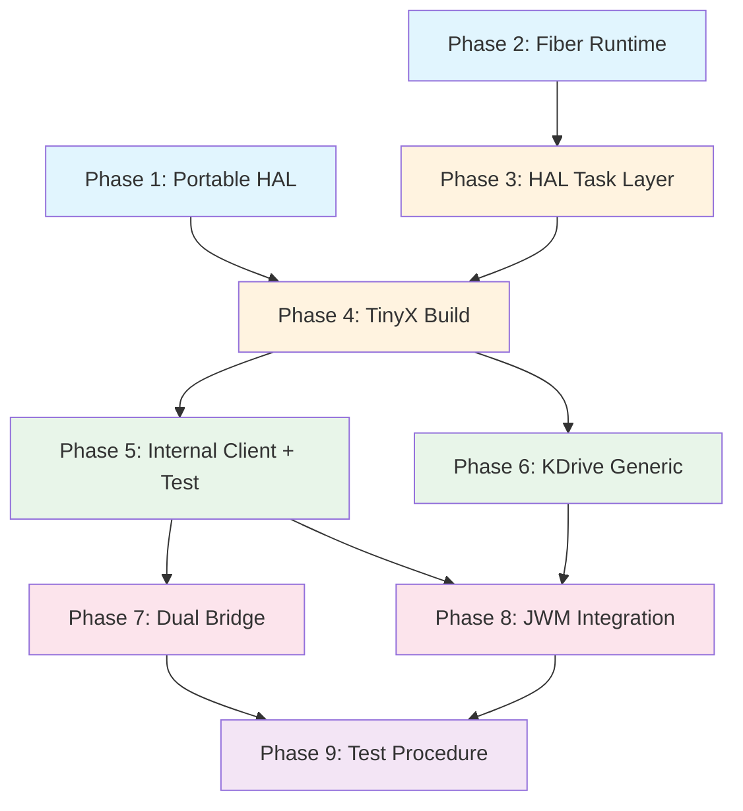

# WMB Implementation Plan — SDL + Fiber + Dual Bridge

**Status:** Active implementation plan
**Date:** 2026-06-01
**Scope:** Phased plan to bring TinyX + JWM to life on SDL using libucontext fibers, with portable abstractions and a dual-bridge test architecture.

---

## 0. Guiding Principles

1. **Portable-first:** Every component defines a platform-abstract interface. SDL is the *first* backend, not the *only* one.
2. **KDrive is generic:** The DDX/HAL adapter (`tinyx/kdrive/tima/`) talks to a portable framebuffer + input HAL — not to SDL directly.
3. **Linux-independent TinyX + JWM:** All Linux/POSIX dependencies in TinyX `os/` and JWM are wrapped in `WMB_HAS_OS_TRANSPORT` / `_USE_LINUX` guards. The same source tree compiles for both hosted (SDL) and target (Tima OS).
4. **Fiber is the runtime:** Single OS thread, cooperative scheduling via `hal_task_*` → fiber core → libucontext (hosted) or Tima primitives (target).
5. **Dual bridge for validation:** X11 socket bridge (stock apps) + WMB bridge (target-path apps) coexist for testing. Both are scaffolding — compiled out on target.
6. **Test-driven progression:** Each phase has a concrete DoD with a runnable test. No phase starts until the previous one passes.

---

## Phase 1: Portable Framebuffer + KDrive HAL (Foundation)

**Goal:** Define the portable display/input HAL that KDrive targets. SDL implements it; future platforms swap in their own backend.

### 1.1 Define Portable HAL Interface

Create `framework/library/hal_display.h`:

```c
/* Portable framebuffer interface — KDrive DDX targets this */
typedef struct {
    uint8_t  *pixels;       /* linear pixel buffer */
    uint32_t  width;
    uint32_t  height;
    uint32_t  stride;       /* bytes per row */
    uint8_t   bpp;          /* bits per pixel (16 or 32) */
} hal_framebuffer_t;

int   hal_display_init(uint32_t width, uint32_t height, uint8_t bpp);
hal_framebuffer_t *hal_display_get_fb(void);
void  hal_display_flush(const hal_framebuffer_t *fb, int x, int y, int w, int h);
void  hal_display_shutdown(void);
```

Create `framework/library/hal_input.h`:

```c
/* Portable input interface */
typedef enum { HAL_KEY_PRESS, HAL_KEY_RELEASE } hal_key_action_t;
typedef struct { int dx; int dy; uint32_t buttons; int wheel; } hal_mouse_state_t;

int   hal_input_init(void);
int   hal_input_poll_key(uint8_t *keycode, hal_key_action_t *action);
int   hal_input_poll_mouse(hal_mouse_state_t *state);
void  hal_input_shutdown(void);
```

### 1.2 SDL Backend (First Implementation)

Refactor existing `framework/sdl_drivers/` to implement the HAL interface:
- `framework/sdl_drivers/hal_display_sdl.c` — wraps SDL texture/window as a framebuffer
- `framework/sdl_drivers/hal_input_sdl.c` — wraps SDL event pump into key/mouse polling

The existing `lcd_driver.c`, `mouse_driver.c`, `keyraw_driver.c` become thin adapters or are replaced by the new HAL implementation.

### 1.3 Wire KDrive DDX to Portable HAL

Update `tinyx/kdrive/tima/tima_kdrive_fb.c`:
- `timaCardInit()` → `hal_display_init()` + `hal_display_get_fb()`
- Shadow update callback → `hal_display_flush()`
- Remove any direct SDL references from DDX files

### 1.4 Deliverables

| File | Purpose |
|------|---------|
| `framework/library/hal_display.h` | Portable framebuffer contract |
| `framework/library/hal_input.h` | Portable input contract |
| `framework/sdl_drivers/hal_display_sdl.c` | SDL framebuffer backend |
| `framework/sdl_drivers/hal_input_sdl.c` | SDL input backend |
| Updated `tima_kdrive_fb.c` | Uses `hal_display_*` instead of direct SDL |
| Updated `tima_kdrive_kbd.c` | Uses `hal_input_poll_key` |
| Updated `tima_kdrive_mouse.c` | Uses `hal_input_poll_mouse` + fix §7.3 bugs |

### 1.5 DoD

- KDrive DDX files compile with zero SDL includes — they only include `hal_display.h` / `hal_input.h`.
- SDL backend implements the HAL and connects to the existing SDL window.
- A stub `main()` can initialize display + draw a test pattern to the framebuffer → visible in SDL window.

---

## Phase 2: Fiber Runtime — Hosted Port with libucontext

**Goal:** Bring the proven fiber core online with a libucontext-based hosted port. Validate cooperative context switching.

### 2.1 Vendor libucontext

- Add `framework/third_party/libucontext/` (vendored source, built as STATIC lib).
- CMake: `add_library(libucontext STATIC ...)`, guard with `WMB_HOSTED`.

### 2.2 Create Hosted Port (`framework/fiber/arch/hosted/`)

| File | Implements |
|------|-----------|
| `fiber_port_hosted.c` | `fiber_port_init_stack` (via `libucontext_makecontext`), `fiber_port_request_switch`, `fiber_port_irq_lock/unlock` (via `sigprocmask`) |
| `hosted_timer.c` | Background tick thread (`clock_nanosleep` loop → `fiber_tick_isr`) |
| `hosted_intr.c` | POSIX signal dispatch for interrupt simulation |

### 2.3 `fiber_config.h` Overrides

```c
#ifdef WMB_HOSTED
#define FIBER_MAX                 16
#define FIBER_DEFAULT_STACK       (64*1024)
#define FIBER_DEFAULT_PREEMPTION_MS 10
#define FIBER_MUTEX_MAX           16
#define FIBER_COND_MAX            16
#define FIBER_HOSTED_MMAP_STACKS  1
#endif
```

### 2.4 Build Integration

Update `framework/fiber/fiber.cmake`:
- Conditional include of `arch/hosted/` sources when `WMB_HOSTED` is defined.
- Link `libucontext` and `pthread` (only for timer/irq threads).

### 2.5 Test: Ping-Pong Fibers

```c
/* test: two fibers yield back and forth 1000 times */
void fiber_a(void *arg) { for (int i=0; i<1000; i++) fiber_yield(); }
void fiber_b(void *arg) { for (int i=0; i<1000; i++) fiber_yield(); }
// Measure: completes without crash, <100ms total.
```

### 2.6 Deliverables

| File | Purpose |
|------|---------|
| `framework/third_party/libucontext/` | Vendored context-switch library |
| `framework/fiber/arch/hosted/fiber_port_hosted.c` | Port contract → libucontext |
| `framework/fiber/arch/hosted/hosted_timer.c` | Tick simulation |
| `framework/fiber/arch/hosted/hosted_intr.c` | Signal-based interrupt sim |
| Updated `fiber_config.h` | Hosted overrides |
| Updated `fiber.cmake` | Conditional arch sources |
| `tests/test_fiber_hosted.c` | Ping-pong + preemption test |

### 2.7 DoD

- Two fibers ping-pong via `fiber_yield()` — completes cleanly.
- A busy-loop fiber is preempted within 2× tick period (safety net test).
- `fiber_sync` mutex/cond work between hosted fibers.
- Valgrind clean.

---

## Phase 3: HAL Task Layer + Cooperative Scheduling

**Goal:** Build the `hal_task_*` surface that WMB code uses. Connect it to the fiber core.

### 3.1 Implement `hal_task.h` + `hal_task_hosted.c`

Per FIBER_PORTABLE_ARCHITECTURE §5:
- `hal_task_create` → `fiber_create` + name wrapper
- `hal_task_yield` → `fiber_yield`
- `hal_yield_timeout` → cooperative loop with tick-based elapsed check
- `hal_task_wait` / `hal_task_wake` → fiber block/unblock primitives

### 3.2 Implement `os_get_tick_ms()`

Hosted: `clock_gettime(CLOCK_MONOTONIC)` wrapped in `framework/library/hal_time_hosted.c`.

### 3.3 Test: Producer/Consumer with Timeout

```c
void producer(void *arg) {
    hal_yield_timeout(50);  // wait 50ms
    hal_task_wake(consumer_task);
}
void consumer(void *arg) {
    int woken = hal_yield_timeout(200);
    assert(woken == 1);  // should be woken before timeout
}
```

### 3.4 Deliverables

| File | Purpose |
|------|---------|
| `framework/library/hal_task.h` | Public HAL task API |
| `framework/library/hal_task_hosted.c` | Hosted impl (fiber wrapper) |
| `framework/library/hal_time_hosted.c` | `os_get_tick_ms` |
| `tests/test_hal_task.c` | Producer/consumer + timeout test |

### 3.5 DoD

- `hal_task_create` spawns fiber tasks.
- `hal_yield_timeout` returns 0 on timeout, 1 on explicit wake.
- `hal_task_wait/wake` correctly blocks and resumes tasks.
- No use of `pthread` in application logic — only in timer thread.

---

## Phase 4: TinyX Whole-Stack Build (Linux-Independent)

**Goal:** Assemble TinyX as module groups in CMake. Introduce `WMB_HAS_OS_TRANSPORT` guards. Server loop runs on a fiber.

### 4.1 CMake Module Assembly

Add TinyX source groups to `framework/CMakeLists.txt`:

```cmake
set(TINYX_DIX_SOURCES   ../tinyx/dix/main.c ../tinyx/dix/dispatch.c ...)
set(TINYX_OS_SOURCES    ../tinyx/os/connection.c ../tinyx/os/io.c ...)
set(TINYX_MI_SOURCES    ../tinyx/mi/...)
set(TINYX_FB_SOURCES    ../tinyx/fb/...)
set(TINYX_KDRIVE_SOURCES ../tinyx/kdrive/src/...)
set(TINYX_EXT_SOURCES   ../tinyx/Xext/... ../tinyx/render/... ...)
# Shadow, damage, randr, xfixes
```

### 4.2 Generate `dix-config.h` / `kdrive-config.h`

Create minimal hosted-profile config headers via CMake `configure_file()`. Enable `HAVE_CONFIG_H`.

### 4.3 Linux Dependency Guards

Apply `WMB_HAS_OS_TRANSPORT` guards (file-level) to:
- `tinyx/os/connection.c` — socket creation/accept
- `tinyx/os/WaitFor.c` — `select()` loop
- `tinyx/os/io.c` — Xtrans read/write
- Exclude `xstrans.c`, `xdmcp.c` from target build

Create target stubs:
- `tinyx/os/connection_wmb.c` — no-op socket functions
- `tinyx/os/waitfor_wmb.c` — `hal_yield_timeout` based
- `tinyx/os/io_wmb.c` — direct buffer read/write

### 4.4 TinyX Entry Point on Fiber

```c
void tinyx_server_main(void *arg) {
    /* Replaces dix/main.c main() — runs as a fiber */
    InitOutput(...);
    InitInput(...);
    /* DIX dispatch loop — uses hal_yield_timeout for WaitForSomething */
    Dispatch();
}
```

### 4.5 `tima_WaitForEvents()` Implementation

In `tima_kdrive_system.c`:
```c
void tima_WaitForEvents(int timeout_ms) {
    hal_yield_timeout(timeout_ms);
}
```

### 4.6 Deliverables

| File | Purpose |
|------|---------|
| Updated `framework/CMakeLists.txt` | TinyX module group assembly |
| `framework/dix-config.h.in` | Config template for hosted profile |
| `framework/kdrive-config.h.in` | KDrive config template |
| Guarded `tinyx/os/connection.c` | `WMB_HAS_OS_TRANSPORT` wrap |
| Guarded `tinyx/os/WaitFor.c` | `WMB_HAS_OS_TRANSPORT` wrap |
| Guarded `tinyx/os/io.c` | `WMB_HAS_OS_TRANSPORT` wrap |
| `tinyx/os/connection_wmb.c` | Target connection stubs |
| `tinyx/os/waitfor_wmb.c` | Target wait stubs |
| `tinyx/os/io_wmb.c` | Target I/O stubs |
| Updated `tima_kdrive_system.c` | `tima_WaitForEvents` → `hal_yield_timeout` |

### 4.7 DoD

- `wmb_tima_build` links with zero unresolved symbols.
- TinyX server fiber starts, initializes KDrive, opens SDL window.
- Server dispatch loop runs (idle, no clients yet).
- `WMB_HAS_OS_TRANSPORT` defined → X11 socket listener active, stock `xterm` can connect.
- `WMB_HAS_OS_TRANSPORT` undefined → compiles with stubs, no Linux socket headers required.
- Tima DDX mouse bugs (§7.3 of knowledge base) fixed.
- **Patch budget:** ≤ 3 modified upstream TinyX files (file-level guards only, upstream-safe).

---

## Phase 5: Internal Client Path + Dry-Test (Socketless)

**Goal:** Implement the libX11-wmb transport stubs. Validate with `wmb_test_client` running as a fiber — zero sockets.

### 5.1 libX11 Transport Stubs

Per XCB_STUB_ARCHITECTURE, implement in `framework/wmb_x11/`:
- `_XConnectXCB` → register as internal client, set `dpy->synchandler = wmb_sync_handler`
- `_XGetRequest` → allocate in `dpy->buffer`
- `_XReply` → block fiber until server deposits reply
- `_XRead`, `_XReadEvents` → read from internal event queue
- `_XSend`, `_XFlush` → no-op (SyncHandle triggers everything)
- `_XBufferOverflow` → realloc `dpy->buffer`

### 5.2 `wmb_sync_handler` Direct Dispatch

In `framework/wmb_x11/wmb_io.c`:
```c
int wmb_sync_handler(Display *dpy) {
    /* Push request to server queue */
    /* hal_task_wake(server_task) */
    /* hal_task_wait() — blocks client until reply ready */
    return 0;
}
```

### 5.3 TinyX Internal-Client Registration

Additive hook in TinyX — `NextAvailableClient()` extended to accept internal (non-socket) clients:
- `wmb_register_internal_client()` → creates `ClientPtr` without socket FD
- `WriteToClient` hook for internal clients → deposit into fiber-local reply buffer

### 5.4 `wmb_test_client` (Dry-Test App)

As specified in HOST_BUILD_DUAL_BRIDGE §9.2.2:
- Runs as fiber inside WMB
- Exercises: XOpenDisplay → XCreateSimpleWindow → XMapWindow → wait Expose → XFillRectangle → XDrawString → cleanup
- Prints PASS/FAIL for each step
- Window visible in SDL display

### 5.5 DoD

- `wmb_test_client` prints all-PASS for the 6-step sequence.
- A white window with black rectangle and "WMB TEST OK" text visible in SDL window.
- Runs with both bridges OFF (zero socket listeners).
- Valgrind clean.
- **This validates the exact target code path.**

---

## Phase 6: KDrive Generic Platform (SDL-First, Portable)

**Goal:** Ensure the KDrive DDX is fully platform-agnostic. Remove any lingering Linux/SDL assumptions from the KDrive layer.

### 6.1 Audit and Clean KDrive DDX

- `tima_kdrive_fb.c` — only calls `hal_display_*`, no platform includes
- `tima_kdrive_kbd.c` — only calls `hal_input_poll_key`, no platform includes
- `tima_kdrive_mouse.c` — only calls `hal_input_poll_mouse`, no platform includes
- `tima_kdrive_system.c` — only calls `hal_task_*` / `hal_yield_timeout`, no platform includes

### 6.2 Portable KdOsFuncs

```c
/* KdOsFuncs contract — all implemented via HAL */
KdOsFuncs timaOsFuncs = {
    .WaitForSomething = tima_WaitForEvents,  /* → hal_yield_timeout */
    .ScreenInit       = tima_ScreenInit,     /* → hal_display_init */
    .ScreenFini       = tima_ScreenFini,     /* → hal_display_shutdown */
};
```

### 6.3 HAL Pump as Fiber

The main loop (or a dedicated `WMB_TASK_HAL` fiber):
```c
void hal_pump_fiber(void *arg) {
    for (;;) {
        hal_input_sdl_pump();  /* SDL-specific: polls SDL events into HAL buffers */
        hal_yield_timeout(1);
    }
}
```

Only `hal_pump_fiber` knows about SDL. Everything above it is platform-agnostic.

### 6.4 DoD

- `grep -r "SDL\|sdl" tinyx/` returns zero results.
- `grep -r "SDL\|sdl" framework/library/` returns zero results (only in `sdl_drivers/` and `sdl_library/`).
- KDrive DDX compiles with a mock HAL (no SDL linked).

---

## Phase 7: Dual Bridge Implementation

**Goal:** Enable both stock X11 apps and WMB-linked apps to connect externally for development testing.

### 7.1 X11 Socket Bridge (Native TinyX)

- Already built into TinyX — just ensure `WMB_ENABLE_X11_LISTENER` guard works.
- `CreateWellKnownSockets()` opens `/tmp/.X11-unix/XN`.
- Stock apps connect with `DISPLAY=:N`.
- Tests: `xterm`, `xclock`, `xeyes` render correctly.

### 7.2 WMB Bridge (Target-Path Validation)

Implement per HOST_BUILD_DUAL_BRIDGE §5:

**Server side** (`framework/wmb_x11/wmb_bridge.c`):
- Listen on `/tmp/.wmb-N`
- Accept connections → create internal `ClientPtr`
- Read `wmb_bridge_header_t` + payload → `ProcVector[opcode](client)`
- Send replies/events back as `WMB_MSG_REPLY` / `WMB_MSG_EVENT`

**Client side** (`framework/wmb_x11/wmb_client_stub.c`):
- `XOpenDisplay` → connect to `/tmp/.wmb-N`
- `dpy->synchandler = wmb_client_stub_sync` → serialize `dpy->buffer` over socket
- Receive replies/events

**Protocol** (`framework/wmb_x11/wmb_bridge_protocol.h`):
- 12-byte header: length, msg_type, opcode, sequence, reserved
- Payload = raw `dpy->buffer` content (byte-for-byte identical to target path)

### 7.3 Test App (`test_apps/wmb_hello/`)

Minimal WMB-linked app (separate process) that:
- Opens display via WMB bridge
- Creates window, draws text
- Handles Expose/KeyPress/ButtonPress events

### 7.4 DoD

- Stock X11 app (`xterm`) connects via `:N` socket, window rendered in SDL.
- WMB-linked `wmb_hello` connects via `/tmp/.wmb-N`, window rendered in SDL.
- Both running simultaneously — JWM manages both windows.
- Request bytes logged: bridge payload == target `dpy->buffer` (byte-identical).
- Bridges compiled out when guards are OFF → standalone mode works.

---

## Phase 8: JWM Integration (Internal Fiber Client)

**Goal:** JWM runs as a fiber inside WMB, managing windows for all client types.

### 8.1 JWM Adaptations

- Strip: Cairo, Pango, Xrender, PNG/JPEG dependencies
- XBM icons only, hard-coded config
- `main()` → `jwm_main(void *arg)` under `#ifdef WMB_INTERNAL_CLIENT`
- Remove: signal handlers, `exit()`, `execl()`, `waitpid()`, `fork()`
- `EventLoop`'s `WaitForEvent` → uses `hal_task_wait()` + internal event queue

### 8.2 JWM as Fiber

```c
hal_task_create("jwm", jwm_main, NULL, 128 * 1024);
```

JWM calls standard Xlib APIs (XOpenDisplay, XCreateWindow, etc.) — all routed through `wmb_sync_handler` internally.

### 8.3 DoD

- JWM desktop visible in SDL window (root menu, taskbar).
- Internal test client's window has JWM decorations (title bar, borders).
- Stock X11 apps (via X11 bridge) get JWM decorations.
- WMB-linked apps (via WMB bridge) get JWM decorations.
- Window move/resize/close via JWM works.
- Alt+Tab / root menu switches between windows.

---

## Phase 9: Test Procedure & Executable Validation

**Goal:** Define the complete test matrix and automated validation procedure.

### 9.1 Test Levels (Strict Progression)

```
Level 0: Fiber sanity          — ping-pong, preemption, mutex/cond
Level 1: HAL task              — create/yield/timeout/wait/wake
Level 2: Display HAL           — framebuffer write → SDL visible
Level 3: TinyX server boot     — fiber starts, dispatch loop idle
Level 4: wmb_test_client       — internal direct-API path (6-step)
Level 5: JWM internal          — decorated desktop visible
Level 6: Stock X11 app         — xterm via socket bridge
Level 7: WMB-linked app        — wmb_hello via WMB bridge
Level 8: Dual simultaneous     — stock + WMB-linked + JWM coexisting
Level 9: Standalone (no listen)— JWM-only, target simulation
```

**Rule:** Level N+1 cannot start until Level N passes.

### 9.2 Build Profiles for Testing

| Profile | CMake flags | Tests covered |
|---------|-------------|---------------|
| `WMB_HOSTED_FULL` | `-DWMB_HOSTED=ON -DWMB_HAS_OS_TRANSPORT=ON -DWMB_ENABLE_X11_LISTENER=ON -DWMB_ENABLE_WMB_BRIDGE=ON` | All levels (0-8) |
| `WMB_HOSTED_STANDALONE` | `-DWMB_HOSTED=ON -DWMB_HAS_OS_TRANSPORT=OFF -DWMB_ENABLE_X11_LISTENER=OFF -DWMB_ENABLE_WMB_BRIDGE=OFF` | Levels 0-5, 9 |
| `WMB_HOSTED_X11_ONLY` | `-DWMB_HOSTED=ON -DWMB_HAS_OS_TRANSPORT=ON -DWMB_ENABLE_X11_LISTENER=ON -DWMB_ENABLE_WMB_BRIDGE=OFF` | Levels 0-6 |
| `WMB_HOSTED_WMB_ONLY` | `-DWMB_HOSTED=ON -DWMB_HAS_OS_TRANSPORT=OFF -DWMB_ENABLE_X11_LISTENER=OFF -DWMB_ENABLE_WMB_BRIDGE=ON` | Levels 0-5, 7 |

### 9.3 Automated Test Script

```bash
#!/bin/bash
# test_wmb.sh — Run all validation levels

set -e
BUILD_DIR="build_test"

echo "=== Level 0: Fiber sanity ==="
./$BUILD_DIR/test_fiber_hosted && echo "PASS" || exit 1

echo "=== Level 1: HAL task ==="
./$BUILD_DIR/test_hal_task && echo "PASS" || exit 1

echo "=== Level 2: Display HAL ==="
./$BUILD_DIR/test_display_hal && echo "PASS" || exit 1

echo "=== Level 3: TinyX server boot ==="
timeout 5 ./$BUILD_DIR/wmb_tima_build --test-boot && echo "PASS" || exit 1

echo "=== Level 4: wmb_test_client ==="
timeout 10 ./$BUILD_DIR/wmb_tima_build --test-client | grep -q "all tests passed" && echo "PASS" || exit 1

echo "=== Level 5: JWM internal ==="
timeout 10 ./$BUILD_DIR/wmb_tima_build --test-jwm | grep -q "jwm ready" && echo "PASS" || exit 1

echo "=== Level 6: Stock X11 app ==="
./$BUILD_DIR/wmb_tima_build :99 &
WMB_PID=$!
sleep 2
DISPLAY=:99 xdpyinfo > /dev/null 2>&1 && echo "PASS" || echo "FAIL"
kill $WMB_PID

echo "=== Level 7: WMB-linked app ==="
./$BUILD_DIR/wmb_tima_build :99 &
WMB_PID=$!
sleep 2
WMB_DISPLAY=99 timeout 5 ./$BUILD_DIR/wmb_hello --auto-close && echo "PASS" || echo "FAIL"
kill $WMB_PID

echo "=== All levels passed ==="
```

### 9.4 Validation Criteria Per Level

| Level | Success condition | Failure diagnosis |
|-------|-------------------|-------------------|
| 0 | No crash, 1000 iterations < 100ms | libucontext port bug |
| 1 | Timeout returns 0, wake returns 1 | HAL task layer logic |
| 2 | Pixel pattern matches expected buffer | SDL backend or HAL display |
| 3 | Server prints "Dispatch loop entered" | TinyX link/init issue |
| 4 | All 6 PASS lines printed | Transport stubs or ProcVector |
| 5 | JWM root window mapped | JWM adaptation or event delivery |
| 6 | `xdpyinfo` returns 0 exit code | Socket listener or protocol |
| 7 | wmb_hello window visible + events work | WMB bridge protocol |
| 8 | Multiple windows + correct input routing | Client multiplexing |
| 9 | Server boots with zero sockets | Guard correctness |

---

## Dependency Graph



**Parallelizable:** Phases 1 and 2 can proceed in parallel (no dependencies).
**Critical path:** P2 → P3 → P4 → P5 (fiber → hal_task → TinyX → internal client).

---

## File Inventory Summary

### New Files (by phase)

| Phase | Files | Est. LOC |
|-------|-------|----------|
| 1 | `hal_display.h`, `hal_input.h`, `hal_display_sdl.c`, `hal_input_sdl.c` | ~400 |
| 2 | `fiber_port_hosted.c`, `hosted_timer.c`, `hosted_intr.c`, libucontext vendor | ~500 |
| 3 | `hal_task.h`, `hal_task_hosted.c`, `hal_time_hosted.c` | ~250 |
| 4 | `dix-config.h.in`, `kdrive-config.h.in`, `connection_wmb.c`, `waitfor_wmb.c`, `io_wmb.c` | ~400 |
| 5 | Transport stubs in `wmb_io.c` (extend), `wmb_test_client.c` | ~350 |
| 6 | Cleanup only (no new files) | 0 |
| 7 | `wmb_bridge.c`, `wmb_bridge.h`, `wmb_bridge_protocol.h`, `wmb_client_stub.c`, `wmb_hello/` | ~700 |
| 8 | JWM wrapper (`jwm_main` entry) | ~100 |
| 9 | `test_wmb.sh`, per-level test sources | ~300 |
| **Total** | | **~3000** |

### Modified Upstream Files (Patch Budget)

| File | Change | Phase | Guard |
|------|--------|-------|-------|
| `tinyx/os/connection.c` | File-level `WMB_HAS_OS_TRANSPORT` guard | 4 | Upstream-safe |
| `tinyx/os/WaitFor.c` | File-level `WMB_HAS_OS_TRANSPORT` guard | 4 | Upstream-safe |
| `tinyx/os/io.c` | File-level `WMB_HAS_OS_TRANSPORT` guard + internal-client hook | 4-5 | Upstream-safe |
| `jwm/src/main.c` | `#ifdef WMB_INTERNAL_CLIENT` wrapper | 8 | Upstream-safe |

**Total:** 3 TinyX files + 1 JWM file (within budget).

---

## Implementation Order (Recommended Start)

1. **Start Phase 1 + Phase 2 in parallel** — HAL interface design and libucontext port are independent.
2. **Phase 3** immediately after Phase 2 completes (days, not weeks).
3. **Phase 4** is the heaviest — TinyX assembly + config generation. This is the former M1.
4. **Phase 5** is the critical validation gate — proves the entire direct-call path.
5. **Phases 6-8** can overlap once Phase 5 passes.
6. **Phase 9** is ongoing — tests run after each phase.

---

## Risk Mitigation

| Risk | Phase | Mitigation |
|------|-------|------------|
| libucontext doesn't build on host | 2 | Fallback to glibc `ucontext.h`; CMake `check_include_file` |
| TinyX link explosion (hundreds of unresolved symbols) | 4 | Systematic module-group approach; generate config headers first |
| `ProcVector` dispatch fails for internal clients | 5 | Dry-test client isolates this — no socket complexity to confuse debugging |
| JWM too entangled with POSIX | 8 | Incremental stripping; keep `#else` path for reference builds |
| Bridge protocol diverges from target path | 7 | Payload is byte-identical to `dpy->buffer` by design; log + compare |
| Stack overflow in JWM/TinyX | 4-8 | Guard pages (mmap + mprotect PROT_NONE); start with large stacks |
