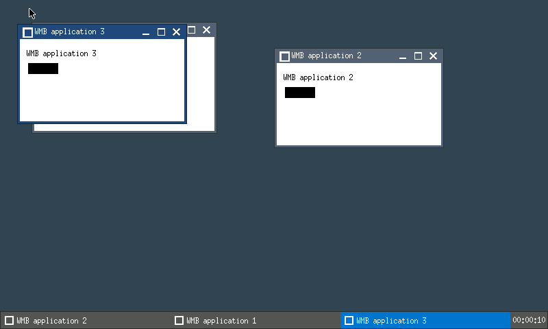

# P7 - JWM on the in-process TinyX stack

This is the actual JWM window manager, not application-drawn decorations.
It runs as a client fiber against retained Xlib and the existing TinyX server.
The portable HAL contracts and upstream `Dispatch()` are unchanged.

## Build and run

From the repository root, use the [server prerequisites](../../tinyx/wmb/README.md):
CMake 3.16+, a GNU-compatible C11 toolchain/linker supporting
`#pragma redefine_extname`, Git, `patch`, Python 3.10+, SDL2 development files
and zlib. No additional JWM graphics/font packages are required.

```sh
cmake -S . -B build-p7 -DWMB_TINYX_BUILD_SERVER=ON \
    -DWMB_KDRIVE_BUILD_TESTS=ON -DWMB_SDL_BUILD_TESTS=ON \
    -DCMAKE_BUILD_TYPE=Debug
cmake --build build-p7
./build-p7/bin/wmb_host --desktop
ctest --test-dir build-p7 --output-on-failure
```

The existing ignored `build-p4` directory also contains the current host.
`--desktop` opens two named demo clients. Drag a title bar, resize a corner,
click a window to focus/raise it, or right-click the background and select
**Open demo**. **Exit desktop**, client close buttons and closing the SDL window
use cooperative cleanup.

The bottom tray contains the real task list and an **uptime** clock. The current
profile has no enabled wall clock; `%H:%M:%S` means elapsed component time, not
calendar time. `%c` is the uptime tooltip. Other clock formats/timezones are
diagnosed as unsupported.

Without arguments the host still runs the original root-only P4 mode;
`--client-test` remains the unmanaged P5 regression. P7 does not replace those
independent gates.



The image above is the actual RGB565 framebuffer from a desktop SDL run.
The third window was opened through JWM's native root-menu selection.

## Verification modes

| Mode | Workload |
|---|---|
| `--wm-test` | Real decorations/pixels, bidirectional focus/stacking, exact mouse and keyboard move/resize, root-menu launch, native JWM server grab, then ten seconds of idle/cadence/scheduling checks |
| `--wm-cadence` | The same workload with **60 seconds** of normal performance/clock measurements |
| `--wm-soak` | Sixty-second instrumentation workload; CPU/startup/scheduler/clock precision thresholds are not performance claims under Valgrind |
| `--wm-cancel-menu` | Stop while the real root menu is mapped and holds its grabs |
| `--wm-cancel-move` / `--wm-cancel-resize` | Stop with a real drag active and the pointer button still held |

Headless example:

```sh
SDL_VIDEODRIVER=dummy SDL_RENDER_DRIVER=software \
    ./build-p7/bin/wmb_host --wm-test
ctest --test-dir build-p7 --output-on-failure -R '^tinyx_p7_'
```

The normal suite has **36 tests**, including all P4/P5/P6/HAL/KDrive gates.
The optional independent stock-Xlib reference adds one, for 37.
Run precise performance gates without concurrent builds or other instrumentation;
they measure a cooperative hosted process, not hard real-time guarantees under
arbitrary host load. The test verifies startup below 200 ms, CPU below 5%,
each observed server/JWM/demo scheduling gap at most 50 ms, actual one-second
clock framebuffer-draw completions within 990-1010 ms, and bounded periodic
callbacks. Physical panel/SDL refresh timing is not a hardware certificate.
CTest uses SDL's software renderer. Use that same renderer when measuring
startup on a real desktop, so unrelated GPU/context initialization is not mixed
into the portable stack's performance profile.

Tests use native XTEST input, not a bypass of JWM's event handlers. Drag completion
waits for exact server geometry and actual grab/status-window cleanup, rather
than assuming a fixed sleep means the WM has processed input. Decorations are
checked by reparenting, frame extents and actual title-band image pixels.

For a reproducible framebuffer capture:

```sh
SDL_RENDER_DRIVER=software WMB_WM_CAPTURE=build-p7/jwm.ppm \
    ./build-p7/bin/wmb_host --wm-test
```

The host writes an RGB PPM from the actual HAL framebuffer after interactions.
It is a host-only verification aid, not a file API in JWM or the HAL.

Memory analysis:

```sh
SDL_VIDEODRIVER=dummy SDL_RENDER_DRIVER=software \
    valgrind --max-stackframe=65536 --error-exitcode=42 --leak-check=full \
    --errors-for-leak-kinds=definite,possible \
    ./build-p7/bin/wmb_host --wm-soak
```

The stack threshold distinguishes nearby fiber stacks; it does not suppress
memory errors. See [the verification record](../../docs/41-verification-plan.md)
for final matrix and memory results.

## Reuse the component

[wmb.h](../../transport/api/wmb.h) is the standard-C lifecycle contract.
The caller initializes the runtime/allocator, provides the application registry,
calls `wmb_main`, then continues yielding and polling:

```c
int status;
if (hal_task_runtime_init(0) != 0 || wmb_main(NULL) != 0)
    return 1;
while ((status = wmb_poll()) == 0) {
    hal_task_yield();
    /* A hosted caller sleeps briefly here when it has no other work. */
}
return status < 0 ? 1 : 0;
```

Call `wmb_shutdown()` to request synchronous, bounded cooperative shutdown.
This lifecycle is once per process/runtime initialization, not a restartable
external ABI. `wmb_main(NULL)` selects the compiled default configuration.
A `wmb_config_t` can supply another in-memory JWM XML string; that string must
remain valid through shutdown/restarts. Native files and shell includes are not
silently enabled by providing a different XML configuration.

Applications see `wmb_stop_requested()` after JWM has unmanaged its windows.
They must close their own `Display` before returning. The shutdown order is:

1. Stop/unwind JWM, unmanage live windows, close its display.
2. Notify application fibers to close their displays and return.
3. Reap application tasks, then stop the server and release HAL resources.

This avoids native BadWindow races caused by destroying clients while the WM
is still unmanaging them. SDL stop/error notification is deferred through a
generic **KDrive port** callback; standalone/root-only users retain immediate
termination behavior. No SDL type or stop policy is added to the public HAL.

The caller must keep scheduling/polling WMB. Applications that ignore shutdown
cause an explicitly diagnosed five-second timeout; arbitrary abandoned-display
cleanup and recovery from fatal server/Xlib I/O remain later stability work.

### Register and launch applications

Provide the two registry symbols from
[wmb_app_table.h](../../transport/api/wmb_app_table.h):

```c
const wmb_app_t wmb_app_table[] = {
    { "demo", demo_main, 256 * 1024 }
};
const size_t wmb_app_table_size =
    sizeof(wmb_app_table) / sizeof(wmb_app_table[0]);
```

Entries and their names remain valid for the component lifetime.
`wmb_app_lookup` returns the matching entry or NULL. JWM logs unknown names.
`wmb_app_launch` copies argv into owned storage and creates a blocked task;
call `hal_task_wake` to start it. The returned task handle is borrowed: the
component reaps it after completion, so callers must not destroy or retain it.
The launch test covers copied/mutated argv, blocked start, OOM, 100 reuses, and
canceling a never-started application.

JWM commands use whitespace-separated arguments, up to 32 arguments and 4096
bytes per argument. Shell quoting, pipes, redirection and interpolation are
explicitly rejected. This is an application registry, not a partial shell.

The host's [demo clients](../../linux_hosted/apps/wmb_host/desktop_client.c) are
separate client-ABI translation units. Follow
[the host link target](../../linux_hosted/apps/wmb_host/CMakeLists.txt):
private Xlib/JWM must precede SDL's dependencies and remain hidden from dynamic
symbol lookup. Never include private client headers in the server-ABI host TU.

## Files and supported profile

| Surface | Responsibility |
|---|---|
| [JWM CMake](../CMakeLists.txt) | Freeze/select 52 units, generated config, archive visibility, optional reference harness |
| [jwm_entry.c](jwm_entry.c), [jwm_port.h](jwm_port.h) | Client fiber, readiness, scoped errors, metrics and termination adapter |
| [jwm_config.c](jwm_config.c) | Compiled XML: desktop/colors, bindings, root menu, task list and uptime clock |
| [timing_wmb.c](timing_wmb.c) | Monotonic HAL time without `TZ`, calendar APIs or process environment |
| [jwm_namespace.h](jwm_namespace.h) | Generated compiler-level isolation of 400 native external symbols, without rewriting C fields |
| [wmb_main.c](../../transport/x11/wmb_main.c) | Standard-C lifecycle, server-before-WM readiness and orderly shutdown |
| [wmb_apps.c](../../transport/x11/wmb_apps.c) | Application lookup, argv ownership, blocked task launch and safe reaping |
| [wmb_xlib.h](../../transport/x11/wmb_xlib.h) | Cooperative client event wait and per-Display error handler |
| [desktop host/tests](../../linux_hosted/apps/wmb_host/) | OS idle/CPU/capture, native input scripts and actual scheduling measurements |

The 52-unit cohort is 49 retained JWM sources plus three owned adapters.
Native `timing.c` is not modified or compiled in this profile. Optional Xft,
Pango, cairo, image-file libraries, SHAPE, Xinerama and dynamic Xcursor loading
are off. Core fonts, native drawn title buttons and in-memory client icons remain.
Config/image files, process output, host environment expansion and external
exit commands are diagnosed/refused. XBM **file** loading is not enabled.

Sixteen JWM files have presence-based `WMB_INPROC` branches, including complete
modal cancellation and the motion-coalescing/absent-modifier corrections found
by real integration. Queued pre-grab motion is normalized to the actual grabbed
root context; mouse/keyboard paths do not read an uninitialized incoming event.
Original alternatives are retained. The approved expansion
and rejected shortcuts are recorded in [D-55](../../docs/90-decisions.md).
`jxlib.h` still calls retained Xlib directly; the P8 external ABI is not invented
inside this internal client.

The [source manifest](../../docs/reference/jwm-sources.reference),
[patch manifest](../../patches/MANIFEST.md) and
[namespace generator](../../tools/jwm_namespace.py) are checked. After deliberate
changes to JWM's global symbol set, rebuild and regenerate the namespace header
with `--archive PATH --write`, rebuild again, then run its check without `--write`.
Guarded original-file changes follow the existing
[P6 replay procedure](../../docs/48-p6-portability.md).

## Independent stock-Xlib harness

The same portable `wmb_jwm` archive can be verified without TinyX/in-process
Xlib. This optional target needs system Xlib development files and Xvfb:

```sh
cmake -S . -B build-p7 -DWMB_TINYX_BUILD_SERVER=ON \
    -DWMB_JWM_BUILD_REFERENCE=ON
cmake --build build-p7 --target wmb_jwm_reference
ctest --test-dir build-p7 --output-on-failure -R '^tinyx_p7_standalone$'
```

[The runner](../../linux_hosted/jwm_standalone/run.py) starts an isolated
800x480 depth-16 Xvfb with no TCP listener, waits for its announced display,
runs the harness, and terminates that specific server in `finally`.
It verifies two real reparented stock-Xlib clients, a registry launch and cleanup.
The interactive movement/menu/precision gates run against the actual in-process
stack, not merely this smaller oracle.

The harness links system Xlib, **not** `wmb_xlib` or TinyX. Its native sockets are
host-only verification scaffolding, never another subject transport profile.
Normal P7 deployment does not require system Xlib/Xvfb packages.

## Remaining phases

P8 owns external ABI/versioning, foreign-thread admission, one-hour stability,
10,000 lifecycle cycles and allocator/stack attribution. P9 owns freestanding
libc/console/allocator/math/zlib closure and hardware. P7 supplies a functioning
hosted window manager; it is not those later certifications.
